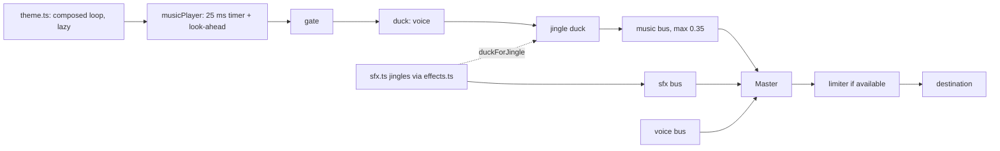

# Chiptune: design

## Signal path

## What changes

| File | Change |
| --- | --- |
| `src/audio/theme.ts` (new, lazy) | The composition as data: 16 bars of lead, arpeggio, bass and drums per bar, `themeEventsAt(seed, step)` (pure, loops with `step mod 256`, key from the seed), `THEME_KEYS`. Loaded by `import()` only. |
| `src/audio/chiptune.ts` | Procedural song generator removed. Keeps the shared types, `STEPS_PER_BAR`, `midiToHz`, `nextBarStep`, `calmEvents` and the level constants (`LEVELS`, `MUSIC_PEAK_CEILING`, `MUSIC_BUS_MAX`). |
| `src/audio/musicPlayer.ts` | Gets the tune from the lazy theme (`loadTheme`, `themeReady`), stops its timer when the music is inaudible, pauses and resumes with the page (`pageHidden`, `pageVisible`), single look-ahead of 150 ms. |
| `src/audio/sfx.ts` | New original gem, last gem, finish and summary fanfare; new `scare`. `JINGLES` lists the ones that duck the loop. |
| `src/audio/graph.ts` | New `jingleDuck` gain between `duck` and the music bus; `duckForJingle`; music bus scaled by `MUSIC_BUS_MAX`; optional limiter on the master. |
| `src/audio/automation.ts` | `jingleDuckOps(now, seconds)`, pure, tested with `valueAt`. |
| `src/audio/settings.ts` | `chiptune` flag (default on), `busGains` gives music 0 unless `chiptune`; `musicAudible(settings)`; default music 0.8. |
| `src/audio/engine.ts` | `unlock()` does nothing while muted; `updateSettings` suspends or resumes, stops or starts the music, unlocks in the tap that unmutes; `playSfx` ducks for jingles; page visibility drives the music. |
| `src/ui/SoundMenu.tsx`, `src/i18n` | "Chiptune music" checkbox, `sound.chiptune` in EN and ES. |
| `src/ui/useGhost.ts` | Plays `scare` when the night scare fires. |

## Composition

Written by hand for this app, in sixteenth-note steps at 4/4. The lead (25 % pulse) uses short motifs:

- **Creeping motif** (bars 1 to 4, answered in 5 to 8): a rising tip-toe arpeggio on the tonic minor with a raised-seventh wink, then a drop. Chords: Am, Am, Dm, E, Am, Am, F, E.
- **Whole-tone wander** (bars 9 to 12): glittering rising and falling lines on the whole-tone scale of A (bars 9, 10) and of B♭ (bars 11, 12), over a held tonic and then a half-step-up pedal. No snare, sparse hats, so it floats.
- **Cute resolution** (bars 13 to 16): a bouncy answer on Am, F, E, Am that leaves a short breath at the end of bar 16, which the bass and kick cover into bar 1.

The arpeggio plays chord tones on every second step (one octave above the chord, 12.5 % pulse). The bass is triangle: root, octave, root, octave. Drums: kick on beats 1 and 3, a soft noise snare on 2 and 4 (not in the wander), hats on the off-beats. The calm planning-screen arrangement keeps lead, bass and kick (`calmEvents`) and uses another key.

Keys: the seed picks 0, −2 or +3 semitones (A, G or C minor). The menu music has a fixed seed. `themeEventsAt` is a pure function of the step, so the loop boundary is just `step mod 256`.

## Loudness budget

Voice levels (peak gain per note): lead 0.08, arpeggio 0.025, bass 0.10, kick 0.12, snare 0.06, hat 0.02. The worst step sums to 0.325. The music bus is `sliderToGain(music) × MUSIC_BUS_MAX` with `MUSIC_BUS_MAX = 0.35`, so the worst case at 100 % is 0.114, under `MUSIC_PEAK_CEILING = 0.12`. A test computes the worst step of every key from the data. Jingle notes are 0.22 × note gain, at most four sound together (under 0.5 after the effects bus). `createGraph` puts a `DynamicsCompressorNode` (threshold −8 dB, ratio 12, fast attack) after the master when the context has one.

## Lazy loading and "no work when muted"

`musicPlayer.ts` starts a dynamic `import('./theme.ts')` on the first tick where `musicAudible` is true and no theme is loaded. Until it arrives the player keeps the clock running and plays nothing. `themeReady()` returns that promise for tests. While the music is not audible the player's timer is cleared (`idle`) and restarted by `engine.updateSettings`, so a muted app has no interval. `engine.unlock()` returns early while muted, so no `AudioContext` exists; the next tap that unmutes (`updateSettings({ muted: false })`) calls it. A muted engine with a context (muted after start) suspends it with `ctx.suspend()` and resumes it on unmute; the automatic recovery listeners skip a muted engine.

## Page visibility

`engine` listens to `visibilitychange` (installed with the recovery listeners). Hidden: `music.pageHidden()` closes the gate (fade 0.35 s) and the timer is cleared after the fade; visible: `pageVisible()` resets the clock to the context time (the step counter keeps its place, so the loop resumes where it was) and reopens the gate. The old "schedule 1.5 s ahead in a hidden tab" rule (voice-audio 7f.2) is superseded: music no longer plays hidden, and speech does not depend on it.

## Jingle ducking

`duckForJingle(g, seconds)` schedules on the `jingleDuck` gain: hold the current value, glide to 0.33 (time constant 0.03 s) now, and glide back to 1 (time constant 0.2 s) at `now + seconds + 0.15`. A second jingle repeats the same call, which extends the duck. The voice duck keeps its own node, so the two never release each other. `playSfx` calls it for the names in `JINGLES` after the effect is accepted (running context, effects bus audible).

## Scare and demo

`useGhost` calls `audioEngine().playSfx('scare')` in the effect that shows the scare lines (once per quest). The demo needs nothing extra: `useQuestRunner` already turns events into jingles with `sfxFor`, and the demo's simulated fixes carry real-world speed, so the loop follows. The first tap unlocks (armed in `begin` with `gesture = false`).

## Tests

- `theme.test.ts`: 16 bars, in key, range, loop boundary (`themeEventsAt` at 255 and 256), downbeats, calm arrangement, worst-case loudness for all three keys, determinism.
- `musicPlayer.test.ts`: fake context and clock: notes ahead, no step scheduled twice, seamless loop boundary, stop, pause on hidden and resume in place, muted creates nothing and runs no timer, toggling `chiptune` stops and restarts, theme is loaded lazily.
- `jingles.test.ts`: durations and levels, `jingleDuckOps` with `valueAt` (down, back, overlap), engine ducks the music for a jingle and not for a click, the voice duck is independent.
- `audio.test.ts` (settings) and `engineSound.test.ts`: `chiptune` default, sanitize, persistence round trip, `busGains`, `musicAudible`; no context while muted, unmute in a tap creates it, mute suspends it, the context starts only in a gesture, the music bus is capped.
- `ui/demoAudio.test.tsx`: demo events through the real path (`sfxFor` plus `playSfx`) fire gem, last gem, scare and finish jingles; the loop starts after the first tap and stops at the finish.
- `ui/SoundMenu.test.tsx`, `ui/useGhost.test.tsx`, `i18n/*`: the new checkbox and keys, the scare jingle once per quest.
- `fakeAudio.ts` is the shared fake of the Web Audio API for these tests.
