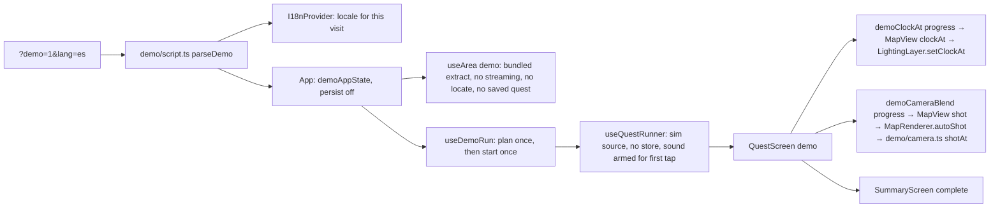

# Demo mode: Design

Part of the StepQuest specs; see [../README.md](../README.md). Requirements: [requirements.md](requirements.md).

## Shape

## Pure parts (`src/demo/`)

- `script.ts`: `parseDemo`, the fixed constants (`DEMO_SETTINGS` 6,000 steps loop, `DEMO_WALK_SECONDS` 62, `DEMO_CLOCK` 18:30 → 22:30, `DEMO_DAY_MS` midnight of 21 June 2026 CEST, `DEMO_TICK_MS` 100, `DEMO_CLOSE_ZOOM` 24, `DEMO_QUEST_ID`, dialogue timings), `demoTimeScale(distance)`, `demoProgress`, `demoClockMinutes`/`demoClockAt`, `demoCameraBlend` (smoothstep ramps), and `demoTimeline()` (the camera script in real seconds, for tests and the recording notes).
- `camera.ts`: `fitZoom` and `shotAt` (log-scale zoom blend, centre blend, clamped to the floor and the close zoom).

Everything is driven by the share of the route walked, not by a wall clock, so the script cannot drift from the walk: a slower device takes slightly longer but shows the same pictures in the same order.

## Wiring

- `App`: `demo` is read once from `location.search`. The reducer starts from `demoAppState(DEMO_SETTINGS)` (no intro, no avoid list); settings and avoid list are not saved. `usePlanner` gets `night: true` so the route does not depend on the hour. `startQuest` creates a simulated quest with `DEMO_QUEST_ID` and `{ timeScale: demoTimeScale(distance), noiseM: 0, tickMs: 100 }` and calls `runner.begin(q, false, gesture = false)`, which arms the audio unlock instead of creating the context.
- `useDemoRun`: two effects with once-only refs: plan when the world is there; start when a result is `ok`.
- `useArea({ demo })`: no saved quest at boot, return before the location prompt, streaming `enabled: false`, no auto-load of the view.
- `useQuestRunner(reroute, { persist: false })`: the session uses a store that keeps nothing.
- `QuestScreen({ demo })`: computes progress, `clockAt` and the camera `shot`; `onPointerDownCapture` on the console screen stops the auto camera (except on `.sound-resume`); reduced motion turns it off from the start. Dialogues get `autoNextMs` (2.5 s) and the finish dialogue `autoCloseMs` (3 s).
- `MapView`: `clockAt` → `renderer.setClockAt`, `shot` → `renderer.autoShot` after the follow effect, so it has the last word.
- `LightingLayer.setClockAt(ms)`: an absolute moment that wins over the `?time=` preview.

## Timing

| Part | Seconds (about) |
| --- | --- |
| Load and plan the loop | 1 to 3 |
| Walk (6 gems, camera close → whole route → close, 18:30 → 22:30) | 62 |
| Finish dialogue (two lines, auto) | 7 |
| Summary with celebration | stays |

Total to the summary: about 72 s.

## Tests

- `src/demo/script.test.ts`: URL parsing, timeline order and determinism, time warp per distance, clock interpolation (ends, monotone, clamped, NaN), fixed day in UTC, lighting from afternoon to lamps on, camera blend (ends, plateau, bounded, no jumps), `shotAt` ends and clamps.
- `src/AppDemo.test.tsx`: the whole run in the app with `fetch` failing (the walk compressed to 4 s): no onboarding, Spanish from `lang=es`, quest starts by itself, a tap stops `autoShot` while the walk continues, all gems collected, summary "complete", clock monotone up to 22:30, no fetch, streaming disabled, nothing saved, saved settings and language untouched; reduced motion: no `autoShot`; a normal visit shows the onboarding and streams as before.
