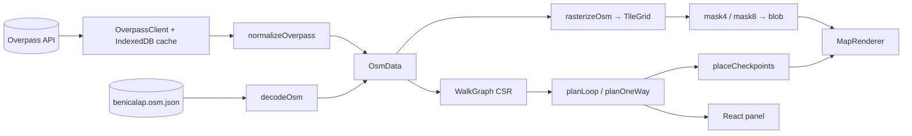

# Map rendering and data: Design

Part of the StepQuest specs; see [../README.md](../README.md). See also: [routing](../routing/requirements.md), [quest](../quest/requirements.md) (route and walker overlays), [retro-ui](../retro-ui/requirements.md) (dialogue box, plural forms).

## Overview

A client-only React app. All heavy lifting is pure TypeScript: OSM normalization, rasterization, auto-tiling and routing run without the DOM and are tested against the bundled Benicalap extract. The renderer is a small canvas engine in the style of old console map engines: a tile grid, a lazily painted tile atlas, cached 32×32-tile chunks, and sprites drawn on top.

## Architecture

## Data model

- `OsmData`: shared node arrays (`lat`, `lon`) plus ways `{ kind, highway, walkable, area, tunnel, crossing, nodes[] }`. Shared node indices encode junctions.
- Compact JSON (`CompactOsm`): delta-encoded 1e-6° integers and flat way rows; the 13.4k-way demo extract is 1.3 MB (≈410 kB gzip) and lazy-loaded.

## Tile grid

- Origin at the bbox's north-west corner, equirectangular projection, 5 m per tile (Benicalap: ≈636 × 646 tiles).
- Roads are thick segments sized by highway class (6–16 m); paths are 4-connected one-tile lines; areas are scanline-filled at tile centres.
- Layer bits per tile, resolved to one terrain. Sidewalks overlapping a drawn carriageway stay road; only `footway=crossing` turns road into zebra.

## Auto-tiling

- `mask4`: N=1, E=2, S=4, W=8. Paths connect to paths, crossings and (one-way) roads.
- `mask8`: N, NE, E, SE, S, SW, W, NW = 1…128; `reduceMask8` clears a diagonal unless both neighbouring cardinals are set → 47 masks (`BLOB_MASKS`).
- The map edge counts as connected so no borders appear at the edge of the loaded area.

## Rendering

- `paintTile(ctx, x, y, spec)` draws a tile from `(terrain, m4, m8, variant, roof, vertical)`; the atlas paints each distinct key once.
- Chunks (32×32 tiles = 512×512 px) are cached with an LRU of 96. Zoom ladder 0.5–48 CSS px per tile; ≥ 8 draws tiles, below that a 1-px-per-tile overview image.
- Overlay: route cells (4-connected rasterization of the polyline) as footprints, numbered checkpoint gems, finish flag, start mat and walker sprite.

## Town and landmarks (Phase 3)

- OSM extras: `barrier=*` lines, `place=square` areas, and landmark points (`shop=supermarket`, hospitals and health centres, stations and subway entrances, schools). Points come from nodes or way/relation centres, are deduplicated per kind (a station's entrances merge) and stored in codec v2 as `[kind, lat×1e6, lon×1e6]` triples; ways gain a style index (park style, barrier type, building type, plaza). v1 data still decodes.
- `layoutTown(grid)` (cached per grid): landmarks first, at the nearest free spot of their size within 9 tiles (on buildings, then half on buildings, then any open ground or plaza); park gates where a footpath enters a big park. Remaining building components are cut by BSP into lots; each lot gets up to three houses placed with a largest-rectangle search, plus a front yard (fence or hedge with a gate in line with the door) or side garden when there is room. Everything is seeded from tile coordinates, so it is stable across reloads.
- Structures are painted after the tiles of each chunk and clipped to it, so they are cached with the chunk; the overview uses roof colours.
- Diagonal streets: a soft tile whose two cardinal neighbours and the diagonal between them are road gets an asphalt triangle in that corner; tiles with three road sides become road.
- Route: the polyline is rasterized to ordered 4-connected cells, staircase corners are dropped, and the band is stamped as a pixel brush along the segments, with arrow heads (9×9, rasterized from one triangle in 8 directions) every 6 cells.
- Walker: `facingFrom(dx, dy, previous)` with a 1.25 axis bias to avoid flicker on diagonals; frames 0-1-0-2 every 140 ms while moving; position tweened between fixes.

## Map without holes (task 50b)

- Root cause: `MapRenderer.render` cleared the canvas to ink black and painted only chunks inside the one loaded grid, each built synchronously in the frame that first needed it. Anything outside the loaded bounding box (the camera may go half a screen beyond it, and zoom 0.5 shows several kilometres) stayed black, and zooming into a big area built many chunks at once and stalled frames. The loaded area was only replaced through a manual "Load this area" button.
- Rendering: the canvas is cleared to the ground colour (`groundB`); the loaded grid rectangle is `groundA`. `chunkPlan.ts` (pure) lists the visible chunks and a one-chunk prefetch ring, both sorted by distance to the screen centre. `drawChunks` paints visible chunks in that order until `CHUNK_BUDGET_MS` (6 ms) is used, always at least one per frame; the others are drawn as a scaled slice of the 1-px-per-tile overview (same palette), and a follow-up frame is requested. When all visible chunks exist, one ring chunk is painted per frame. `LruCache` (96 chunks, or visible + 8 if the screen needs more) never evicts chunks on screen.
- Data: `ui/autoLoad.ts` (`shouldAutoLoad`) decides when a rested view outside the loaded area loads by itself: no download running, no route or quest to lose, and not within 500 m of a failed attempt. `App` waits 1.2 s after the map settles, then calls the existing `loadLiveAround`, so requests still go through `OverpassClient` (cache, single request, 10 s spacing, mirrors). With a plan or quest the "Load this area" button remains. Panning anywhere with several areas merged into one world was not done: the walking graph, tile grid and town layout are built per bounding box.

## Error handling: Overpass

- Overpass errors map to `busy`, `rateLimited`, `tooLarge`, `network`, `badResponse`, each with a translated message.

## Testing strategy

- Unit tests for geo maths, step conversion, tag classification, codec round-trip, Overpass client (mocked fetch: cache, throttling, fallback, size cap), rasterization (connectivity, fills, terrain mix on the fixture), auto-tiling (all masks), the tile painter (pixel probes), sprites, routing on the fixture (targets, feasibility, seeds, stride, robustness over random points), checkpoints, i18n parity and an App smoke test.
