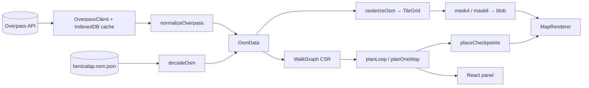
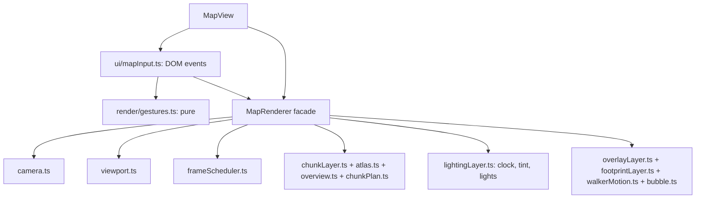

# Map rendering and data: Design

Part of the StepQuest specs; see [../README.md](../README.md). See also: [routing](../routing/requirements.md), [quest](../quest/requirements.md) (route and walker overlays), [retro-ui](../retro-ui/requirements.md) (dialogue box, plural forms).

## Overview

A client-only React app. All heavy lifting is pure TypeScript: OSM normalization, rasterization, auto-tiling and routing run without the DOM and are tested against the bundled Benicalap extract. The renderer is a small canvas engine in the style of old console map engines: a tile grid, a lazily painted tile atlas, cached 32×32-tile chunks, and sprites drawn on top.

## Architecture

## Data model

- `OsmData`: shared node arrays (`lat`, `lon`) plus ways `{ kind, highway, walkable, area, tunnel, crossing, nodes[] }`. Shared node indices encode junctions.
- Compact JSON (`CompactOsm`): delta-encoded 1e-6° integers and flat way rows; the 13.4k-way demo extract is 1.55 MB (≈469 kB gzip, the built `benicalap.osm` chunk) and lazy-loaded.

## Tile grid

- Origin at the bbox's north-west corner, equirectangular projection, 5 m per tile (Benicalap: ≈636 × 646 tiles).
- Roads are thick segments sized by highway class (6–16 m); paths are 4-connected one-tile lines; areas are scanline-filled at tile centres.
- Layer bits per tile, resolved to one terrain. Sidewalks overlapping a drawn carriageway stay road; only `footway=crossing` turns road into zebra.

## Auto-tiling

- `mask4`: N=1, E=2, S=4, W=8. Paths connect to paths, crossings and (one-way) roads.
- `mask8`: N, NE, E, SE, S, SW, W, NW = 1…128; `reduceMask8` clears a diagonal unless both neighbouring cardinals are set → 47 masks (`BLOB_MASKS`).
- The map edge counts as connected so no borders appear at the edge of the loaded area.

## Rendering

- Module layout and the reasons for it: see "Architecture review (Nov 2026)" below (`MapRenderer` is a facade over camera, chunk, lighting and overlay layers).
- `paintTile(ctx, x, y, spec)` draws a tile from `(terrain, m4, m8, variant, roof, vertical)`; the atlas paints each distinct key once.
- Chunks (32×32 tiles = 512×512 px) are cached with an LRU of 96. Zoom ladder 0.5–48 CSS px per tile; ≥ 8 draws tiles, below that a 1-px-per-tile overview image.
- Overlay: route cells (4-connected rasterization of the polyline) as footprints, numbered checkpoint gems, finish flag, start mat and walker sprite.

## Tile art (task 51)

**Tile catalogue** (`src/render/tileset.ts`, `tileSpecs.ts`, `structures.ts`):

| Tile | Art | Chosen by |
| --- | --- | --- |
| Road | asphalt grain, crack on variant 5, kerb band with paving joints, lit/shaded kerb line, dashed centre line | `m8`, `variant`, `lane` |
| Crossing | grained asphalt, white bars with shaded lower or right row | `vertical` |
| Path, park | packed earth: `pathA/B`, specks, pebbles | `surface` 0 |
| Path, town | 4×4 flagstones in staggered rows, joints, lit corner | `surface` 1 |
| Plaza | slabs with joints and lit corners | `variant`, `m8` |
| Park grass | tufts (2, 3; also edge tiles that would hold a tree), stones (4, 7), flowers (5, 6), tree (0, 1 on interior tiles), bush beside a tree | `variant`, `deco` |
| Water | 3 ripple frames, sand shore, foam that laps with the frame | `frame`, `m8` |
| House | roof style (shingles, seams, clay) from `seed>>>4`, shutters, base course, porch, chimney | house `seed` |
| Apartments | shop front and awning on the ground floor for one seed in three | house `seed` |

**Palette use.** Only `src/render/palette.ts`. Added: `kerbLight`, `pebble`, `awnings` (four stripe pairs). Everything else reuses existing colours (`stone*`, `laneMark`, `waterDeep`, `fenceShade`). Light comes from the top-left.

**Variation scheme.** `tileSpecAt` derives `variant = tileHash(tx, ty) % 8` plus three new fields: `lane` (`laneCode`: contiguous road runs along both axes, the street runs along the clearly longer axis, width 3–9; centre tile of odd widths, one edge row of even widths; bit 8 alternates per tile for the dash pattern), `surface` (0 when any 8-neighbour is park) and `deco` (bush when a 4-neighbour holds a tree). Per-pixel grain uses an integer hash of (x, y, variant). No `Math.random`, no time input, so art depends only on the map position.

**Animation and budget.** `TileSpec.frame` (0–2) is part of `tileKey`, so each frame is one extra atlas slot per distinct water tile (about a dozen). Chunks bake frame 0 and record their water tiles. After the chunks are drawn, `drawWater` redraws the water tiles of painted visible chunks from the atlas when the frame is 1 or 2 and sets a single timer for the next 450 ms boundary; it sets none when no water is visible, at zoom below 8 (overview), or with `prefers-reduced-motion`. Other art adds no per-frame work. Atlas growth: lane (≤ 8 codes), surface (2), deco (2), frame (3) multiply keys only for road, path, grass and water tiles.

## Town and landmarks (Phase 3)

- OSM extras: `barrier=*` lines, `place=square` areas, and landmark points (`shop=supermarket`, hospitals and health centres, stations and subway entrances, schools). Points come from nodes or way/relation centres, are deduplicated per kind (a station's entrances merge) and stored in codec v2 as `[kind, lat×1e6, lon×1e6]` triples; ways gain a style index (park style, barrier type, building type, plaza). v1 data still decodes.
- `layoutTown(grid)` (cached per grid): landmarks first, at the nearest free spot of their size within 9 tiles (on buildings, then half on buildings, then any open ground or plaza); park gates where a footpath enters a big park. Remaining building components are cut by BSP into lots; each lot gets up to three houses placed with a largest-rectangle search, plus a front yard (fence or hedge with a gate in line with the door) or side garden when there is room. Everything is seeded from tile coordinates, so it is stable across reloads.
- Structures are painted after the tiles of each chunk and clipped to it, so they are cached with the chunk; the overview uses roof colours.
- Diagonal streets: a soft tile whose two cardinal neighbours and the diagonal between them are road gets an asphalt triangle in that corner; tiles with three road sides become road.
- Route: the polyline is rasterized to ordered 4-connected cells, staircase corners are dropped, and the band is stamped as a pixel brush along the segments, with arrow heads (9×9, rasterized from one triangle in 8 directions) every 6 cells.
- Walker: `facingFrom(dx, dy, previous)` with a 1.25 axis bias to avoid flicker on diagonals; frames 0-1-0-2 every 140 ms while moving; position tweened between fixes.

## Map without holes (task 50b)

- Root cause: `MapRenderer.render` cleared the canvas to ink black and painted only chunks inside the one loaded grid, each built synchronously in the frame that first needed it. Anything outside the loaded bounding box (the camera may go half a screen beyond it, and zoom 0.5 shows several kilometres) stayed black, and zooming into a big area built many chunks at once and stalled frames. The loaded area was only replaced through a manual "Load this area" button.
- Rendering: the canvas is cleared to the ground colour (`groundB`); the loaded grid rectangle is `groundA`. `chunkPlan.ts` (pure) lists the visible chunks and a one-chunk prefetch ring, both sorted by distance to the screen centre. `drawChunks` paints visible chunks in that order until `CHUNK_BUDGET_MS` (6 ms) is used, always at least one per frame; the others are drawn as a scaled slice of the 1-px-per-tile overview (same palette), and a follow-up frame is requested. When all visible chunks exist, one ring chunk is painted per frame. `LruCache` (96 chunks, or visible + 8 if the screen needs more) never evicts chunks on screen.
- Data: `ui/autoLoad.ts` (`shouldAutoLoad`) decides when a rested view outside the loaded area loads by itself: no download running, no route or quest to lose, and not within 500 m of a failed attempt. `App` waits 1.2 s after the map settles, then calls the existing `loadLiveAround`, so requests still go through `OverpassClient` (cache, single request, 10 s spacing, mirrors). With a plan or quest the "Load this area" button remains. Panning anywhere with several areas merged into one world was not done: the walking graph, tile grid and town layout are built per bounding box.

## Error handling: Overpass

- Overpass errors map to `busy`, `rateLimited`, `tooLarge`, `network`, `badResponse`, each with a translated message.

## Testing strategy

- Unit tests for geo maths, step conversion, tag classification, codec round-trip, Overpass client (mocked fetch: cache, throttling, fallback, size cap), rasterization (connectivity, fills, terrain mix on the fixture), auto-tiling (all masks), the tile painter (pixel probes), sprites, routing on the fixture (targets, feasibility, seeds, stride, robustness over random points), checkpoints, i18n parity and an App smoke test.

## Correctness properties (task 58)

Checked with fast-check (fixed seed `20261204`) in `src/osm/codec.property.test.ts` and `src/render/chunkPlan.property.test.ts`.

- **P-M1 Codec round trip.** For random maps (nodes at 1e-6° precision, ways of every kind with optional highway, style, name, safety flags and roundabout flag, landmarks, industrial rings, activity points), `decodeOsm(encodeOsm(x))` equals `x`, also after a JSON text round trip, and `encode(decode(encode(x)))` equals `encode(x)`. The bundled Benicalap extract survives a re-encode unchanged. Validates 1.1, 1.3.
- **P-D1 Visible chunks covered.** For any camera, zoom, screen size, grid and margin, every chunk that the screen rectangle overlaps (and that lies on the grid) is in `visible`; none is listed twice or in both `visible` and `ring`; chunks outside the screen are not visible; both lists are sorted nearest the centre first and stay inside the grid. Validates 7a.2, 7a.3.
- **P-D2 Cache keeps what is on screen.** For any sequence of insertions with any protected set, a protected chunk already cached is never evicted and the cache exceeds its limit only when everything else in it is protected; `chunkLimit` is at least the base and `visible + 8`, so filling the cache with the prefetch ring and the visible chunks never loses a visible one. Validates 7a.4.

## Day-cycle lighting (task 60)

- **Model** (`src/render/daylight.ts`, pure): `lightingAt(ms, place)` = `lightingFromAltitude(sunAltitude(ms, place))`. A piecewise-linear tint table by altitude (30° white, 12° faint warm, 6° golden, 0° orange, −4° pink-purple, −8° blue-purple, −12° and −18° blue night) gives the multiply colour; `darkness = 1 − luminance(tint)`. Lamp strength is a smoothstep from 4° to −6°, window strength from 2° to −8°, so windows light first, just after sunset. Phases: day ≥ 12°, golden ≥ sunset altitude (`HORIZON` exported from `sun.ts`), dusk ≥ −12°, night below. Dawn and dusk share the table, so the morning mirrors the evening. Civil twilight is part of the table, but routing keeps its own rule (night = below the horizon altitude), untouched.
- **Clock**: `MapRenderer.lighting` caches the value per 30 s; a 60 s timer requests a repaint (no per-frame work). `?time=HH:MM` is parsed by `parseTimeParam` in `MapView` and sets `setClockOverride(minutes)`, which uses that local time of today for lighting only.
- **Compositing** in `render()`: ground, chunks, water, rails, then `multiply` fill of the tint (skipped when darkness ≤ 0.5 %), then lights, then route, gems, walker. The route and sprites are drawn after the tint, so they stay bright. Chunk canvases never contain light, so the cache is the same all day and no chunk is repainted on a phase change.
- **Windows** (`lights.ts`): the real painters run once per building against a recording context that collects the glass rectangles (`P.window`, `P.glass`), so the glow sits exactly on the painted windows. About 70 % are kept by a hash of the building seed, position and window position (cached in a WeakMap). They are drawn as plain `fillRect` in warm yellow at the window strength, for houses and landmarks in visible chunks at detail zoom only.
- **Street lamps** (`lamps.ts`): `Layer.lit` (new raster bit 128) marks road tiles of ways with `SAFETY_LIT`. The data has no lamp nodes, so lamps stand on road kerb tiles on a lattice (every 12 tiles per side, the two sides offset by 6): lit tiles always, wide (≥ 3 tiles) streets as presumed-lit main avenues, and every street ≥ 2 tiles wide when the area has no lit tag at all. Lamps are bucketed per chunk once per grid. Each draws a cached 32-px stepped, dithered glow sprite additively (`lighter`), plus a 2×2 art-pixel bright head.
- **Walker and gems**: an additive glow sprite under the walker (4 tiles wide) and each gem (2.4 tiles) at lamp strength.
- **Performance**: one full-canvas fill per frame, plus at detail zoom a few hundred `fillRect` and `drawImage` calls of a cached sprite for the visible chunks. Nothing runs at far zoom except the tint.
- **Reduced motion**: lights are static, so there is nothing to switch off.
- **Testing**: `daylight.test.ts` (phases, golden before sunset, dusk exactly when `isDark`, parser, preview clock), `daylight.property.test.ts` (P-L1 to P-L4), `lights.test.ts` (windows on glass and stable, lit raster bit, lamp lattice and lit rule on a synthetic grid), `nightRender.test.ts` (renderer uses multiply and lights at night, not at noon).

### Correctness properties (task 60)

Fast-check, seed `20261204`, in `src/render/daylight.property.test.ts`.

- **P-L1 Bounds.** For any altitude, time and place, tint channels are integers in 0 to 255, darkness, lamps and windows lie in 0 to 1. Validates 9.3.
- **P-L2 Monotonic in altitude.** A lower sun never gives less darkness, lamp or window strength. Validates 9.3.
- **P-L3 Evening is continuous and monotonic.** For random places and days, from 3 h before to 3 h after sunset, darkness never decreases and changes by under 0.02 per minute. Validates 9.3.
- **P-L4 Morning mirror.** From 3 h before to 3 h after sunrise, darkness never increases. Validates 9.3.

## Architecture review (Nov 2026)

Scope: `src/render/**`, `src/tiles/**`, `src/ui/MapView.tsx`. Method: read the code against requirements 2, 6a, 7a, 8 and 9, then check each suspicion with a failing test before touching the code (tasks 63.x).

### Current structure

- `MapRenderer.ts` (1026 lines) does everything: camera maths, canvas sizing, tile atlas, chunk cache, structure painting, water ripples, overview stand-ins, the day-cycle clock, tint, window and lamp light, rails, avoided-street tape, route footprints, gems, walker tween, speech bubble and pickups. Eleven private fields hold unrelated state and `render()` is a 150-line function.
- `chunkPlan.ts` (pure plan and LRU), `tileSpecs.ts`, `tileset.ts`, `structures.ts`, `lights.ts`, `lamps.ts`, `daylight.ts`, `routePath.ts` are already separate and tested.
- `MapView.tsx` holds all input handling (one 130-line effect: pointer, pinch, wheel) and cannot be tested without a DOM.

### Findings

Bugs (each has a regression test in 63.x; "verified" means the test failed before the fix):

| Id | Finding | Effect |
| --- | --- | --- |
| B1 | Every wheel event is one ladder step; `deltaY = 0` counts as "zoom out" | A trackpad flick runs through all 13 levels; horizontal scroll zooms out |
| B2 | Pinch compares `target` with `zoom × 1.4` after each step. Ladder step 8 → 16 is 2×, so for ratios 1.40 to 1.43 the zoom flips up and down on every move event. Two-finger drag does not pan | Flicker while pinching; map follows only the zoom |
| B3 | `cssWidth` falls back to `canvas.width` (device px) when `clientWidth` is 0, then `render` multiplies by the pixel ratio again | A hidden canvas grows by the pixel ratio on every frame |
| B4 | `devicePixelRatio` is read per frame but nothing triggers a frame when it changes alone | Blurry map after dragging the window to another screen |
| B5 | Backing store is `css × dpr` with no limit | iOS Safari (16.7 Mpx limit) and big 2× screens can give a blank canvas |
| B6 | Window and lamp light is drawn for every planned chunk, also for the ones still showing the 1-px-per-tile stand-in | Yellow dots on the blurry overview while chunks load at night |
| B7 | A stand-in is drawn with width `round(sw × scale)` while its neighbours start at `round(origin + (cx+1) × 32 × scale)` | 1 px ground-coloured seams between stand-ins and painted chunks |
| B8 | Whole 512 px chunks are scaled as one block, but water tiles are redrawn with per-tile rounded edges | At non-integer scale (browser zoom, pixel ratio 1.1) ripples sit up to 1 px off their tiles |
| B9 | Evicted chunks are only dropped from the map, never released; `dispose` frees neither chunks, atlas pages nor the overview; `chunkWater` keeps entries of evicted chunks | Canvas memory stays on iOS until a GC that may never come; 96 chunks are 96 MB |
| B10 | `requestRender` without `requestAnimationFrame` calls `render()` directly, and `render()` calls `requestRender()` while the walker moves or chunks are pending | Unbounded recursion outside a browser |
| B11 | `lampsInChunk(grid, cx, cy, size)` caches by grid only, so the first `size` wins | Latent: wrong lamps if another chunk size is ever used |
| B12 | `zoomStep` from a zoom between two levels moves two levels up | Skipped level (not reachable today; the ladder is the only source) |
| B13 | `setPointerCapture` can throw (`InvalidStateError`); right and middle mouse buttons pan and place points | Uncaught error; context-menu click places a start |
| B14 | The camera is not clamped again after a resize | After rotating a phone the view can sit far outside the map |
| B15 | After a tab returns from the background the sky is stale until the next 60 s timer | Up to a minute of wrong tint |
| B16 | `planChunks` uses the unrounded camera while drawing uses a rounded origin | Suspected 1 px uncovered column at non-integer scale. Not reproduced: `chunkCoverage.property.test.ts` found no gap in 600 random cases with the plan unpadded, so the plan is unchanged |

Missing requirements: pinch pan, inertia, double tap, keyboard, backing-store limit, hidden canvas, pixel-ratio change, release of canvases, repaint on visibility, a performance budget. Added as requirements 10 to 13.

Performance (counting-stub benchmark in `bench.test.ts`, 390 × 700 CSS px at 2×, 7.5 km serpentine route):

- P1 The route is re-projected and re-laid out every frame (`footprints` over the full polyline, thousands of objects) and every footprint is about 30 `fillRect` calls. At far zoom that is 88 910 calls per frame, and the frame is repeated at 60 Hz while the walker moves.
- P2 Per-frame allocations: `chunkKey` template strings (about 6 per chunk per frame), a `Set` of on-screen keys, the chunk plan arrays and their sort, the `toScreen` closures and objects, a lamp list fetched twice.
- P3 Overdraw: the full-canvas ground fill and the loaded-area fill are both painted before chunks that cover them. Kept: they hide edge slivers, and removing the second one at far zoom would change edge pixels (the overview is drawn to a fractional rectangle). The duplicated branches of `render()` that issued the same fill are merged.
- P5 Track lines (`drawRails`, 62 in the demo map) cost about 14 000 `fillRect` calls per frame at far zoom after culling (26 000 before). Left as the largest remaining cost: caching them needs a canvas per sub-unit origin offset (the snapping depends on it), too much memory for the gain. Follow-up: batch each colour into one path fill.
- P4 Chunk blits are scaled to 512 × zoom px each, up to 4608 px at zoom 48 on a 3× phone, although only the visible part matters.

Design:

- D1 One class, many jobs (see above). D2 Dead code: `chevrons`, `ARROW_PATTERNS`, `dir8` (the route is footprints since task 51), `WINDOW_RGB_COOL`, the getters `atlasSize`, `railCount`, `avoidedCount` and `facing`, the duplicated `groundA` fill branches. D3 Requirement 6a.4 still says "direction arrows". D4 Input logic lives in a React effect.

### Target design

- `camera.ts`: `Camera` class with camX, camY, zoom, the CSS size, `screenToTile`, `tileToScreen`, `panBy`, `zoomTo`, `zoomStep`, `fit`, `clamp`. No DOM, no grid projection (the facade converts lat/lon).
- `viewport.ts`: `backingSize(css, dpr, limits)` (pure) and `watchPixelRatio(cb)` (matchMedia re-armed on every change).
- `chunkLayer.ts`: owns atlas, chunk cache (numeric keys, release on eviction), structure index, water tiles, stand-ins; `draw()` returns the chunks that are really painted.
- `lightingLayer.ts`: clock override, 30 s cache, 60 s timer and visibility repaint, tint fill, window and lamp light for painted chunks.
- `overlayLayer.ts`: route, avoided tape, rails, gems, walker, bubble, pickups. `footprintLayer.ts` caches the layout per zoom in world pixels and draws each print as one cached stamp. `walkerMotion.ts` is the pure tween and facing state.
- `frameScheduler.ts`: coalesces `requestRender`, runs the frame, guards re-entrancy.
- Input: `gestures.ts` (`WheelAccumulator`, `pinchLevel`, `VelocityTracker`, `glide`, `TapPairer`, pure) and `ui/mapInput.ts` (listeners, pointer capture, glide loop, keyboard) so `MapView` only creates it.

Rationale: each module has one reason to change and a test that does not need a canvas. Pure modules (camera, gestures, viewport maths, plans) get property tests; layers get tests on a software canvas (`render/testing/softCanvas.ts`) that implements `fillRect`, `drawImage`, alpha, `multiply`, `lighter` and a rectangular clip, so frames can be compared pixel by pixel. Alternative considered: keep one class and only extract helpers. Rejected: the state (cache, clock, walker) would stay shared and every change would keep touching `render()`.

### Visual changes

The approved look is pinned by golden frames (`golden.test.ts`, snapshot of a frame hash per scene). They must not change except for the defects below, each only visible in the stated case:

- B6: no light over stand-ins (only while chunks load at night).
- B7 and B8: seams and ripple offsets at non-integer scale and while chunks load; none at integer scales.
- Input additions are not drawing changes: the map canvas is a tab stop with a dashed gold focus ring (same style as the buttons) and an accessible name (`map.canvas`, English and Spanish).
- Everything else (stamps, caches, module split) keeps every golden hash.

### Results

Golden frames (`golden.test.ts`, 7 frames over 5 scenes) were recorded on the old code before the split and are unchanged: the refactor, the footprint stamps and the culling are pixel-identical. Visible differences are limited to the defects above (B6 while chunks load at night, B7 and B8 at non-integer pixel ratios); no golden scene hits them.

Benchmark (`bench.test.ts`: counting stub context, 390 × 700 CSS px at 2×, 7.5 km route, 80 warm-up frames, steady state; time is the JavaScript side only, median of repeated runs on one machine; calls are `fillRect` plus `drawImage` per frame):

| Scene | Before ms | After ms | Before calls | After calls |
| --- | --- | --- | --- | --- |
| Detail zoom 16, still camera | 0.82 | 0.08 | 5148 | 191 |
| Detail zoom 16, panning | 0.60 | 0.08 | 3890 | 145 |
| Detail zoom 16, route only (no tracks) | 0.76 | 0.06 | 5146 | 191 |
| Far zoom 1, route only (no tracks) | 0.55 | 0.04 | 5141 | 185 |
| Far zoom 1 with the demo map's tracks | 2.05 | 1.04 | 26 010 | 13 931 |
| Night, detail zoom 16 | 0.82 | 0.16 | 5402 | 434 |

A real canvas also pays for the pixels, which this stub does not measure; the call counts are the part a browser must execute, and they are asserted by the tests (under 1500 for the route at every zoom, requirement 12.1).

Bugs fixed with their regression tests: B1, B2, B13 (`gestures.test.ts`, `mapInput.test.ts`); B3, B4, B5, B6, B7, B9, B10, B11, B12, B14, B15 (`rendererBugs.test.ts`, each failed before the fix); B8 and B16 are covered by `chunkCoverage.property.test.ts` (B8 is fixed by construction: water and chunk blits share `tileEdgeX/Y`; B16 not reproduced).

Property tests added (fast-check, seed `20261204`): P-C1 to P-C4 camera and backing store (`camera.test.ts`), P-D3 screen covered (`chunkCoverage.property.test.ts`), P-T1 to P-T6 auto-tile masks on random grids (`autotile.property.test.ts`; no bug found), P-L5 painted frame continuous in time (`lightingLayer.test.ts`), plus wheel, pinch and glide properties (`gestures.test.ts`).

- **P-C1** screen ↔ tile round trip under 1e-6 tile at every zoom and anywhere the clamp allows (also at 36 000 tiles from the origin). **P-C2** zoom keeps the tile under the pointer. **P-C3** clamp bounds and idempotence. **P-C4** pan and opposite pan return to the start.
- **P-D3** every device pixel of the loaded area on screen is covered by a chunk or stand-in, for ratios 1 to 3, zoom 8 to 48, any camera, with all chunks painted or one.
- **P-T1** masks stay in the 47 blob masks and diagonals need both neighbouring cardinals. **P-T2** the map edge is connected. **P-T3** the 4-bit mask is the cardinal part of the 8-bit one. **P-T4** a mask depends only on its 3 × 3 neighbourhood. **P-T5** rotating the grid 90° rotates the masks. **P-T6** one terrain has no borders.
- **P-L5** from 15:00 to 23:30 the mean colour of a painted frame changes by under 5.1 levels per minute (the 0.02 of P-L3), and night is darker than noon with the same chunk cache.
