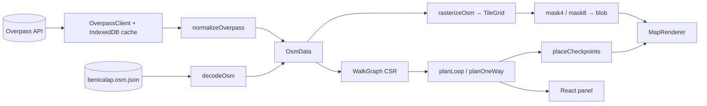
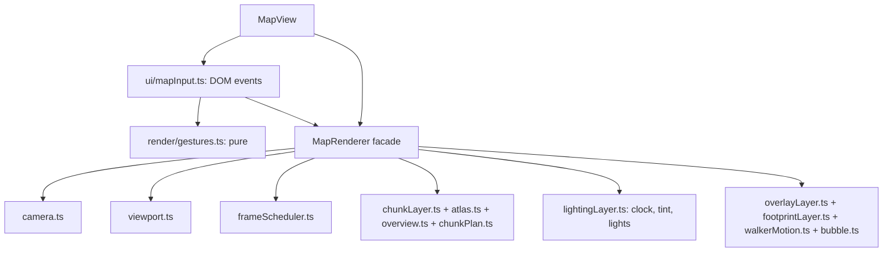

# Map rendering and data: Design

Part of the StepQuest specs; see [../README.md](../README.md). See also: [routing](../routing/requirements.md), [quest](../quest/requirements.md) (route and walker overlays), [retro-ui](../retro-ui/requirements.md) (dialogue box, plural forms).

## Overview

A client-only React app. All heavy lifting is pure TypeScript: OSM normalization, rasterization, auto-tiling and routing run without the DOM and are tested against the bundled Benicalap extract. The renderer is a small canvas engine in the style of old console map engines: a tile grid, a lazily painted tile atlas, cached 32×32-tile chunks, and sprites drawn on top.

## Architecture



## Data model

- `OsmData`: shared node arrays (`lat`, `lon`) plus ways `{ kind, highway, walkable, area, tunnel, crossing, nodes[] }`. Shared node indices encode junctions.
- Compact JSON (`CompactOsm`): delta-encoded 1e-6° integers and flat way rows; the 13.4k-way demo extract is 1.55 MB (≈469 kB gzip, the built `benicalap.osm` chunk) and lazy-loaded.

## Tile grid

- Origin at the bbox's north-west corner, equirectangular projection, 5 m per tile (Benicalap: ≈636 × 646 tiles).
- Roads are thick segments sized by highway class (6–16 m); paths are 4-connected one-tile lines; areas are scanline-filled at tile centres.
- Layer bits per tile, resolved to one terrain. Sidewalks overlapping a drawn carriageway stay road; only `footway=crossing` turns road into zebra.

## Auto-tiling

- `mask4`: N=1, E=2, S=4, W=8. Paths connect to paths, crossings and (one-way) roads.
- `mask8`: N, NE, E, SE, S, SW, W, NW = 1…128; `reduceMask8` clears a diagonal unless both neighbouring cardinals are set → 47 masks (`BLOB_MASKS`).
- The map edge counts as connected so no borders appear at the edge of the loaded area.

## Rendering

- Module layout and the reasons for it: see "Architecture review (Nov 2026)" below (`MapRenderer` is a facade over camera, chunk, lighting and overlay layers).
- `paintTile(ctx, x, y, spec)` draws a tile from `(terrain, m4, m8, variant, roof, vertical)`; the atlas paints each distinct key once.
- Chunks (32×32 tiles = 512×512 px) are cached with an LRU of 96. Zoom ladder 0.5–48 CSS px per tile; ≥ 8 draws tiles, below that a 1-px-per-tile overview image.
- Overlay: route cells (4-connected rasterization of the polyline) as footprints, numbered checkpoint gems, finish flag, start mat and walker sprite.

## Tile art (task 51)

**Tile catalogue** (`src/render/tileset.ts`, `tileSpecs.ts`, `structures.ts`):

| Tile | Art | Chosen by |
| --- | --- | --- |
| Road | asphalt grain, crack on variant 5, kerb band with paving joints, lit/shaded kerb line, dashed centre line | `m8`, `variant`, `lane` |
| Crossing | grained asphalt, white bars with shaded lower or right row | `vertical` |
| Path, park | packed earth: `pathA/B`, specks, pebbles | `surface` 0 |
| Path, town | 4×4 flagstones in staggered rows, joints, lit corner | `surface` 1 |
| Plaza | slabs with joints and lit corners | `variant`, `m8` |
| Park grass | tufts (2, 3; also edge tiles that would hold a tree), stones (4, 7), flowers (5, 6), tree (0, 1 on interior tiles), bush beside a tree | `variant`, `deco` |
| Water | 3 ripple frames, sand shore, foam that laps with the frame | `frame`, `m8` |
| House | roof style (shingles, seams, clay) from `seed>>>4`, shutters, base course, porch, chimney | house `seed` |
| Apartments | shop front and awning on the ground floor for one seed in three | house `seed` |

**Palette use.** Only `src/render/palette.ts`. Added: `kerbLight`, `pebble`, `awnings` (four stripe pairs). Everything else reuses existing colours (`stone*`, `laneMark`, `waterDeep`, `fenceShade`). Light comes from the top-left.

**Variation scheme.** `tileSpecAt` derives `variant = tileHash(tx, ty) % 8` plus three new fields: `lane` (`laneCode`: contiguous road runs along both axes, the street runs along the clearly longer axis, width 3–9; centre tile of odd widths, one edge row of even widths; bit 8 alternates per tile for the dash pattern), `surface` (0 when any 8-neighbour is park) and `deco` (bush when a 4-neighbour holds a tree). Per-pixel grain uses an integer hash of (x, y, variant). No `Math.random`, no time input, so art depends only on the map position.

**Animation and budget.** `TileSpec.frame` (0–2) is part of `tileKey`, so each frame is one extra atlas slot per distinct water tile (about a dozen). Chunks bake frame 0 and record their water tiles. After the chunks are drawn, `drawWater` redraws the water tiles of painted visible chunks from the atlas when the frame is 1 or 2 and sets a single timer for the next 450 ms boundary; it sets none when no water is visible, at zoom below 8 (overview), or with `prefers-reduced-motion`. Other art adds no per-frame work. Atlas growth: lane (≤ 8 codes), surface (2), deco (2), frame (3) multiply keys only for road, path, grass and water tiles.

## Town and landmarks (Phase 3)

- OSM extras: `barrier=*` lines, `place=square` areas, and landmark points (`shop=supermarket`, hospitals and health centres, stations and subway entrances, schools). Points come from nodes or way/relation centres, are deduplicated per kind (a station's entrances merge) and stored in codec v2 as `[kind, lat×1e6, lon×1e6]` triples; ways gain a style index (park style, barrier type, building type, plaza). v1 data still decodes.
- `layoutTown(grid)` (cached per grid): landmarks first, at the nearest free spot of their size within 9 tiles (on buildings, then half on buildings, then any open ground or plaza); park gates where a footpath enters a big park. Remaining building components are cut by BSP into lots; each lot gets up to three houses placed with a largest-rectangle search, plus a front yard (fence or hedge with a gate in line with the door) or side garden when there is room. Everything is seeded from tile coordinates, so it is stable across reloads.
- Structures are painted after the tiles of each chunk and clipped to it, so they are cached with the chunk; the overview uses roof colours.
- Diagonal streets: a soft tile whose two cardinal neighbours and the diagonal between them are road gets an asphalt triangle in that corner; tiles with three road sides become road.
- Route: the polyline is rasterized to ordered 4-connected cells, staircase corners are dropped, and the band is stamped as a pixel brush along the segments, with arrow heads (9×9, rasterized from one triangle in 8 directions) every 6 cells.
- Walker: `facingFrom(dx, dy, previous)` with a 1.25 axis bias to avoid flicker on diagonals; frames 0-1-0-2 every 140 ms while moving; position tweened between fixes.

## Map without holes (task 50b)

- Root cause: `MapRenderer.render` cleared the canvas to ink black and painted only chunks inside the one loaded grid, each built synchronously in the frame that first needed it. Anything outside the loaded bounding box (the camera may go half a screen beyond it, and zoom 0.5 shows several kilometres) stayed black, and zooming into a big area built many chunks at once and stalled frames. The loaded area was only replaced through a manual "Load this area" button.
- Rendering: the canvas is cleared to the ground colour (`groundB`); the loaded grid rectangle is `groundA`. `chunkPlan.ts` (pure) lists the visible chunks and a one-chunk prefetch ring, both sorted by distance to the screen centre. `drawChunks` paints visible chunks in that order until `CHUNK_BUDGET_MS` (6 ms) is used, always at least one per frame; the others are drawn as a scaled slice of the 1-px-per-tile overview (same palette), and a follow-up frame is requested. When all visible chunks exist, one ring chunk is painted per frame. `LruCache` (96 chunks, or visible + 8 if the screen needs more) never evicts chunks on screen.
- Data: `ui/autoLoad.ts` (`shouldAutoLoad`) decides when a rested view outside the loaded area loads by itself: no download running, no route or quest to lose, and not within 500 m of a failed attempt. `App` waits 1.2 s after the map settles, then calls the existing `loadLiveAround`, so requests still go through `OverpassClient` (cache, single request, 10 s spacing, mirrors). With a plan or quest the "Load this area" button remains. Panning anywhere with several areas merged into one world was not done: the walking graph, tile grid and town layout are built per bounding box.

## Error handling: Overpass

- Overpass errors map to `busy`, `rateLimited`, `tooLarge`, `network`, `badResponse` and `badArea` (invalid box, task 66), each with a translated message.

## Testing strategy

- Unit tests for geo maths, step conversion, tag classification, codec round-trip, Overpass client (mocked fetch: cache, throttling, fallback, size cap), rasterization (connectivity, fills, terrain mix on the fixture), auto-tiling (all masks), the tile painter (pixel probes), sprites, routing on the fixture (targets, feasibility, seeds, stride, robustness over random points), checkpoints, i18n parity and an App smoke test.

## Correctness properties (task 58)

Checked with fast-check (fixed seed `20261204`) in `src/osm/codec.property.test.ts` and `src/render/chunkPlan.property.test.ts`.

- **P-M1 Codec round trip.** For random maps (nodes at 1e-6° precision, ways of every kind with optional highway, style, name, safety flags and roundabout flag, landmarks, industrial rings, activity points), `decodeOsm(encodeOsm(x))` equals `x`, also after a JSON text round trip, and `encode(decode(encode(x)))` equals `encode(x)`. The bundled Benicalap extract survives a re-encode unchanged. Validates 1.1, 1.3.
- **P-D1 Visible chunks covered.** For any camera, zoom, screen size, grid and margin, every chunk that the screen rectangle overlaps (and that lies on the grid) is in `visible`; none is listed twice or in both `visible` and `ring`; chunks outside the screen are not visible; both lists are sorted nearest the centre first and stay inside the grid. Validates 7a.2, 7a.3.
- **P-D2 Cache keeps what is on screen.** For any sequence of insertions with any protected set, a protected chunk already cached is never evicted and the cache exceeds its limit only when everything else in it is protected; `chunkLimit` is at least the base and `visible + 8`, so filling the cache with the prefetch ring and the visible chunks never loses a visible one. Validates 7a.4.

## Day-cycle lighting (task 60)

- **Model** (`src/render/daylight.ts`, pure): `lightingAt(ms, place)` = `lightingFromAltitude(sunAltitude(ms, place))`. A piecewise-linear tint table by altitude (30° white, 12° faint warm, 6° golden, 0° orange, −4° pink-purple, −8° blue-purple, −12° and −18° blue night) gives the multiply colour; `darkness = 1 − luminance(tint)`. Lamp strength is a smoothstep from 4° to −6°, window strength from 2° to −8°, so windows light first, just after sunset. Phases: day ≥ 12°, golden ≥ sunset altitude (`HORIZON` exported from `sun.ts`), dusk ≥ −12°, night below. Dawn and dusk share the table, so the morning mirrors the evening. Civil twilight is part of the table, but routing keeps its own rule (night = below the horizon altitude), untouched.
- **Clock**: `MapRenderer.lighting` caches the value per 30 s; a 60 s timer requests a repaint (no per-frame work). `?time=HH:MM` is parsed by `parseTimeParam` in `MapView` and sets `setClockOverride(minutes)`, which uses that local time of today for lighting only.
- **Compositing** in `render()`: ground, chunks, water, rails, then `multiply` fill of the tint (skipped when darkness ≤ 0.5 %), then lights, then route, gems, walker. The route and sprites are drawn after the tint, so they stay bright. Chunk canvases never contain light, so the cache is the same all day and no chunk is repainted on a phase change.
- **Windows** (`lights.ts`): the real painters run once per building against a recording context that collects the glass rectangles (`P.window`, `P.glass`), so the glow sits exactly on the painted windows. About 70 % are kept by a hash of the building seed, position and window position (cached in a WeakMap). They are drawn as plain `fillRect` in warm yellow at the window strength, for houses and landmarks in visible chunks at detail zoom only.
- **Street lamps** (`lamps.ts`): `Layer.lit` (new raster bit 128) marks road tiles of ways with `SAFETY_LIT`. The data has no lamp nodes, so lamps stand on road kerb tiles on a lattice (every 12 tiles per side, the two sides offset by 6): lit tiles always, wide (≥ 3 tiles) streets as presumed-lit main avenues, and every street ≥ 2 tiles wide when the area has no lit tag at all. Lamps are bucketed per chunk once per grid. Each draws a cached 32-px stepped, dithered glow sprite additively (`lighter`), plus a 2×2 art-pixel bright head.
- **Walker and gems**: an additive glow sprite under the walker (4 tiles wide) and each gem (2.4 tiles) at lamp strength.
- **Performance**: one full-canvas fill per frame, plus at detail zoom a few hundred `fillRect` and `drawImage` calls of a cached sprite for the visible chunks. Nothing runs at far zoom except the tint.
- **Reduced motion**: lights are static, so there is nothing to switch off.
- **Testing**: `daylight.test.ts` (phases, golden before sunset, dusk exactly when `isDark`, parser, preview clock), `daylight.property.test.ts` (P-L1 to P-L4), `lights.test.ts` (windows on glass and stable, lit raster bit, lamp lattice and lit rule on a synthetic grid), `nightRender.test.ts` (renderer uses multiply and lights at night, not at noon).

### Correctness properties (task 60)

Fast-check, seed `20261204`, in `src/render/daylight.property.test.ts`.

- **P-L1 Bounds.** For any altitude, time and place, tint channels are integers in 0 to 255, darkness, lamps and windows lie in 0 to 1. Validates 9.3.
- **P-L2 Monotonic in altitude.** A lower sun never gives less darkness, lamp or window strength. Validates 9.3.
- **P-L3 Evening is continuous and monotonic.** For random places and days, from 3 h before to 3 h after sunset, darkness never decreases and changes by under 0.02 per minute. Validates 9.3.
- **P-L4 Morning mirror.** From 3 h before to 3 h after sunrise, darkness never increases. Validates 9.3.

## Architecture review (Nov 2026)

Scope: `src/render/**`, `src/tiles/**`, `src/ui/MapView.tsx`. Method: read the code against requirements 2, 6a, 7a, 8 and 9, then check each suspicion with a failing test before touching the code (tasks 63.x).

### Current structure

- `MapRenderer.ts` (1026 lines) does everything: camera maths, canvas sizing, tile atlas, chunk cache, structure painting, water ripples, overview stand-ins, the day-cycle clock, tint, window and lamp light, rails, avoided-street tape, route footprints, gems, walker tween, speech bubble and pickups. Eleven private fields hold unrelated state and `render()` is a 150-line function.
- `chunkPlan.ts` (pure plan and LRU), `tileSpecs.ts`, `tileset.ts`, `structures.ts`, `lights.ts`, `lamps.ts`, `daylight.ts`, `routePath.ts` are already separate and tested.
- `MapView.tsx` holds all input handling (one 130-line effect: pointer, pinch, wheel) and cannot be tested without a DOM.

### Findings

Bugs (each has a regression test in 63.x; "verified" means the test failed before the fix):

| Id | Finding | Effect |
| --- | --- | --- |
| B1 | Every wheel event is one ladder step; `deltaY = 0` counts as "zoom out" | A trackpad flick runs through all 13 levels; horizontal scroll zooms out |
| B2 | Pinch compares `target` with `zoom × 1.4` after each step. Ladder step 8 → 16 is 2×, so for ratios 1.40 to 1.43 the zoom flips up and down on every move event. Two-finger drag does not pan | Flicker while pinching; map follows only the zoom |
| B3 | `cssWidth` falls back to `canvas.width` (device px) when `clientWidth` is 0, then `render` multiplies by the pixel ratio again | A hidden canvas grows by the pixel ratio on every frame |
| B4 | `devicePixelRatio` is read per frame but nothing triggers a frame when it changes alone | Blurry map after dragging the window to another screen |
| B5 | Backing store is `css × dpr` with no limit | iOS Safari (16.7 Mpx limit) and big 2× screens can give a blank canvas |
| B6 | Window and lamp light is drawn for every planned chunk, also for the ones still showing the 1-px-per-tile stand-in | Yellow dots on the blurry overview while chunks load at night |
| B7 | A stand-in is drawn with width `round(sw × scale)` while its neighbours start at `round(origin + (cx+1) × 32 × scale)` | 1 px ground-coloured seams between stand-ins and painted chunks |
| B8 | Whole 512 px chunks are scaled as one block, but water tiles are redrawn with per-tile rounded edges | At non-integer scale (browser zoom, pixel ratio 1.1) ripples sit up to 1 px off their tiles |
| B9 | Evicted chunks are only dropped from the map, never released; `dispose` frees neither chunks, atlas pages nor the overview; `chunkWater` keeps entries of evicted chunks | Canvas memory stays on iOS until a GC that may never come; 96 chunks are 96 MB |
| B10 | `requestRender` without `requestAnimationFrame` calls `render()` directly, and `render()` calls `requestRender()` while the walker moves or chunks are pending | Unbounded recursion outside a browser |
| B11 | `lampsInChunk(grid, cx, cy, size)` caches by grid only, so the first `size` wins | Latent: wrong lamps if another chunk size is ever used |
| B12 | `zoomStep` from a zoom between two levels moves two levels up | Skipped level (not reachable today; the ladder is the only source) |
| B13 | `setPointerCapture` can throw (`InvalidStateError`); right and middle mouse buttons pan and place points | Uncaught error; context-menu click places a start |
| B14 | The camera is not clamped again after a resize | After rotating a phone the view can sit far outside the map |
| B15 | After a tab returns from the background the sky is stale until the next 60 s timer | Up to a minute of wrong tint |
| B16 | `planChunks` uses the unrounded camera while drawing uses a rounded origin | Suspected 1 px uncovered column at non-integer scale. Not reproduced: `chunkCoverage.property.test.ts` found no gap in 600 random cases with the plan unpadded, so the plan is unchanged |

Missing requirements: pinch pan, inertia, double tap, keyboard, backing-store limit, hidden canvas, pixel-ratio change, release of canvases, repaint on visibility, a performance budget. Added as requirements 10 to 13.

Performance (counting-stub benchmark in `bench.test.ts`, 390 × 700 CSS px at 2×, 7.5 km serpentine route):

- P1 The route is re-projected and re-laid out every frame (`footprints` over the full polyline, thousands of objects) and every footprint is about 30 `fillRect` calls. At far zoom that is 88 910 calls per frame, and the frame is repeated at 60 Hz while the walker moves.
- P2 Per-frame allocations: `chunkKey` template strings (about 6 per chunk per frame), a `Set` of on-screen keys, the chunk plan arrays and their sort, the `toScreen` closures and objects, a lamp list fetched twice.
- P3 Overdraw: the full-canvas ground fill and the loaded-area fill are both painted before chunks that cover them. Kept: they hide edge slivers, and removing the second one at far zoom would change edge pixels (the overview is drawn to a fractional rectangle). The duplicated branches of `render()` that issued the same fill are merged.
- P5 Track lines (`drawRails`, 62 in the demo map) cost about 14 000 `fillRect` calls per frame at far zoom after culling (26 000 before). Left as the largest remaining cost: caching them needs a canvas per sub-unit origin offset (the snapping depends on it), too much memory for the gain. Follow-up: batch each colour into one path fill.
- P4 Chunk blits are scaled to 512 × zoom px each, up to 4608 px at zoom 48 on a 3× phone, although only the visible part matters.

Design:

- D1 One class, many jobs (see above). D2 Dead code: `chevrons`, `ARROW_PATTERNS`, `dir8` (the route is footprints since task 51), `WINDOW_RGB_COOL`, the getters `atlasSize`, `railCount`, `avoidedCount` and `facing`, the duplicated `groundA` fill branches. D3 Requirement 6a.4 still says "direction arrows". D4 Input logic lives in a React effect.

### Target design



- `camera.ts`: `Camera` class with camX, camY, zoom, the CSS size, `screenToTile`, `tileToScreen`, `panBy`, `zoomTo`, `zoomStep`, `fit`, `clamp`. No DOM, no grid projection (the facade converts lat/lon).
- `viewport.ts`: `backingSize(css, dpr, limits)` (pure) and `watchPixelRatio(cb)` (matchMedia re-armed on every change).
- `chunkLayer.ts`: owns atlas, chunk cache (numeric keys, release on eviction), structure index, water tiles, stand-ins; `draw()` returns the chunks that are really painted.
- `lightingLayer.ts`: clock override, 30 s cache, 60 s timer and visibility repaint, tint fill, window and lamp light for painted chunks.
- `overlayLayer.ts`: route, avoided tape, rails, gems, walker, bubble, pickups. `footprintLayer.ts` caches the layout per zoom in world pixels and draws each print as one cached stamp. `walkerMotion.ts` is the pure tween and facing state.
- `frameScheduler.ts`: coalesces `requestRender`, runs the frame, guards re-entrancy.
- Input: `gestures.ts` (`WheelAccumulator`, `pinchLevel`, `VelocityTracker`, `glide`, `TapPairer`, pure) and `ui/mapInput.ts` (listeners, pointer capture, glide loop, keyboard) so `MapView` only creates it.

Rationale: each module has one reason to change and a test that does not need a canvas. Pure modules (camera, gestures, viewport maths, plans) get property tests; layers get tests on a software canvas (`render/testing/softCanvas.ts`) that implements `fillRect`, `drawImage`, alpha, `multiply`, `lighter` and a rectangular clip, so frames can be compared pixel by pixel. Alternative considered: keep one class and only extract helpers. Rejected: the state (cache, clock, walker) would stay shared and every change would keep touching `render()`.

### Visual changes

The approved look is pinned by golden frames (`golden.test.ts`, snapshot of a frame hash per scene). They must not change except for the defects below, each only visible in the stated case:

- B6: no light over stand-ins (only while chunks load at night).
- B7 and B8: seams and ripple offsets at non-integer scale and while chunks load; none at integer scales.
- Input additions are not drawing changes: the map canvas is a tab stop with a dashed gold focus ring (same style as the buttons) and an accessible name (`map.canvas`, English and Spanish).
- Everything else (stamps, caches, module split) keeps every golden hash.

### Results

Golden frames (`golden.test.ts`, 7 frames over 5 scenes) were recorded on the old code before the split and are unchanged: the refactor, the footprint stamps and the culling are pixel-identical. Visible differences are limited to the defects above (B6 while chunks load at night, B7 and B8 at non-integer pixel ratios); no golden scene hits them.

Benchmark (`bench.test.ts`: counting stub context, 390 × 700 CSS px at 2×, 7.5 km route, 80 warm-up frames, steady state; time is the JavaScript side only, median of repeated runs on one machine; calls are `fillRect` plus `drawImage` per frame):

| Scene | Before ms | After ms | Before calls | After calls |
| --- | --- | --- | --- | --- |
| Detail zoom 16, still camera | 0.82 | 0.08 | 5148 | 191 |
| Detail zoom 16, panning | 0.60 | 0.08 | 3890 | 145 |
| Detail zoom 16, route only (no tracks) | 0.76 | 0.06 | 5146 | 191 |
| Far zoom 1, route only (no tracks) | 0.55 | 0.04 | 5141 | 185 |
| Far zoom 1 with the demo map's tracks | 2.05 | 1.04 | 26 010 | 13 931 |
| Night, detail zoom 16 | 0.82 | 0.16 | 5402 | 434 |

A real canvas also pays for the pixels, which this stub does not measure; the call counts are the part a browser must execute, and they are asserted by the tests (under 1500 for the route at every zoom, requirement 12.1).

Bugs fixed with their regression tests: B1, B2, B13 (`gestures.test.ts`, `mapInput.test.ts`); B3, B4, B5, B6, B7, B9, B10, B11, B12, B14, B15 (`rendererBugs.test.ts`, each failed before the fix); B8 and B16 are covered by `chunkCoverage.property.test.ts` (B8 is fixed by construction: water and chunk blits share `tileEdgeX/Y`; B16 not reproduced).

Property tests added (fast-check, seed `20261204`): P-C1 to P-C4 camera and backing store (`camera.test.ts`), P-D3 screen covered (`chunkCoverage.property.test.ts`), P-T1 to P-T6 auto-tile masks on random grids (`autotile.property.test.ts`; no bug found), P-L5 painted frame continuous in time (`lightingLayer.test.ts`), plus wheel, pinch and glide properties (`gestures.test.ts`).

- **P-C1** screen ↔ tile round trip under 1e-6 tile at every zoom and anywhere the clamp allows (also at 36 000 tiles from the origin). **P-C2** zoom keeps the tile under the pointer. **P-C3** clamp bounds and idempotence. **P-C4** pan and opposite pan return to the start.
- **P-D3** every device pixel of the loaded area on screen is covered by a chunk or stand-in, for ratios 1 to 3, zoom 8 to 48, any camera, with all chunks painted or one.
- **P-T1** masks stay in the 47 blob masks and diagonals need both neighbouring cardinals. **P-T2** the map edge is connected. **P-T3** the 4-bit mask is the cardinal part of the 8-bit one. **P-T4** a mask depends only on its 3 × 3 neighbourhood. **P-T5** rotating the grid 90° rotates the masks. **P-T6** one terrain has no borders.
- **P-L5** from 15:00 to 23:30 the mean colour of a painted frame changes by under 5.1 levels per minute (the 0.02 of P-L3), and night is darker than noon with the same chunk cache.

## OSM data and rasterizer review (Nov 2026)

Scope: `src/osm/**`, `src/tiles/**`, `src/town/layout.ts`, `src/geo/geo.ts`, `scripts/build-fixture.ts`, `osm-etiquette.md`. Method: read the code against requirements 1, 2 and 6a, check each suspicion with a small hand-made area or a scratch run on the code before the change ("verified" means it failed or misbehaved there), then fix with a regression test (tasks 66.x). Requirements 14 to 16 hold the resulting rules. Overpass etiquette is unchanged: one request per mirror, one download at a time, 10 s gap, 36 km² cap, cache first; every new step in this section works on local data.

### Current structure

- `osm/`: `demoArea.ts` (query), `download.ts` (mirror race, answer check), `download.worker.ts` (runs it off the main thread), `normalize.ts` (Overpass JSON to `OsmData`), `classify.ts` (tags), `codec.ts` (compact JSON, bundled fixture and cache form), `cache.ts` (IndexedDB), `overpass.ts` (client: cache, index, spacing, cap).
- `tiles/`: `grid.ts` (layers, terrain priority), `rasterize.ts` (polygon fill, thick segments, 4-connected lines), `autotile.ts`, `diagonal.ts`. `town/layout.ts` builds houses and landmarks on the resolved terrain.
- The routing graph reads `OsmData.ways` directly (walkable ways clipped to the bbox), so everything `normalize` lets through reaches both the picture and the planner.

### Findings

| Id | Finding | Effect |
| --- | --- | --- |
| D1 | A NaN, inverted or out-of-range box: `NaN > 36` is false, so the cap passes; the query text then contains `NaN` (verified) | A bad coordinate from the UI downloads nothing useful and can be cached |
| D2 | Area uses the width of the south edge only (small error, but it is the only check of the cap); the cap was tested on the request while the downloaded box and the cache key were different boxes. The key rounded to the nearest 0.001°, so an entry could miss up to 50 m of a request that mapped to it | Edge of the map missing after a cache hit; a request just over the cap could pass or fail by rounding |
| D3 | `decodeOsm` of a damaged or old entry throws a plain `Error` inside `cached()`; the entry stays (verified: `loadArea` rejects with "Unsupported map data version 9") | Every load of that area fails until the entry expires after 7 days |
| D4 | The area index is parsed without checking its records; a `null` record throws a `TypeError` in `contains` | The same failure, from `localStorage` |
| D5 | Nothing is ever deleted: expired areas, areas that fell off the 40-record index, and entries of older cache versions stay in IndexedDB | Storage grows for ever; quota errors later |
| D6 | An entry with a saved-at time in the future (clock set back) counts as fresh until the clock passes it | Stale map for much longer than 7 days |
| D7 | A failed `indexedDB.open` is remembered for the session; a write that ends in `abort` without `error` leaves its promise pending, and the client stays `busy` for ever | No cache for the session; hardening, not reproduced in a test |
| D8 | The key prefix `v3` is typed by hand and has no link to the codec version | A format change keeps serving old data lacking the new fields |
| D9 | `decodeOsm` repairs what it cannot read: an unknown kind becomes a road (verified), an out-of-range node index reads `?? 0` (a point at 0°, 0°), missing arrays throw later in the renderer | Damaged data draws wrong things instead of failing |
| D10 | An answer without `elements` (an empty object, `null`, a page that happens to parse) is normalized to an empty map and cached for a week (verified) | "No streets here" for 7 days |
| D11 | Only `null` geometry points are gaps; `NaN` or 1e9 is accepted, and a building of two points and back is kept | Chords across the map; coordinates 1e9 away make every later step slow |
| D12 | The query asks for ways only, so multipolygon relations never arrive: a building with a courtyard or a park with a pond mapped as a relation is missing when its outer way is untagged (the usual case). The model has no inner rings | Missing large buildings and parks in live maps; no holes anywhere |
| D13 | `isTunnel` lets `layer=-1` win over an explicit `tunnel=no` (verified), which also drops the way from the picture and sets the COVERED safety flag; there is no bridge information, so rail tracks are drawn across bridge decks | Cuttings vanish; tracks run over road bridges |
| D14 | The local projection subtracts longitudes directly: 0.01° across the antimeridian gives 38 134 km (verified). `bboxAround` returns longitudes above 180 and latitudes above 90, which Overpass rejects. Near a pole `cos(lat)` reaches 0 and the inverse divides by zero | Fiji, Chukotka and polar users get nonsense; none in the Benicalap demo |
| R1 | Rasterization visits every tile of a feature's own extent, inside the grid or not. Overpass returns whole ways, so a forest or river that merely touches the area costs its full size: a 110 km square forest took 5.1 s for a 6 × 6 km area; a 20 000 × 20 000 tile polygon makes 400 million visits in 1.35 s (verified); a coordinate of infinity never ends | Freezes the phone (the worker only covers the download, not the grid) |
| R2 | `thickSegment` tests every tile of the segment's bounding box: a long diagonal costs length², not length × width | Slow long rivers and roads |
| R3 | `line4` with a slope that rounds to zero (denormal) gets `NaN` step distances and walks away from its end tile (verified: tiles 0,0 to 0,-3 for a line to (-5e-324, 0)); rounding can also overshoot the end column | Broken 4-connection on near-axis lines; found by the property test |
| R4 | A ring whose corners are on one line paints the tiles whose centres lie exactly on it | Stray lines from zero-area buildings (rare) |
| R5 | No holes (see D12), so a courtyard cannot exist | |
| R6 | Rails are drawn after the chunks, whatever lies over them | See D13 |
| R7 | Not changed on purpose: area-tagged ways that are not closed are filled with a closing chord (a mapping error, and the answer is whole ways, so the closed case is the common one); the equirectangular projection error is below 0.3 % at 6 km up to latitude 80°, so the scale stays at the north-west corner | Documented, covered by `geo.test.ts` |
| T1 | Town layout: blocks are 4-connected components of building tiles, lots are cut from the block's rectangle and masked by the block, so courtyards and a grid edge stay empty. No defect found; cost is one-off (below) | Courtyard test added |

Reviewed without change: worker protocol (a new worker per download, progress throttled), mirror race (each mirror gets one request, the winner aborts the rest, 429 and 504 map to `rateLimited`, timeouts abort), `Promise.any` error priority, key spacing and `busy` rule, `areaForWalk` formula, attribution.

### Design

- `geo.ts`: `wrapDeltaLon`, `wrapLon` (identity for values already in range, so existing coordinates keep their bits and the golden frames stay), `MAX_LAT` guard in `LocalProjection`, `bboxAround` clipped to ±90 and ±180, `isValidBBox`, `bboxAreaSphereKm2`. A walk next to the antimeridian gets a box trimmed at 180°; the grid and graph are per box and never wrap.
- `overpass.ts`: `snapBBox` grows a request outwards to the 0.001° grid with a `1e-7` float guard; the client downloads, keys, indexes and caps that box. `areaForWalk` caps its radius at 2.85 km (was 3 km) so the grown box stays under 36 km² (a 2.9 km radius gave 36.05 km² after growing; 2.85 km stays under 36 at the equator, 40° and 60°, tested). Only walks above about 13 km of target distance are affected. `cacheKey` is `v${CODEC_VERSION}:…`. `readEntry` decodes with a `try`, deletes what it cannot read and reports a miss. `prune` runs after a successful save: it drops expired and overflow index records and their data, and once per session deletes keys without the current prefix. `AreaCache` gains optional `delete` and `keys`.
- `cache.ts`: `isFresh(savedAt, now)` (number, under 7 days, at most 5 minutes in the future); `IndexedDbCache` forgets a failed or closed connection, rejects on `abort` and `blocked`, and implements `delete` and `keys`.
- `download.ts`: `isOverpassResponse`; the timeout remark is checked before the shape, so a remark-only answer is `busy`.
- `normalize.ts`: `validPoint` (finite, ±90, ±180) decides gaps; areas need three different corners; relations of kind building, park or water with `type=multipolygon` go through `multipolygon.ts` (`assembleRings` joins member ways by equal end coordinates, `buildPolygons` gives each inner ring to the smallest containing outer ring), producing one area way per outer ring with `holes`; outer members that are also tagged on their own are skipped (`claimed`). Roads and paths with `bridge=*` get `bridge`. Relation nodes are indexed by coordinate and not shared with way nodes, because relation members carry no node ids; areas never join the walking graph.
- `classify.ts`: `isTunnel` (bridge never, explicit `tunnel` tag first, then negative `layer`) also serves the rail rule; `isBridge`.
- `codec.ts`: version 4 adds flag 32 (bridge) and `holes: {w, r}[]` (delta-coded rings). `validate` checks shape, kinds and every node index before decoding and throws `CorruptDataError`. Encoding is deterministic, so the stability property holds. The bundled fixture stays at version 3 (rebuilding needs the original Overpass answers, which are not in the repository); it decodes unchanged, so `bridge` and `holes` are absent there.
- `rasterize.ts` (public API, all pure): `fillRings(rings, visit, bounds?)` (even-odd over several rings; crossings bucketed per row, so cost is edges × rows crossed; rows and columns clamped to `bounds`), `fillPolygon` (one ring), `thickSegment(a, b, half, visit, bounds?)` (per row, only the columns of the strip around the line are tested, then the same exact distance test as before, so output is identical), `line4(a, b, visit, bounds?)` (clips to one tile outside the grid, always steps towards the end tile), `clipSegment`, `cutRailsAtBridges`, `rasterizeOsm`, `buildTileGrid`. `TileGrid.bridge` marks bridge-deck tiles; `rasterizeOsm` cuts the rail polylines there, in half-tile steps, only for polylines that touch a deck.
- Town: no code change.

Alternatives considered. (1) Add `rel` clauses for multipolygons to the live query: rejected for now. It is still one request, but it enlarges every answer and the steering file says ways only; the parser, codec and rasterizer are ready, so it is a one-line query change once the owner agrees. (2) Clip polygons geometrically (Sutherland–Hodgman) before filling: rejected; clamping rows and columns gives identical tiles with less code. (3) Serve a stale cache entry when the network fails: useful offline, but it changes requirement 1.3; left as a suggestion. (4) Scale the projection at the box centre: error gain below 0.1 %, but it would move grid sizes and every golden frame; not done.

### Correctness properties (task 66)

Fast-check, fixed seed `20261204`.

- **P-G1 Projection round trip.** `toLatLon(toXY(p))` returns `p` for origins and points anywhere, across the antimeridian. Validates 16.7.
- **P-G2 Scale.** Within 6 km up to latitude 70°, the projected distance is within 0.5 % of haversine. Validates 16.7.
- **P-G3 Box validity.** `bboxAround` of any point and radius is valid and contains the point. Validates 14.1.
- **P-M1 (extended) Codec round trip** on random maps now with holes and bridge flags, through JSON text; encoding is stable.
- **P-M2 Damage.** A damaged compact value either throws `CorruptDataError` or decodes with every node index in range. Validates 15.7.
- **P-T1 Area.** A filled convex polygon has as many tiles as its area, within half its perimeter. Validates 16.1.
- **P-T2 Bounds.** Filling with bounds equals filling without them, restricted to the bounds. Validates 16.1.
- **P-T3 Holes.** Outer minus hole is exactly `w·h − iw·ih` tiles and every hole tile is empty. Validates 16.2.
- **P-T4 Translation.** Moving a polygon by whole tiles moves its fill. Validates 16.1.
- **P-T5 Thick segment.** The row-limited version marks exactly the tiles of the brute-force test plus the centre line. Validates 16.4.
- **P-T6 Clipped line.** A line from inside the grid to anywhere stays 4-connected, within one tile of the grid and keeps its inside end. Validates 16.1, 16.4.

### Results

Measured on one machine (Node 24, median of 7 runs for Benicalap, a single run for the synthetic areas; pure functions, no canvas). The 36 km² area is synthetic: 6 × 6 km, 6128 street segments and about 1900 buildings, 1198 × 1199 tiles.

| Case | Before | After |
| --- | --- | --- |
| Rasterize Benicalap (635 × 645, 15 457 ways) | 37 ms | 33 ms |
| Rasterize 3 × 3 km synthetic (600 × 600) | 11 ms | 12 ms |
| Rasterize 6 × 6 km synthetic (the cap) | 26 ms | 23 ms |
| The same plus a 110 km forest and a 70 km river through it | 5109 ms | 49 ms |
| Fill of a 20 000 × 20 000 tile polygon | 400 000 000 visits, 1347 ms | 10 000 visits (bounded to a 100 × 100 grid), under 1 ms |
| Decode the Benicalap extract (96 k nodes) | 2.6 ms | 6.3 ms (shape check) |
| Encode the Benicalap extract | 6 ms | 6 ms |
| Town layout, Benicalap / 36 km² synthetic | 119 ms / 236 ms | unchanged code: 114 ms / 243 ms |

The decode check costs about 4 ms once per map and guards every cache read and every download. The town layout is a one-off cost (about 70 % is the per-lot ramp and corner test, 5.6 ms is landmarks, 22 ms park gates, 8 ms the block search); it was measured and left alone. The bundled Benicalap grid hashes to the same value as before (`rasterize.regression.test.ts`), and the golden frames are unchanged.

Visible changes: none in the bundled demo. In live data: courtyards and ponds appear when relation geometry is present; rails stop at bridge decks; `tunnel=no` ways with a negative layer are drawn; boxes near ±180° or the poles are valid.

Cross-reference to routing: the graph is unchanged. It still takes walkable ways clipped to the bbox, and `holes` and `bridge` are not read by it. Two effects reach it through `normalize`: ways with a bad coordinate are split at the gap (they used to put NaN into the node table), and a `tunnel=no` way with a negative layer is no longer flagged covered, so it counts as open air in the night weights.

Limits kept: no walk is planned across the antimeridian (the box is trimmed at 180°); a live area still has no relations (D12); an unclosed area-tagged way is filled with a closing chord.


## Town layout review (Nov 2026)

Scope: `src/town/layout.ts` (395 lines, one file) and its callers `render/chunkLayer.ts`, `overview.ts`, `structures.ts`, `lights.ts`. Requirement 17, tasks 69.1 to 69.7.

### Current structure (before)

`layoutTown(grid)`: `placeLandmarks` (grid points in data order, three passes of three sizes within 9 tiles) → `findParkGates` → connected building blocks → BSP lots → up to three largest rectangles per lot → front yards (fence, gate) → trees. All in one file, with a `Set` of block tiles per block.

### Findings

| Id | Finding | Effect |
| --- | --- | --- |
| B1 | Landmarks were placed in the order of `grid.pois`, and each one reserves its tiles. Two points that compete for a spot give a different town when the data order changes (Overpass does not promise an order; the fixture builder merges extracts). | Station and market near (194, 375) on the Benicalap map moved with the order. |
| B2 | Points of one kind on one tile, or one inside the footprint of another, each got a landmark (the second one next door). | Two schools drawn side by side for one OSM school. |
| B3 | A point with an unknown kind threw `LANDMARK_SIZES[kind] is not iterable`; one with NaN coordinates was only skipped by luck of `inBounds(NaN)`. | A bad cached extract would stop the whole map drawing. |
| B4 | Park gates were found after landmarks without looking at them, and houses were placed on the tiles of a gate's arch row (`houseAt` and `landmarkAt` both set). | House and arch painted on the same tiles. A landmark overlap did not occur in tests but was possible by construction. |
| B5 | A horizontal gate at map row 1 had `y = -1`; the code later guarded the index but the painter still received a rectangle outside the map. | Arch clipped or painted at row -1. |
| B6 | A front-yard fence under the removed column of a side garden (`w - 1`) had no house above it, so the "tile under a house stays clear" rule did not protect it and a tree could stand on the fence. | Tree through a fence. |

Checked and found correct: houses are cut from a mask of building tiles, so they never cover roads, water or plazas, and `largestRect` clearing keeps them disjoint (property test confirms, 60 random maps). A front-yard row lies inside the lot. The door column is always inside the house. Block order is the scan order of the first tile, so seeds do not depend on traversal order. `Math.max(...)` and `Set` iteration do not leak into results (the `trees`, `fences` and `gates` sets are only read by membership).

By design (documented, not changed): lots are cut from the bounding box of a block, so a concave block is covered by the pieces of up to three rectangles per lot and an L-shaped leftover stays building tiles; blocks thinner than 2 tiles or under 4 tiles get no house; a landmark can move up to 9 tiles (45 m) from its OSM point.

### Performance

Linear. `layoutBench.test.ts` (printed, one machine, ms, median of 3 runs after, single run before): Benicalap demo 635 × 645 tiles 137 → 110; 600 × 600 tiles of 40-tile blocks 158 → 147; one 600 × 600 block 283 → 182. The saving comes from a tile-to-block `Int32Array` instead of a `Set` per block and a flood fill without a closure per tile. The 36 km² cap is 1200 × 1200 tiles, about four times these grids.

### Target design

```
types.ts      House, Landmark, TownLayout, Rect, LOT, colour counts
random.ts     rng (mulberry32), hash2
blocks.ts     components, analyseBlocks (blocks + owner array), subdivide (BSP), largestRect
landmarks.ts  landmarkSites (sorted, deduplicated), placeLandmarks, findParkGates, LANDMARK_SIZES
houses.ts     placeHouses (lots, houses, yards, trees), houseKind
layout.ts     layoutTown, townFor, re-exports of the names the renderer and tests import
```

- `landmarkSites(grid)` returns the usable points sorted by kind (`LANDMARK_KINDS` order), then row, then column, with duplicates removed. Placement walks that list, so the result depends on the map, not on the data order.
- `reserved` (a `Uint8Array`) is the single record of tiles that landmarks and gates have taken; houses are placed only on building tiles outside it.
- Trees keep their random draws: `scatterTrees` draws for the same tiles as before and only refuses to store a tree on a fence tile.

### Behaviour changes (all deliberate)

- Landmark order in `TownLayout.landmarks` is now by kind (healing, station, school, greenMarket, market), then position, instead of data order, so `landmarkAt` indices differ. Nothing outside the renderer reads the index.
- On the Benicalap map one station and one market moved by one or two tiles, because they compete for the same space and the winner no longer depends on the data order. This changes one golden frame (`far zoom town map`, night frame at zoom 0.5: `23e2e9c8` to the new hash in `golden.test.ts.snap`). The other four scenes keep their hashes. Confirmed by restoring data-order placement: the old hash returns.
- Gate tiles are reserved, so up to a 3 × 2 patch of building tiles under an arch no longer holds a house.

### Properties (fast-check)

- **P-Y1** for random maps with random points: every house tile is a building tile, houses are pairwise disjoint and do not touch a landmark or gate, landmarks and gates are inside the map and disjoint.
- **P-Y2** shuffling `grid.pois` leaves `landmarks` and `houses` equal.
- **P-Y3** at most one landmark per distinct (kind, tile) point, and each landmark lies near a point of its own kind.
- **P-Y4** no tree on a house, fence or gate tile.

### Page zoom lock (cross-reference)

The map canvas is the only element that handles pinch (`touch-action: none`, pointer events in `ui/mapInput.ts`). The page-level guard that stops Safari from zooming the page is specified in retro-ui requirement 17; it must keep skipping events whose target is inside `.map-canvas`.

## OpenStreetMap credit placement (task 72, requirement 18)

Field bug (iPhone): the credit floated mid-map because five rules (`.quest`, `.layout`, `.console-screen`, a media query) each gave it a different offset.

Design: one rule, `.map-attribution { position: absolute; left: 0; bottom: 0; z-index: 4; height: var(--attr-h) }`, inside `.map` (the map viewport; on the planner the panel is a sibling below it, in a quest the HUD is an overlay). The other rules are deleted. In a quest the bottom HUD (`.hud-bottom`) and the map banners move up by `--attr-h` (16 px) so nothing covers the strip. The text is the short form with a link; the long "Map data ... (ODbL)" wording is not needed because the link leads to the licence page, which ODbL attribution allows.

Trade-off: 16 px of the quest screen go to the credit. Tests: `src/ui/attribution.test.ts` (placement rules in the CSS, font and contrast) and `MapView.test.tsx` (link and text in both languages).

## Streaming multi-area world (requirement 19, task 70)

Field report (iPhone, active quest, zoomed out): the map ends at a hard edge, nothing beyond is ever loaded. Cause: `World` was one bounding box. `OsmData` (one node table, one bbox), `TileGrid` (origin and size from that bbox), `townFor(grid)` (one layout for the whole grid) and `WalkGraph` (built once from the data, clipped to its bbox) were all built for one box, and `useArea` replaced all four when a different area was loaded, which is not allowed during a quest.

### Architecture

```
src/world/
  cells.ts        cell maths: CellId, cellOf, cellBBox, cellsInBBox, nearest-first order, batch planning
  slice.ts        cut an OsmData into per-cell records (coverage, node remap)
  worldData.ts    WorldData: append-only merge of records (dedupe by id, stitch, unify nodes)
  coverage.ts     which points lie inside loaded cells (graph clipping)
  tileWorld.ts    frame grid, per-cell rasterization, per-cell town units, change events
  liveWorld.ts    LiveWorld: records, WorldData, graph accumulator, TileWorld, LRU, `World` snapshots
  streamer.ts     view -> wanted cells -> batches; debounce, cancel, rate cap, back-off, one in flight
src/osm/overpass.ts   OverpassClient.loadCells (cache per cell, one request, slicing)
src/routing/graph.ts  GraphAccumulator (shared by `new WalkGraph(data)` and the incremental path)
src/render/*          TownLookup, chunk invalidation, loading stipple, incremental overview, far overview
```

### Whole view covered, soft frontier (requirements 19.19 to 19.22)

Field report 2 (390 × 844 phone, quest, furthest zoom, 75 s later): the loaded map still ends in straight top and bottom edges. Cause: at zoom 0.5 the view is about 3.9 × 8.4 km, 40 to 50 cells, and the unchanged budget (12 cells a minute, 4 per request, 10 s apart) needs minutes to fill it. The view box itself was already the real rectangle; the quest simply allowed a view the budget cannot cover. The loaded region ended at cell borders and nothing hid that.

- `world/window.ts` (pure): `QUEST_WINDOW_CELLS = 12`; `worstCellsTouched(widthM, heightM, lat)` = (ceil(w / cellWidth) + 1) × (ceil(h / cellHeight) + 1), the most cells a box of that size can touch whatever its alignment (cell height 0.01° of latitude, width 0.01° of longitude times cos(lat), 2 % safety margin); `questMinZoom(cssW, cssH, metresPerTile, lat)` = smallest `ZOOM_LEVELS` entry whose view stays within the budget (the top level if none). On 390 × 844 at València it is 1.5; wider screens get a higher floor.
- `Camera.minZoom` (default 0, so the planner is unchanged) clamps `zoomTo` and `zoomStep`. `MapRenderer` sets it from the canvas size and the view latitude each frame while a quest overlay is set, and lifts a smaller current zoom to it, so rotation and resize are covered. The `Streamer` keeps its per-view cap and nearest-first order; with a view of at most 12 cells the whole view is requested and, at 12 cells a minute, filled in about 70 s without touching the client limits.
- Frontier: `LiveWorld.frontier()` (cached per `version`) lists the edges of loaded, covered rectangles whose far side is not loaded (cell border with a missing or partial neighbour, an inner edge of a partly covered cell, the frame edge). `render/frontier.ts` draws, for each edge, five bands on the loaded side, each `FOG_STEP_CSS` (8 CSS px) deep, with the ground colour through a 4 × 4 Bayer pattern of 2-device-pixel dots at 14, 11, 8, 5 and 2 of 16. Patterns are cached canvases anchored to the screen; the cost is one clipped fill per band (a few dozen per frame). It runs after the layers and before rails, lighting and the route, so it also covers the overviews. Convex corners overlap and darken slightly, which is fine.

### Data flow

```
view settles ──> Streamer.plan(view box) ──> wanted cells (missing, in frame, not cooling down), nearest first
   └─> planBatch -> rectangle of <= 4 cells ─> OverpassClient.loadCells
          cache hit per cell (IndexedDB)  ─┐
          else ONE request (bbox of the missing cells, mirrors raced, 10 s gap, one in flight)
          └─> normalize -> slice per cell -> encode + cache per cell
   └─> LiveWorld.addRecords(records)
          WorldData.addRecord   (stitch, dedupe, unify nodes; append-only, ids stay)
          GraphAccumulator.add  (new ways only; retry edges that were outside the old coverage)
          TileWorld.paintCell   (window raster -> blit owned rect; town unit; rails)  -> change event {rect}
          snapshot -> World {data, grid (same object), graph, safety} -> React state
ChunkLayer / overview listen to the change event and repaint only the touched rect.
```

The `grid` object of a world never changes after the first area, so the renderer, the camera and the quest overlay are not rebuilt. The `data`, `graph` and `safety` objects are new immutable snapshots; anything holding an old snapshot (a plan in the worker, a reroute in flight) keeps a consistent map.

### Cell size

`CELL_DEG = 0.01`. Reasons:

- Overpass answer size grows with area, not with how many calls: a dense city is about 1 to 3 MB of JSON per km². One cell (about 0.95 km² at 39.5° N) is one polite, small request, and a batch of 4 stays near 4 km², a neighbourhood and a ninth of the 36 km² cap. A 36 km² request (the old `areaForWalk` box) took 20 to 40 s on a phone.
- Rasterized, a cell is about 220 × 180 tiles (40 k tiles): small enough to paint, blit and lay out in a few milliseconds, and to evict alone.
- 0.01° is a decimal grid that lines up with the existing 0.001° cache grid, so cell edges are exact in float arithmetic (`i / 100`), and a cell key needs no projection.
- It shrinks east-west with latitude (0.86 km at València, 0.55 km at 60°). That keeps the maths exact and the request count a little higher in the north; accepted over a latitude-banded grid, whose neighbours would not share edges.
- Slippy-map tiles (zoom 14 is about 2.4 km) were considered. They are Mercator, so the area per tile varies as well, and a zoom-14 tile is 4 to 6 times a cell, too big for one request on a phone.

### Frame and tile grid

All cells of a session share one `TileGrid` (the frame): the cell-aligned box of 9 × 9 cells (`MAX_RADIUS_CELLS = 4`) around the first cell, about 10 × 7.7 km, 2000 × 1560 tiles at València. One projection means tiles of neighbouring cells line up exactly (a per-cell grid would have its own origin and cos(lat), and a seam). The arrays are 5 bytes per tile (15 MB for the largest frame), zero-filled lazily by the browser, so a session that stays in the demo area touches a fraction.

A cell owns the tile columns `[round(x(west)), round(x(east)))` and rows likewise, so the cells partition the frame. `TileGrid.window` makes a small grid with the frame's projection and an integer tile offset; the cell is rasterized into it from its own data (a one-tile apron comes from the same data), and only the owned rectangle is copied into the frame. Result: a cell's tiles do not depend on its neighbours or on the order of arrival. At render time the tile painter reads neighbours across the border from the frame, and a change event redraws the border tiles when a neighbour arrives or leaves.

### Stitching

Overpass `out geom` returns whole ways (all nodes, also outside the box), so a way crossing a border is in both cells with the same id and the same points. Merge rules (`WorldData.addRecord`, per `kind:id`):

1. nodes are unified by exact coordinate, across and inside records, so the merged data does not depend on the order cells arrive in;
2. a way whose node run is a contiguous part of an existing run of the same id (either direction) is dropped; an existing run that is part of the new one is retired;
3. a line that meets an existing run of the same id at an end point is joined with it into one run (the old runs are retired). This covers extracts that are cut at the box, for example the bundled fixture, whose ways are clipped at its border;
4. area ways (buildings, parks, water) are only deduplicated, by subset, never joined;
5. points of interest go through `dedupePois`, activity points through an exact-coordinate set.

A retired way keeps its index (indices never move, so graph edges and route nodes stay valid) and is skipped by `liveWays()`. Merging all records in sorted order into a fresh `WorldData` (`compact`) gives the same set of live ways whatever the arrival order.

Known limit: two different OSM nodes at exactly the same coordinates become one node. In the bundled extract this joins a handful of ways that stacked duplicate nodes left unconnected; the edge count of the demo graph stays within 1 % of the single-extract graph (tested).

### Town per cell

The town is laid out per cell on its window grid with every tile outside the cell's owned rectangle `reserved` (the existing mechanism that keeps houses off landmarks), so blocks are cut at the cell border, houses and landmarks lie wholly inside the cell, and the layout depends only on the cell's data. The cost is a visible cut of a building block at a cell border (a lot may be a few tiles smaller there). The bundled demo gets the same treatment, so its houses differ from the single-grid layout only along the cell lines; the golden frames use the single grid path (`townFor`) and are unchanged. Lookups go through `TownLookup` (`houseIndexAt`, `landmarkIndexAt`, `hasTree`...) so the renderer works with either layout; the world keeps small arrays per cell rectangle instead of two `Int32Array`s of frame size, and a frame-wide column-to-cell and row-to-cell table makes a lookup two array reads.

### Walking graph

`GraphAccumulator` holds the node map (data node index to graph node), the edge list and the dedupe set. `add(data, fromWay)` processes the ways from `fromWay` on and retries the edges that were skipped because an end lay outside the loaded cells. `new WalkGraph(data)` is `add(data, 0)` plus the CSR build, so there is one code path; the incremental path calls `add` for the new ways only and rebuilds the CSR arrays (linear, no geometry or island work for old ways). "Inside" is the union of the loaded cells' coverage (`OsmData.coverage`), not the bounding box, so a route never leaves the drawn part of the map. Node and edge ids already issued never change while cells are only added. Dropping a cell rebuilds the accumulator from the remaining records (ids change then), which is why a cell near the active route is never dropped.

### Etiquette

All of `osm-etiquette.md` holds; what is new:

- Cells are fetched by the same `OverpassClient` instance, so the single in-flight flag and the 10 s gap are shared with area downloads.
- Cache first, per cell; a batch whose cells are all cached sends nothing.
- At most 4 cells per request, 12 cells per rolling minute, a back-off after any failure, and nothing is sent while a pan or zoom is still moving or while `navigator.onLine` is false.
- A request is for cells in view only (nearest first), never a look-ahead ring.
- The same query text, mirrors, timeouts and 429/504 mapping as before.

### Memory budget

| Item | Size |
| --- | --- |
| Frame arrays (layers, terrain, style, barrier, bridge), largest frame | 5 B × 3.1 M tiles = 15.6 MB |
| Town lookups per cell (house and landmark index Int32, flags Uint8, over the cell's own tiles) | 9 B per tile, about 360 KB per cell |
| Town overview canvas (1 px per tile) | 12 MB at the largest frame, created when first zoomed out, repainted per cell rectangle |
| Far overview canvas (1 px per 2 × 2 tiles) | 3 MB at the largest frame |
| Coverage mask (`TileGrid.covered`, 1 B per tile) | 3.1 MB |
| Resident cell records (`MAX_RESIDENT_CELLS = 49`) | 0.3 to 1.5 MB of JS objects each |
| Chunk canvases (`MAX_CHUNKS`, unchanged) | 96 × 1 MB |

Eviction: LRU by last time the cell touched the view; the farthest from the view centre goes first; never a cell on the active route (one cell of margin) or in the view.

### Failure modes

| Failure | Behaviour |
| --- | --- |
| 429 / 504 / timeout / network error | cells stay "loading" (stipple), back-off 30 s doubling to 5 min, no retry loop, no banner during a quest |
| Answer without `elements`, or unreadable | not cached, same back-off |
| Answer covers a cell only partly (extract cut at its box) | the cell is loaded with its covered part and fetched again as a whole when in view |
| IndexedDB unavailable or full | the cell is used in memory and not cached |
| Offline | cached cells still load; nothing is requested |
| Out of frame | no request; the "load this area" offer (not in a quest) re-anchors |
| A live area wider than the frame (far north, where cells are narrow) | the cells outside the frame are not kept; the area's middle is complete |
| Way cut at a border with no shared point and a whole-way answer not given | a gap in that street at the border (graph and drawing); stays until the neighbour is fetched whole |

### Testing

Cell maths (properties: cellOf/cellBBox round trip, partition, neighbours share edges, batch is a rectangle of wanted cells); stitching (split way, duplicate way, no duplicate nodes or edges, order independence); incremental graph equals the one-go graph by coordinates; client rate limits with fake timers (one in flight, 10 s gap, per-minute cap, back-off, per-cell cache and expiry); streamer (debounce, cancel stale, nearest first); tile world (seam, order independence, no overlap of structures); quest not disturbed; far-zoom frame cost on a 9 × 9 cell world (bench).

### Results (task 70)

- Merging the 20 cells of the bundled demo gives the same walking graph whatever the order or batch size (property P-G4 compares nodes, edges and lengths by coordinates); its edge count is within 1 % of the single-extract graph.
- The demo cut into cells and painted into the frame keeps the road, building, park, water and path tile counts within 3 % of the single grid; the differences are the rounding of the cell borders and blocks cut at a cell border.
- One cell costs about 6 to 10 ms to rasterize and lay out, and about 27 ms in total including the merge and the graph edges (Node, one machine). The graph and safety weights of a snapshot are built only when the main thread plans; with the worker they are built there from `data`.
- Far zoom on a full 9 × 9 cell world (`farZoom.bench.test.ts`, 390 × 844 at 3×): one `drawImage` and two `fillRect` per frame at every zoom below `DETAIL_ZOOM`; first frame 22 ms with the far overview (zoom ≤ 1.5) against 110 to 150 ms with the town overview; later frames under 0.1 ms of JavaScript.
- Golden frames: the scene "far zoom town map" at zoom 0.5 now uses the far overview (no roofs), so its second hash changed from `059187d3` to `f62d580d`. Confirmed by setting `FAR_ZOOM` below 0.5: the old hash returns. The other frames keep their hashes.

### Behaviour changes (deliberate)

- The app always runs a streamed world: the bundled demo is its first 20 cells. Its tiles are drawn on the frame grid (origin at a cell corner), so tile coordinates differ from the single-extract grid, and houses next to a cell border are cut by it.
- Tiles without data inside the frame are not drawn as grass: the darker no-data ground shows through, as it did outside a single extract.
- The "load this area" offer only appears when the view rests outside the frame; inside it, cells load by themselves.
- A saved quest is resumed with the cached cells under its route, so a walk planned on streamed cells survives a reload.

## Map loading v2 (requirement 20, task 73)

Field report 3 (iPhone, mobile connection, active quest, zoomed out): most of the map stays blank green or fog and only a strip of tiles renders; loading is far too slow and sometimes never finishes. Ilias asked for the loading architecture to be rethought, not patched. This section replaces the loading rules of "Streaming multi-area world" (requirement 19.2 to 19.5, 19.14, 19.20 to 19.22; each is marked superseded in requirements.md). The cell grid, the merged world, the incremental graph, the frame and the renderer chunks of that section stay.

### Root cause

Update (task 74): the causes below are real but not the deepest one. The field benchmark that followed showed the public Overpass servers at capacity (502, timeouts with 0 bytes), so a map whose drawing depends on them can stay blank whatever the client does. See "Map data from vector tiles": drawing now comes from OpenFreeMap tiles and Overpass only feeds the walking graph.

What was measured and what is reasoning. Machine: the development box (Node, Vitest), bundled Benicalap extract (10.3 km², 15 457 ways, 138 117 way points). The Overpass servers could not be measured from the sandbox: one polite request for one cell got "502, this server is at capacity" from overpass-api.de, which is itself what a phone meets at busy hours. Every network number below is therefore an estimate from measured sizes, marked "est.".

**Measured**

| What | Number |
| --- | --- |
| Way points by kind | building 62 987 (46 %), park 25 176, path 23 994, road 13 681, barrier 10 513, rail 941, waterway 473, water 352 |
| Raw `out geom` JSON per km² (est.: 38 B per point, 220 B per way) | 0.84 MB; one cell (0.95 km²) 0.8 MB; a batch of 4 cells 3.2 MB; a 12-cell quest view 9.6 MB |
| On the wire with gzip (est., about 5 : 1) | 0.16 MB per cell, 0.64 MB per batch of 4 |
| Decode the whole extract, cut it into 20 cells | 15 ms, 40 ms |
| Encode / decode one cell for the cache | 1.4 ms / 1.3 ms, 102 KB of JSON |
| Arrival of one cell on the main thread (merge, raster, town, graph edges, snapshot) | 28 ms on average, 85 ms at most; a batch of 4 is one task of 110 to 340 ms here, 2 to 4 times that on an iPhone (est.) |
| Cells a phone view touches at the old quest floor (390 × 844, zoom 1.5, worst alignment) | 12; at zoom 0.5 it would be about 50 |

**Cause 0, found by the field benchmark (before all the others): the loader never plans work for a view off the frame.** Field benchmark of the first version of this redesign (preview build, Chrome 390 × 844, real Overpass): start a quest, zoom out to the floor, drag about three screens to the north-west, wait. Result, cold and warm cache: the canvas stays the flat no-data ground for 150 s, no Overpass request is sent after the pan, and the canvas says `data-map-ready="full" data-map-pending="0"`. The code before the redesign behaved the same. The chain:

1. The frame (`TileWorld`, 9 × 9 cells, about 10 × 7.7 km) is fixed around the first cell of the session and never moves (requirement 19.9 and 19.16).
2. `Camera.clamp` lets the camera centre go half a screen past the grid edge, so the whole view can lie outside the frame (at `x = -width/2` the right edge of the view is the frame's left edge). Three screens at zoom 1 is about 5.9 km, more than the 4.3 km from the Benicalap cell to the frame's west edge.
3. `Streamer.setView` filtered the cells of the view box with `world.inFrame`, so the wish list, the regions and the horizon were all empty: nothing to read from the cache, nothing to request.
4. Readiness was computed over that filtered list; an empty list is `full` with 0 pending, which hid the bug from the instrumentation.
5. The "load this area" offer (7a.5) that would have re-anchored the map is never made while a route or a quest exists, by design.

The renderer and the overview were not at fault: they draw the frame's grid, and there was nothing in it to draw. Fix (requirement 20.17): while a route or a quest exists, a view that rests showing cells outside the frame moves the frame to the cell under the view centre (`LiveWorld.recentre`). Data, detail records and the graph stay; records inside the new frame are repainted one per task, nearest first; `MapView` hears the frame change and rebuilds its renderer on the new grid at the same place and zoom; the streamer plans from the same view box again. Readiness counts every cell the camera shows, so a view off the frame reads `loading`. Regression: `world/panAway.test.ts` drives a real `MapRenderer` (390 × 844, quest floor), pans three screens north-west and checks that before the fix the view is off the frame and reported as ready with no request planned, and after it coarse is requested first, detail after zooming in, and `full` is reached for the visible cells.

**Where the time goes once the view is inside the frame, in order of effect**

1. **The budget cannot fill the view, even when nothing fails.** One download in flight, 10 s between downloads, 4 cells per download, 12 cells a minute. A 12-cell view is 3 downloads: the third starts at 21 s or later (1 s settle, then two gaps), and each needs its own service time (server 4 to 10 s plus transfer). Best case about 30 s, on a good link. The nearest-first wish list makes the first answer a rectangle of 4 cells (a 1 × 4 or 2 × 2 strip) and the other 8 cells stay empty for 10 s steps. Field symptom: "only a strip renders". This is a property of the design, not of the connection.
2. **A batch of 4 cells that cannot finish is retried unchanged, so on a poor link it never finishes.** The answer is 0.64 MB gzipped (est.) and needs 3.2 MB of parsing. `raceMirrors` asked all three mirrors at once and kept every body running until the first one finished, so a phone with one link split it three ways: at 1 Mbit/s one answer takes 5 s alone and 15 s shared, at 0.4 Mbit/s 13 s alone and 38 s shared, plus 6 to 10 s of server time, against a 40 s limit per mirror. At 0.4 Mbit/s and below every attempt times out. The streamer then put all 4 cells into a 30 s back-off and tried the same 4 cells again; nothing in the code makes the next batch smaller. This is the deterministic "sometimes never finishes".
3. **Back-off is long and shared.** One failure holds its 4 cells for 30 s, 60 s, 2 min, 4 min, 5 min. A 504 (a server-side timeout, which Overpass sends under load) pauses every request by the same doubling. Two 504s in a row mean no request for 90 s or more. On a flaky mobile link most failures are transient, so the wait costs more than the retry would.
4. **A stuck dependency stops everything.** (a) The cache pass of a round (`await client.cachedCell(c)`, one after the other, no timeout) runs before the request of that round. An IndexedDB open that never answers (reported for some iOS Safari versions, not reproduced here) blocks the whole streamer for the session. (b) `OverpassClient.inFlight` is a flag with no deadline on the main thread; a worker that is killed or frozen without an error event leaves it set, and the streamer then polls `busy` every 2 s for ever. (c) `loadCells` awaited four IndexedDB writes before it handed over the records, so an arrival waited for the disk (est. 20 to 150 ms per write on iOS). (b) and (c) are reasoning from the code; (a) has no field proof. All three are cheap to rule out.
5. **Main-thread work comes in lumps.** A 4-cell answer is added in one call: 110 to 340 ms in one task here. The chunk layer already invalidates only the tile rectangle of the cell and repaints chunks within 6 ms a frame, so the repaint is not the problem; the lump is the add.
6. **Fog everywhere in the view.** Requirement 19.21 draws a dithered band on every border with a missing neighbour. With a strip loaded, the band runs across the screen at every border of the strip, and the cells behind it are the no-data ground, so the view looks broken for the 30 s or more that item 1 describes.

**Checked and not a cause**

- Warm cache: it is read before any request, per cell, but only after the 1 s settle, serially, and for the cells of the view. Fine, but slower than it could be (now immediate).
- Eviction of cells that are needed: the 49-cell resident limit never drops a cell of the view or within one cell of the route; the 300-cell IndexedDB limit is oldest-saved-first and is far above the 81-cell frame. Rebuilding the data after an eviction costs about 28 ms a cell but only runs when the safe set leaves candidates, which a walk along one route does not.
- Back-off that never retries: it does retry (the wake-up is the earliest expiry); it is only slow (item 3).
- Parsing on the main thread: JSON parsing and normalising already run in a worker (`download.worker.ts`); the main thread decodes, slices and paints. Slicing is 2 ms a km², about a tenth of the arrival, so moving it to a worker would not change what a user sees.

### Design

```
view rests / changes ──> Streamer.setView(box, centre, zoom, horizon box)
   ├─ cache pass (immediate, local): regions and cells of the view, the horizon and the route ahead
   │     └─ added one cell at a time with a yield
   └─ after SETTLE_MS: two lanes, taking turns, at most 2 downloads in flight, 1.5 s between starts
         coarse lane: region under the view -> other regions of the view -> regions of the horizon
         detail lane: cells of the view, nearest first, in adaptive batches (zoom above FAR_ZOOM only)
                      route ahead (<= 1.2 km, <= 6 cells), only while nothing else runs
OverpassClient
   loadCoarse(region)  one coarse query for the 0.05° region, cut into 25 cell records
   loadCells(cells)    one detail query for the bounding box of the missing cells (<= 6)
   both: cache first (2 s read limit), hedged mirrors, 75 s deadline, answer handed over before the cache writes
LiveWorld
   addCoarse(records)  tiles + tracks only, only where there is no detail; record kept for fall-back
   add(records)        detail: raster, town (buildings whole), merged data, graph edges
   setLoading / frontier   stipple only where there is nothing at all; no band between layers
MapView canvas   data-map-ready = loading | coarse | full, data-map-pending = n
```

**Layers.** Coarse: streets (motorway to living street, pedestrian), big green and blue areas, rivers, rail; no buildings, barriers, paths, service ways, lawns, small gardens or points of interest. Detail: what requirement 19 loaded. A region is 5 × 5 cells (0.05°, 24 km² at València, under the 36 km² cap) so a region border is a cell border and the cut into cells reuses `sliceToCells`.

| | Detail cell batch | Coarse region |
| --- | --- | --- |
| Area per request | 0.95 to 5.7 km² (1 to 6 cells) | 24 km² |
| Way points per km² (bundled extract) | 13 400 | 2 000 (14.7 % of the extract's points: roads 13 681, rail, water, parks without lawns and gardens) |
| Raw JSON per request (est.) | 0.8 to 4.8 MB | about 1.8 MB |
| Per km² | 0.84 MB | 0.075 MB (11 times less) |
| Raster cost per cell (measured) | 24 to 28 ms with town and graph | 5 ms, no town, no graph |

The share is measured by `osm/coarse.test.ts` on the bundled extract (under 16 %; the first filter, with lawns, was 24 %: 1067 lawn polygons carry 13 441 points and are invisible at one pixel per tile, so they were dropped).

**What fixes each cause**

| Cause | Fix |
| --- | --- |
| 1. Budget cannot fill the view | The first paint no longer needs the detail: one coarse request (est. 1.8 MB raw, 0.35 MB on the wire) colours 24 km². Two downloads at once, 1.5 s apart; at most 12 starts a minute. |
| 2. Fixed batch, shared link | Hedged mirrors (below); the batch adapts to what the link finishes: starts at 2 cells, +1 after an answer under 10 s up to a ceiling, a failure at n cells sets the ceiling to n − 1 and halves the batch; a probe every 8 good answers. The slow-link test shows 3 failures at most, then every cell loads. |
| 3. Slow shared back-off | 4 s, doubling to 2 min, ±25 % jitter, per unit; 429 and 504 pause for 20 s (jittered), not minutes. The pause stays global (the server asked for it). |
| 4. Stuck dependencies | Cache reads 2 s, writes 5 s, writes after hand-over and one job at a time; header 25 s, stall 12 s, call 60 s, client deadline 75 s (frees the slot and aborts the worker), streamer watchdog 100 s. No call can hold a slot. |
| 5. Lumps | The streamer adds one cell per task with a yield. Per-cell cost is unchanged (28 ms before, 24 to 28 ms after, same method, same machine); the largest task is one cell. |
| 6. Fog | Coarse tiles are the placeholder; stipple only over cells with nothing; the band only at the edge of everything drawn. |

**Hedged mirrors (replaces the race of requirement 14 and 19.5).** The mirror that answered last is asked first. The next mirror joins when the first has failed, or has sent no answer header for 6 s. The first good header wins; the others are aborted before they send a body. One call therefore moves one body over the link, and a quiet network sends one request, not three. A mirror gets 25 s for its header (the server may be running the query), 12 s of silence in a body, and the call 60 s. After a failure the next call starts with another mirror.

**Prefetch (replaces "no look-ahead").** With a route, the detail cells within 1.2 km of the view centre along the route (at most 6) and their coarse regions are loaded while no download runs. Why: a walker crosses a cell border every 12 minutes or so; without prefetch the next cell starts to load when it is already on screen. Cost: at most 6 cells per walk segment, cached for 7 days, one slot always free for the view.

**Quest zoom floor (replaces 19.20).** The budget counts coarse regions at wide zooms (at most 4) and detail cells above `FAR_ZOOM` (at most 12). On the 390 × 844 reference phone at València the floor drops from 1.5 to 1.0 (view 1.95 × 4.2 km, at most 4 regions, usually 1 or 2). A floor below 1.0 would need 6 regions (zoom 0.5) of 1.8 MB each; not worth it on a phone.

**Whole buildings (requirement 20.12).** Before, each cell laid out its houses only on its own tiles, so a building across a border was cut into two blocks with two lot splits and a visible seam. A cut on the tile mask cannot be made whole by looking at the tiles alone: two windows see different neighbours, so their blocks differ. The fix assigns each building way to one cell by the centre of its bounding box, a rule that depends on that way only. The owner rasterizes the building into a scratch mask (window widened to hold it, at most 80 tiles), its blocks are the connected tiles of that mask, and its houses may extend into the neighbour's tiles. Those tiles are registered in a sparse `spill` map; the lookup (`houseAt`, `hasTree`, `hasFence`, `hasGate`, `structuresIn`) reads the owner's arrays first and the spill second, and a landmark on a tile wins. The other cells treat the building's tiles as reserved, and landmarks never stand on a building another cell owns, so a house and a landmark cannot overlap (the earlier version overlapped on 4 tiles of the demo; the rule removed them). Cost: a second raster of the cell's own buildings (a few ms), a window that is wider only where a building reaches out, a sparse map. Known limits: the part of a building on the neighbour's side shows plain building tiles until the owner arrives (the rule trades a seam for a short wait), and a house reaching into a neighbour is dropped with the owner when it is evicted.

**Instrumentation (requirement 20.15).** `Streamer.status()` computes `{ ready, pending }` on every view change, cache read, arrival and failure, and reports changes through `onLoad`. `useStreaming` hands it to `useArea`, which gives it to `MapView` as `load`; the canvas gets `data-map-ready` and `data-map-pending`. Playwright or a benchmark can wait for `[data-map-ready="full"]`, or time the move from `loading` to `coarse` to `full`. It never changes anything visible.

### Alternatives rejected

| Option | Why not |
| --- | --- |
| Larger detail units (0.02° cells, or one big query per view) | Fewer requests, but each one heavier, which is the failure on a slow link (cause 2). The adaptive batch gets the same count on a good link and smaller ones on a bad link, and keeps the 0.01° unit that the raster, cache and eviction are built on. |
| Racing all mirrors (kept as it was) | Three bodies share one phone link, so every answer arrives 3 times later, and the public servers carry three times the load. Hedging costs one extra request only when the first mirror is silent for 6 s. |
| Moving decode, slice and paint into a worker | The network dominates (30 s against 0.03 s a cell). The tile grid is shared with the renderer; a worker needs `SharedArrayBuffer`, which needs cross-origin isolation headers that GitHub Pages cannot send, or copies of 15 MB arrays. Yielding per cell bounds the lump at no such cost. |
| Pre-rendered offscreen canvases per cell | The chunk layer already caches 32 × 32-tile canvases and an arrival invalidates only the rectangle of its cell. The coarse to detail swap repaints those chunks once. Nothing to add. |
| A third-party vector or raster tile service | Adds an account, a key and a dependency we do not control; the product runs no servers and no accounts. |
| A pre-baked extract of the city in the app | The bundle would grow by megabytes for one city, and the app is for any street. |
| One coarse request for the whole frame (77 km²) | Over the 36 km² cap, and a request that large is the failure of cause 2 again. |
| Simplifying coarse geometry (Douglas-Peucker) in the worker | Could take another 30 % off the wire; not needed yet. Listed for later. |

### Failure modes (replaces the table of requirement 19)

| Failure | Behaviour |
| --- | --- |
| Slow link, a detail batch times out | the batch size falls (ceiling = size − 1), the cells wait 4 s ±25 %, the coarse layer keeps the screen coloured |
| 429 / 504 | all starts pause 20 s ±25 % (longer after repeats); coarse and cached data stay on screen |
| A mirror is silent | the next mirror joins after 6 s; the first good header wins |
| A mirror's body stalls | cut off after 12 s, the next mirror is asked, the next call starts with another mirror |
| Worker or client never answers | the client frees the slot at 75 s, the streamer at 100 s; the unit is retried after its back-off |
| IndexedDB never answers | reads count as a miss after 2 s, writes as not saved after 5 s; the map works without the cache |
| Offline | cached data loads and draws; nothing is requested; `retry()` runs on the online event |
| Region has no data (a sea) | the region is cached as empty for 7 days; the cells draw as ground |
| Coarse record for a cell that already has detail | kept, not painted; painted again if the detail is dropped |
| View rests off the frame (route or quest) | the frame moves to the view centre; records repainted nearest first; the renderer is rebuilt at the same place; a drag in progress at that moment ends (the input is re-attached to the new renderer) |
| View larger than the frame (planner at the lowest zoom, a tall screen) | the frame is centred on the view; cells beyond it stay pending and readiness says so |

### Testing

Pure and fake-timer tests, no network. `osm/download.test.ts`: hedging order, hedge delay, header timeout, stall, total timeout, caller abort, one request when the first answers, progress. `osm/coarse.test.ts` and `osm/coarse.client.test.ts`: query text, filter, share of points on the bundled extract (under 16 %), one request per region, cut into 25 cells, cache before network in a new client, expiry, damage, pruning, failure not cached. `osm/cells.client.test.ts`: two in flight, 1.5 s gap, `busy`, an area download alone, cache writes after hand-over. `world/streamer.test.ts`: settle, cache at once, lane order, no detail at far zoom, horizon, stale list, route ahead, back-off and jitter, batch adaptation, 429 pause, a client that never answers, a cache that never answers, offline, load state, placeholder instead of stipple, one cell per change notice, two slow-link simulations (a link on which the old batch of four never finishes; coarse in under 10 s inside one region and under 30 s at the worst alignment on a 1 Mbit/s link). `world/regions.test.ts`, `world/window.test.ts`, `world/liveWorld.test.ts` (coarse), `world/tileWorld.test.ts` (coarse paint, whole buildings: one owner, order independence, no gap, no overlap, drop), `ui/MapView.test.tsx` (attributes). Golden frames unchanged.

### Behaviour changes (deliberate)

- At zoom 1.5 and below the far overview of a place that has only the coarse layer shows streets, parks and water but no building colour and no lawns, and no detail is requested for it. The golden "far zoom" frame uses a fully loaded world and is unchanged.
- Houses of one building can stand on two cells' tiles; two tests of requirement 19.10 changed from "on the tiles of its own cell" to "landmarks on their own cell, houses on the building, none overlap".
- The quest floor on the reference phone is 1.0, not 1.5.
- Requests: up to 2 at once, 1.5 s apart, back-off from 4 s. Limits and reasons are in `osm-etiquette.md`.
- While a route or quest exists the frame follows the view, so the map has no edge in a quest; the grid object changes when it moves (requirement 19.12 amended), the route and the graph do not.
- `OSM_ATTRIBUTION` read "© OpenStreetMap contributors" at this point; task 74.8 changed it to "OpenFreeMap © OpenMapTiles © OpenStreetMap contributors".

## Map data from vector tiles (requirement 21, task 74)

This section replaces "Map loading v2" wherever that section had Overpass draw the map. The frame, cells, readiness, the frame that follows the view and the renderer stay.

### Root cause (field benchmark 3)

Preview build, Chrome 390 × 844, Spanish, real network, a quest, zoom out and pan three screens, cold cache: the frame re-anchored (the fix of 20.17 works), then the view stayed the flat placeholder for 150 s, 11 Overpass requests went out, 8 failed with timeouts of 18 to 66 s, and the canvas said `data-map-ready="loading"`, 15 pending. Ilias's own probe of the mirrors at the same time: overpass-api.de answered "502, server at capacity, request queue full" (406 without a User-Agent); overpass.private.coffee and maps.mail.ru timed out after 30 s with 0 bytes. Our own probe on 24 November gave the same 502.

The public Overpass service is a few volunteer servers that run queries; at peak hours their queues are full. No batching, hedging or back-off on our side gives an answer the servers do not compute. The design error was to make **painting** depend on a query service. Overpass is the only source of full OSM tags (lighting, sidewalks, names) that the walking graph and the safety weights need, but drawing needs none of them.

### Measurements (24 November 2026, this sandbox, OpenFreeMap planet `20261122_124456_pt`)

| What | Number |
| --- | --- |
| TileJSON | `tiles: [".../planet/20261122_124456_pt/{z}/{x}/{y}.pbf"]`, minzoom 0, maxzoom 14 |
| z14 tile 8174/6232 (Benicalap) | HTTP 200, 233 KB on the wire (gzip), 371 KB decoded, 25 to 160 ms; `cache-control: max-age=315360000, public`, `access-control-allow-origin: *`. Ilias measured another z14 tile: 0.21 s, 304 KB |
| z12 tile 2043/1558 (about 7.5 km) | 135 KB on the wire, 251 KB decoded, 40 ms; has every street class including `minor`, no buildings |
| z14 tile content | `building`: 46 features, 69 932 points (planetiler merges buildings into multipolygons); `transportation`: 539 features; `poi`: 2028 (43 supermarkets); `landcover` 696; `water` 38 |
| The four z14 tiles of cell (3949, −40) | 1.65 MB decoded; convert 50 ms per tile (Node, runs in the worker); 851 KB per tile in the compact cache form |
| Assemble that cell | 37 ms for the first cell of a tile set (way boxes), 9 ms for the next cell |
| Paint that cell (raster, town) | 76 ms warm: 18 ms raster, 58 ms town; an Overpass cell was about 39 ms. On a phone 2 to 4 times that, one cell per task |
| Coarse cell (one z12 tile) | assemble 2 ms, paint 5 ms |
| Same cell, terrain tiles, Overpass extract vs vector tiles | road 7254 vs 7373, building 10 613 vs 11 691, path 3724 vs 4755, park 5014 vs 5003, water 160 vs 159; crossings 112 vs 0 (not in the schema) |

### Architecture

```
view -> Streamer.setView(box, centre, zoom)
   cache pass (local, at once): IndexedDB tiles of the wanted cells, graph cells of the route ahead
   assemble: every wanted cell whose tiles are all in -> LiveWorld.addCoarse / addDrawn (one per task)
   after 0.4 s at rest:
      tile lane (<= 6 at once): z12 tiles of the view, z14 tiles of the view (zoom > 1.5), z14 of the route ahead
      graph lane (1 at a time): Overpass cells along the route ahead -> LiveWorld.add (graph only where tiles drew)
VectorTileClient: TileJSON (24 h) -> URL -> fetch (15 s) -> worker: vector-tile + pbf decode -> omt.ts -> compact
LiveWorld: paint preference graph(complete) > drawn > graph(partial) > coarse; readiness over the visible cells
```

New modules: `src/vector/tileMath.ts` (Mercator tiles), `omt.ts` (OpenMapTiles to tags to `OsmWay`, clipping), `assemble.ts` (tiles of a cell, building anchors across seams, cell records), `client.ts` (TileJSON, cache, worker, slots), `fetchTile.ts` (one request), `testing.ts` (an MVT encoder for tests). Decoding uses `@mapbox/vector-tile` 3.0.0 and `pbf` 5.2.0 (both BSD-3-Clause, no other runtime dependency).

### Seams and whole buildings

The tile's own buffer is dropped: every ring and line is clipped at the tile edge in tile units (Sutherland-Hodgman for rings, Liang-Barsky for lines, cut points snapped onto the edge) and converted to degrees from `x * extent + px`, an integer, so a neighbour computes the same edge number. Two halves of a polygon clipped at one line rasterize to the same tiles as the polygon (the scanline fill covers a tile once, from one side). Ownership by "centre of the way's box" would split a building at a seam into two owners, so `anchorBuildings` groups pieces that lie on a shared edge over overlapping spans (union-find over neighbouring tiles) and stamps the centre of the group's box on each piece (`OsmWay.anchor`); `TileWorld` owns a building by its anchor. A cell is assembled from the tiles that meet it grown by 0.004° (the 400 m reach of the house spill), so every cell that sees a group sees all of it and computes the same anchor. `assemble.test.ts` checks a building across the real seam at lon −0.37353: zero tile difference against the uncut building, identical houses, the same layout in either arrival order, and the same anchor after the cache codec (1e-6°).

### Walking graph from tiles? Evaluated, not switched

The z14 `transportation` layer has `class`, `subclass`, `brunnel`, `oneway`, `ramp`, `service`, `access`, `foot`, `bicycle`, `surface`, `layer`, `indoor`. It has no `lit`, no `sidewalk*`, no `covered`, and names only in a separate, merged `transportation_name` layer. Lines are merged across OSM ways (539 features in a tile where Overpass gives several thousand ways), cut at tile edges, and carry no node ids, so junctions would have to be guessed from equal coordinates. The safety layer reads `lit` (the strongest signal, more so at night), sidewalks, tunnels and covered ways, and the avoid list reads names per way: from tiles, every street would count as "probably dark" and the night weights would change. So routing stays on Overpass and the bundled extract; the tiles never enter the graph.

### Alternatives rejected

| Option | Why not |
| --- | --- |
| More retries, longer timeouts, more Overpass mirrors | The servers were at capacity; more requests add load and do not draw anything sooner. |
| Raster map tiles | They would replace the hand-made tile art with someone else's style. |
| MapLibre GL rendering | A second renderer and a different look; the tile art and the town layout need features, not pictures. |
| Providers that need a key (MapTiler, Stadia) or self-hosted PMTiles | A key is an account; self-hosting is a server. The product runs neither. |
| Caching the raw `.pbf` in IndexedDB | 30 to 60 % smaller, but every cached read would decode on the main thread (50 ms per tile); the browser's HTTP cache already keeps the raw bytes for years. |
| Horizon prefetch of the furthest-out view | Beyond the view, against the fair-use rule; one z12 tile is 7.5 km, so the view's own coarse tiles nearly always cover it. Removed. |

### Known differences and limits

- No fences, hedges or walls (the schema has no barriers), no zebra crossings, no building types (every tile building is a plain block; house kinds come from their size), and the street name list for "streets to avoid" still comes from the graph data only.
- One provider: OpenFreeMap has no second host. A failed tile keeps the coarse tile or the stipple and is retried; tiles seen once stay on the device for 7 days (and in the HTTP cache).
- A detail cell is heavier to paint than an Overpass cell (76 against 39 ms on this machine) because tile buildings are many small polygons; it stays one cell per task. Moving the town layout into the worker is the next step if phones show it.
- Golden frames: unchanged (they use the bundled extract). The quest floor on the reference phone is gone (0.5); on 1280 × 800 it is 1.

### Testing

`vector/omt.test.ts` (tile maths, layer mapping, landmarks, coordinates, coarse filter, codec, clipping, shared edge), `vector/assemble.test.ts` (seam, anchors, whole building, order), `vector/client.test.ts` (TileJSON at run time and stale fallback, cache before network in a new session, 204/404/429/5xx, six slots, deadline with a fetch that ignores abort, stuck cache), `world/streamer.test.ts` (coarse before detail, far zoom coarse only, cache at once, route ahead, painting reaches `full` while every Overpass request fails, graph cells when it answers, failing and hanging tiles keep the placeholder and retry, 429 pause, offline, load state, one cell per notice), `world/panAway.test.ts` (the pan-away field case on tiles), `world/window.test.ts` (floor), `ui/attribution.test.ts` (credit text, links, fit at 320 px). Tiles in tests are encoded by `vector/testing.ts`; no test uses the network.

### Field check of f1632f2 (task 75)

Preview build, Spanish, 390 × 844, quest with a simulated walk, fully zoomed out (0.5) without panning, at 12:00 and 22:30. `data-map-ready` went to `full` after 1 s, but (1) the bottom of the view and a strip at the top left were flat no-data ground, (2) the bundled planning area stood out as a dense square with dithered borders inside a sparse map of street lines, (3) the credit read "OpenFreeMap© OpenMapTiles© …", (4) OpenFreeMap's quick start asks for at most 4 parallel requests.

**Root cause, reproduced** (the field view, the demo world, the real z13/z12 tiles of the area read from disk, the software canvas; counts are flat no-data pixels per row band). Before the fix the streamer reported `full`, 0 pending, with rows 240 and 560 to 680 of 844 100 % flat, and rows 280 to 520 40 to 74 % flat.

1. **The flat bands were the edge cells of the bundled extract**, which covers only part of them: row 3947 has 100 m of the extract and 900 m of nothing (the extract starts at 39.479), row 3950 stops at 39.508, column −42 has 50 m. The paint order of 21.7 put a partial graph record ahead of the coarse tile, so the rest of those cells stayed flat, and `LiveWorld.hasAny` counted any painted record, so readiness said covered. It was not the view box (it already spans the whole canvas, including the part under the HUD) and not the z12 coverage (both needed z12 tiles were asked for).
2. **The square** was two looks side by side: inside the extract, the far overview drew every street, path, building and lawn from the graph data; outside, the z12 coarse filter kept only main streets and big areas. Partial edge cells added a dithered frontier inside the cell around their covered part.
3. **The credit**: `.map-attribution` is a flex box, and a flex box drops whitespace-only text between its items, so the `{' '}` between the three links vanished. The DOM test read `textContent`, which keeps the spaces, so it did not catch it.

**Fix.**

- A partial graph record is painted only while the cell has no tile record (coarse beats it), and a cell counts as covered only when its painted record covers the whole cell (`hasAny`), so readiness and `pending` follow what is really on screen.
- The coarse layer is z13 with every way (buildings, all streets and paths, landcover, pitches, water, rail; no points of interest), and at zooms at or below `FAR_ZOOM` every cell with a coarse record is painted from it, including the cells of the bundled extract (`LiveWorld.setWide`). Graph records stay in the data and the graph for routing; when the view zooms back in they are painted again. The repaint runs one cell per task, visible cells first, nearest the centre first, and keeps the old picture until the new one is in. Rendered on the software canvas, the field view now has no flat pixel, no square and no fog band.
- Tile concurrency 4 (`MAX_TILES_IN_FLIGHT`, `MAX_TILE_CONCURRENT`).
- The three links sit in one inline `span`; a test checks the strip has that single child.

**Numbers (this sandbox, planet `20261122_124456_pt`).** z13 tile over Benicalap 4087/3116: 168 KB decoded, 2855 features (`building` as 1 merged polygon of 25 434 points, 2601 `transportation` lines including 1223 `minor`). The field view at 0.5 needs 8 z13 tiles (worst alignment 12; 2 z12 tiles before). So the quest's coarse budget is 12 z13 tiles (`QUEST_WINDOW_COARSE_TILES`), which keeps 0.5 reachable on the reference phone; detail stays at 6 z14 tiles. A cold start at that view is 8 requests of about 100 KB at 4 at a time.

**Rejected.** Blending the planning area's border (fading the square into the coarse map): it hides the edge but keeps two looks, and the dither is what made the border visible. z12 with fills added: z12 has no buildings at all, so the extract would still stand out. z14 for the far zooms: 15 to 24 tiles of 0.4 to 0.9 MB for one phone view.

**Known limits.** At far zoom the bundled area now shows z13 data: features that OpenMapTiles drops at z13 (small farmland and lawns, a surface light-rail line) are not drawn there until the view zooms in past `FAR_ZOOM`. Offline, with no coarse tiles cached, the extract is drawn from its own data as before and its edge cells stay partly flat; readiness then says `loading`, which is true.

## Street lamps and night details (requirement 22, task 76)

### What was there

Lamps (`lamps.ts`: kerb tiles of lit or wide streets, 12 tiles per side, cached per chunk), glow sprites (`lights.ts`), lit windows (70 %, found from the real painters) and the tint were in place. Lamps were a pool plus a 2×2 dot, only at detail zoom, uncapped, never animated.

### Data

The Overpass query takes ways only and OpenFreeMap tiles carry no lamp points, so `highway=street_lamp` nodes are not available. Lamps stay procedural. The seam for real nodes is not built (YAGNI); requirement 22.2 says what would happen.

### Changes

- `lamps.ts`: `capLamps(list, cap)` keeps an evenly spaced subset (index `floor(i * n / cap)`), `MAX_LAMPS_PER_CHUNK = 12`, `MAX_LAMPS_PER_FRAME = 1500`, `flicker(lamp, now, reduced)` (pure: 1 − up to 0.08 from a hash of the lamp and the step, in `FLICKER_MS = 500` steps; exactly 1 when reduced). Chunk lists stay cached by `lampsInChunk`.
- `fireflies.ts` (new, pure): `firefliesInChunk(grid, cx, cy)` picks park-like tiles by a tile hash (about 1 in 40), at most `MAX_FIREFLIES_PER_CHUNK = 6`, cached per grid like lamps (`forgetLamps` clears both); `fireflyLevel(f, now, reduced)` gives the blink strength.
- `lightingLayer.ts`: the lamp pass is split in `drawLampSprites` (detail: pool, then post sprite, bulb), `drawLampDots` (overview: 1 to 3 px dot with pool alpha, chunks computed from the view rectangle, within the frame cap) and `drawFireflies`. The post sprite (6×10 art pixels) is painted once into a canvas. One `setTimeout` (cleared on each frame, as the water timer does) requests the next frame while something flickers, never with reduced motion.
- `MapRenderer.render`: the overview branch now also calls the dot pass at night.
- Draw order is unchanged: tint, lights, then the route overlay, so route, gems and walker stay on top. Pool alpha is at most `light.lamps × 0.5` (glow band 0.5) and fireflies are 1 to 2 art pixels, both below the gem glow.

### Cost

Per frame at detail zoom: visible chunks × ≤12 lamps (one `drawImage` pool and one sprite each). In the overview at most 1500 dots, 1 `fillRect` each, no `drawImage`. Measured by `nightCost.test.ts` through a counting canvas on the demo area: the counts are asserted under the caps. The timer repaints a frame every 500 ms only at night at detail zoom.

### Behaviour changes (deliberate)

- The golden "night with lamps, windows, walker, bubble and a pickup, at 2x density" changes (lamp posts are new). The far-zoom night frame (zoom 0.5, 23:00) changes (dots). Daylight, dusk and the other frames are untouched. New golden frames: night frame with lamps and fireflies at zoom 16, and far zoom 1.5 night.
- Requirement 9.7 (no animation) is replaced by 22.5 and 22.6.

### Testing

`lamps.property.test.ts` (fast-check: lamps on road tiles, same-side spacing, same input same output, cap keeps an even subset and is idempotent), `fireflies.test.ts`, `lights.test.ts` (windows deterministic), `nightRender.test.ts` (sprite at detail, dots only in the overview, no timer with reduced motion, caps), goldens.

## Frame performance (requirement 24, task 79)

Report (iPhone, Nov 2026): since textures, lamps, fireflies and vector tiles the app feels slow and the simulated walk moves in jerks even at ×1. Baseline on the harness at build 508dcb0: night ×20 walk 25 fps, pan 27 fps, zoom 14 fps with 7.0 s of long tasks (max 963 ms); day ×20 walk 10 fps.

### Method

`/tmp/perf.mjs` (Chrome headless through `playwright-core`, 390 × 844 at ratio 3, CPU throttled 4×, quest on the simulator; phases: walk 5 s, pan 5 s, zoom out and in, far pan; frame times from `requestAnimationFrame`, long tasks from `PerformanceObserver`). Nothing was added to the app for profiling: a copy of the harness serves a local build through `page.route` (no server), builds it with `--minify false` and records a V8 CPU profile (`Profiler.start`, 0.5 ms sampling) for one phase, then prints self time and inclusive time per function. `npm run build` output is the measured artefact; the numbers below are from this machine, so only the ratios carry over to the phone.

### Causes found

| Cause | Measured cost (zoom phase, night ×20, 4× throttle) |
| --- | --- |
| `ChunkLayer.paintChunk` copied 1024 tiles per chunk with one `drawImage` each (plus structures). A zoom out to level 8 builds 30 to 40 chunks. | 5.1 s of the 6.5 s spent in `render`; single tasks of 0.6 to 1.5 s |
| Every frame redrew everything: ground, chunks, water, tracks, full-screen tint, window and lamp light. The walker animation asked for the next frame whenever it moved, so a walking hero meant 30 to 60 full redraws per second. | night walk 25 to 30 fps, day walk 10 to 49 fps; a frame of the scene costs 15 to 40 ms |
| Backing store at the device ratio (3): 1170 × 2532 px, six full-screen passes in the night frame. | 2.25 times the pixels of a ratio-2 canvas |
| `drawRails` recomputed the stamps of every track every frame. | 0.9 s in the zoom phase (the demo area has 62 track lines) |
| The prefetch ring built a chunk inside the frame that drew the scene. | one more chunk build in each idle frame |
| `WalkerMotion` tweened over the gap since the last fix, capped at 900 ms. At ×1 a fix comes every 2 s: the hero moved for 0.9 s and stood for 1.1 s. The camera was put on the raw fix once per fix. | the "jerks at ×1" |
| Voice callouts render on the main thread, one phrase per timer slot (already sliced). | single tasks of 60 to 90 ms; not changed |
| Planner hidden on a tab change: the map grew by CSS and its canvas was resized and rebuilt while the Bag slid in. | about 1 s of stretched bitmap |

### Changes

- `chunkLayer.ts`, `atlas.ts`: an atlas tile is read back once (`getImageData`, kept in shared blocks of 256 tiles); a chunk is assembled with `Uint32Array.set` in a reused 512 × 512 buffer and written with one `putImageData`. Tiles whose pixels cannot be read (stub canvases) fall back to `drawImage`. `prefetchStep()` paints one ring chunk per idle frame.
- `MapRenderer.ts`: the scene cache. `render()` samples the clock once, moves the camera (follow or demo shot) from the walker's shown position, calls `updateScene` (redraw only when dirty, see requirement 24.3), blits the window of the scene that is on screen, then draws the overlay with the same clock value. `sceneDirty` is set by the layers' ticks (source change, water step, flicker step, sky timer, pixel-ratio change) and by clock changes; a camera move compares the origin with the scene's origin. `renderNow()` is used by the resize observer. `stats` counts frames and scene draws.
- `lightingLayer.ts`: far-zoom lamp dots keep a budget for the screen and a separate one for the margin, so the dots on screen do not depend on the margin (golden unchanged). `View.inset` carries the margin.
- `viewport.ts`: `MAX_DPR = 2`, `backingRatio`.
- `walkerMotion.ts`: dead reckoning with an exponential lag, evaluated in closed form at the frame time (speed from the last two fixes, extrapolated for at most 1.25 fix intervals, lag 220 ms, walking flag held for 1.5 intervals). Continuous at a fix, independent of the frame rate, no per-frame state. `OverlayLayer.walkerTile(now)` gives the camera the same position the sprite uses; `MapRenderer.follow`/`stopFollow`/`clearShot` replace "centre on each fix".
- `Sheet.tsx`, `index.css`: the planner sheet keeps its room on phones while hidden (`keep-space`, `visibility: hidden`), so the map never changes size on a tab change.
- `QuestScreen.tsx`: the simulation badge is not drawn in the demo (demo-mode D7).

### Results

Harness, this machine, 4× throttle. Heap is after a forced collection.

| Phase | Before | After |
| --- | --- | --- |
| Night ×20, walk | 30 fps, p95 50 ms | 54 fps, p95 33 ms |
| Night ×20, pan | 24 fps, 35 long tasks = 2.3 s | 60 fps, no long task |
| Night ×20, zoom out and in | 12 fps, 40 long tasks = 8.0 s, max 853 ms | 50 fps, 8 long tasks = 0.54 s, max 105 ms |
| Night ×20, far pan | 24 fps | 51 fps |
| Day ×20, walk | 49 fps (p95 33 ms, max task 183 ms) | 55 fps |
| Day ×20, zoom out and in | 17 fps, 5.9 s, max 929 ms | 51 fps, 0.24 s, max 125 ms |
| Night ×1, walk / pan | 47 / 37 fps (pan: 3.1 s of long tasks, max 893 ms) | 57 / 59 fps (max task 79 ms) |
| Night ×1, zoom out and in | 24 fps, 4.4 s, max 1476 ms | 52 fps, 0.29 s, max 100 ms |
| Heap after collection, night ×20 | 40.3 MB | 40.1 to 42.6 MB (run to run) |

Inclusive time of `render` in the zoom phase: 6.5 s to 1.65 s; `paintChunk` 5.1 s to 0.43 s (the rest is the prefetch ring, now outside the scene redraw). Remaining cost: `drawRails` 0.37 s (stamps are recomputed per scene redraw; caching them per zoom is the next step), `lampsInChunk` 0.17 s, voice phrases 60 to 90 ms per task. On the far-pan phase one task is 204 ms (the town overview of a new cell); the requirement covers zoom.

### Behaviour changes (deliberate)

- All golden frames are unchanged (the 1× and 2× frames are below the ratio cap; the tile pixels read back and copied equal the `drawImage` result, checked by the goldens on `SoftCanvas`, which gained `getImageData`).
- `camera.test.ts` (backing store): a ratio above 2 now gives 2 (the old expectations of 3 became 2; a property test and a ratio test were added). `rendererBugs.test.ts` B6 reads the scene canvas. `layers.test.ts` (walker): the position no longer reaches the fix after 900 ms; it keeps gliding and settles.
- On a phone the walker lags the newest fix by up to about 0.2 s plus the extrapolation; it never stands between fixes.
- The simulation badge is gone from the demo only.

### Testing

`sceneCache.test.ts` (no scene draw for 60 frames of a walking hero, pan inside and beyond the margin, zoom and clock redraw, route/walker/bubble/pickup do not, ratio cap on a 3× phone, camera glide), `walkerMotion.test.ts` (fast-check: per-frame step 0.55 to 1.6 times speed × dt for fix gaps of 0.2 to 2.5 s, latency up to 40 ms and three frame rates; frame-rate independence; no standing at ×1; settle; jump; turn), `camera.test.ts` (ratio cap), `AppShell.test.tsx` (tab switch keeps the canvas element and size; the stylesheet rule), `AppDemo.test.tsx` (no badge), `atlas`/chunk goldens (pixel copy equals draw).

## Full detail around the hero (requirement 25, task 80)

Field report (preview build, after planning an A → B walk): large dark areas with only lamp dots, and only part of the view in detail (`stepquest-submission/shots/plan-prev-ab-after.png`). A 10,000-step walk reaches 8 to 10 km, but at zoom 1.5 and under the map used the z13 coarse layer everywhere, and the coarse cells that had not arrived were ground with night lamp dots on it. Street names were not on the map at all, and a tap placed the finish on the raw point.

### Why not a bigger raster frame

The streamed frame is 9 × 9 cells (about 10 km square, 3.1 M tiles, 15.6 MB of arrays plus 12 MB of town overview). A radius of 9 km is 17 × 17 cells, 14 M tiles: about 70 MB of arrays plus 56 MB of overview, on a phone, to draw one pixel per tile. The tile art is not needed there. So the far look is a **vector LOD layer** beside the frame: it draws from z14 data directly, in its own bitmaps, and does not depend on the frame (the frame still follows the view as before).

### Architecture

```
src/lod/
  config.ts    DEFAULT_LOD_RADIUS_M (9 km), lodRadiusFrom(search): ?lod=<km>, clamped 2 to 15 km
  select.ts    lodLook(distanceM, zoom, R): 'art' | 'blocks' | 'coarse'; bitmapLevel(devPx); tilesWithin(hero, R): ring order; labelMinZoom(class)
  tile.ts      LodTile (typed arrays), tileToLod(mvt bytes, tile), validLod, byteSize; runs in the tile worker
  paint.ts     LodPainter: paints a LodTile into a canvas of 256 / 512 / 1024 px in slices of at most LOD_SLICE_MS
  store.ts     LodStore: resident LodTiles, state per tile (pending, ready, failed), bitmaps per tile and level (LRU by bytes), paint queue
  layer.ts     LodLayer: draws bitmaps into the scene (placeholder, other-level stand-in), draws labels, snap, notifies the renderer
  labels.ts    candidates per tile, layout in screen px (priority, no overlap, per-name spacing), cached with the scene
  snap.ts      nearest walkable street point and its name
  prefetch.ts  LodPrefetcher: view first, then rings from the hero; caps; connection policy
src/app/useLod.ts   builds store, layer and prefetcher around the tile client; hero and view in, onTap snap out
```

**Look by distance (25.1).** `lodLook` is a pure function. Zoom above `FAR_ZOOM`: `art` (the chunks and the town overview, as before). At or below it: `blocks` when the tile's nearest point is within R of the hero, else `coarse`. The far zoom of the scene draws, in this order: ground, the far overview of the frame (coarse cells and whatever raster is there), the loading stipple and frontier fog, then the LOD bitmaps of the `blocks` tiles over them (each bitmap is opaque over its whole tile, so the stipple and the fog never show inside a loaded tile), then rails, the day tint, the night lights and the labels. A `blocks` tile that is not ready yet gets the placeholder: the ground colour of the overview (`P.overview.ground`) filled over its rectangle before the tint, so day and night treat it as loaded empty ground and it never goes black.

**Data (25.2, 25.9).** A LOD tile is made from the raw MVT in the worker (no `OsmData` in between, which would double the work and keep 70 000 building points): `transportation` lines by class with the flags that decide walkability (`foot=no`, `access`, ramps), `transportation_name` lines with their text and class, `building` rings simplified with Douglas-Peucker at 3 m and dropped under 12 m², `landcover`, `park`, `landuse` and `water` rings simplified at 4 m, `waterway` lines. Coordinates stay in tile units (Int16, 0 to 4096 plus the tile's 64-unit buffer), so a street cut at the seam is drawn by both tiles and meets exactly. It is saved in IndexedDB as structured-clone typed arrays (`lod<codec>:z/x/y`) next to the full tiles; its size is measured below.

**Bitmaps (25.4, 25.5).** One canvas per tile and level, `bitmapLevel(devPx)` picks 256, 384, 512, 768 or 1024 px (a z14 tile is 378 tiles of 5 m; at zoom 0.5 on a 2× phone it is 378 device px, at 1.5 it is 1134). A bitmap is painted by `LodPainter` in steps: areas by 80 polygons, buildings by 120 footprints in one path each, streets by class in batches of 150 lines (casings, then fills). After each step the clock is read and the next step starts only if the slowest recent step would still end inside `LOD_SLICE_MS`, so a task ends inside the budget, not one step after it. The store keeps painted bitmaps in an LRU bounded by bytes (48 MB: 12 tiles at 1024 px, 48 at 512 px), draws another level of the same tile scaled (smoothed, so thin streets survive) while the right one is not ready, and tells the renderer when a bitmap is done so the scene is drawn again (one dirty mark per bitmap, not per slice).

**Street widths (25.2).** Device px at level 256, scaled by level/256: motorway 6, trunk 5, primary 5, secondary 4, tertiary 3, minor 2, service 1, path 1, track 1; casing 1 px wider on each side from tertiary up.

**Labels (25.6).** Each tile yields candidates once (name, class rank, polyline in tile units, length). A layout takes the candidates of the tiles in the scene window and the zoom, sorts by rank, then by length, and places each label (text width = characters × 8 px × scale, pixel font Press Start 2P, `FONT_PX` 8 CSS px) at the point of its polyline where the street is flattest (horizontal) or, when the street is steeper than 45° everywhere, rotated 90°. A label must fit inside the visible length of its street, must not overlap a placed one (2 CSS px gap, spatial hash), and must be 160 CSS px away from the same name. Drawn with a 1 px light halo so it reads over any ground; at night the halo and text colours are the sign colours (no tint). The layout is part of the cached scene, so it costs nothing in a frame that only moves the walker.

**Tap (25.7).** `snapStreet(tiles, point, maxM)` over the LOD tiles near the tap: for each walkable line (and each named line) it finds the nearest point (equirectangular metres around the tap), takes the nearest; a named line within 12 m of that distance wins. The result `{ point, name?, distanceM }` replaces the tapped point in the reducer for the A → B finish (`point` action with `street`); a status line over the map says "Finish: Calle X". The existing planner then snaps the point to the walking graph as before.

**Prefetch (25.8).** `LodPrefetcher.setView(box, centre, zoom, hero)` plans the list: view tiles by distance to the view centre, then `tilesWithin(hero, R)` by distance to the hero. Tiles already known (resident, cached) are skipped; cache reads are local and run first, at once. Requests start only after `SETTLE_MS` of rest and go through the shared `VectorTileClient` (which refuses a fifth slot with `busy`; the prefetcher waits 250 ms then). View tiles use up to 4 slots; ring tiles at most 2, so a pan never waits for the rings. A start log keeps the ring lane under 60 per minute. `connectionPolicy({saveData, effectiveType})` gives `{ rings, parallel, radiusM }`: save-data and `2g` stop the rings, `3g` runs one at a time up to 5 km, the rest runs as configured. `PREFETCH_MAX_TILES` and `PREFETCH_MAX_BYTES` end the rings for the session. A failed tile waits the streamer's back-off (2 s doubling to 60 s, ±25 %), a 429 pauses the lane for 30 s.

**Coarse switched off where LOD covers (25.10).** `Streamer` takes `lodCovers(cell)`. At far zoom it does not ask for coarse tiles of a covered cell, and the cell does not count as lacking unless its LOD tiles are missing (`ready` is then `loading`). A failed LOD tile makes `lodCovers` false for the cells it meets, so the coarse tile is asked for.

### Data volume (honest numbers)

A z14 tile is 1.89 km wide at València (latitude 39.5°) and 1.22 km at 60°. The circle of 9 km radius meets about 100 tiles at València and about 190 at 60° north: not 150 to 250 everywhere. Raw tiles over dense city centres are 230 to 300 KB on the wire (gzip), under 50 KB over the outskirts and countryside; the browser's HTTP cache keeps them. Measured numbers are in "Results" below.

### Alternatives rejected

| Option | Why not |
| --- | --- |
| Grow the raster frame to R | 70 MB of arrays and 56 MB of overview on a phone for 1 px per tile (above). |
| Draw the LOD map live with `Path2D` every frame | 20 000 building vertices per tile, several tiles, every pan frame: breaks requirement 24.1. Bitmaps are built once. |
| Convert tiles to `OsmData` and rasterize | The raster is what is too big; the conversion keeps 70 000 points per tile. |
| Labels from the Overpass names | Overpass is at capacity at peak hours (requirement 21); `transportation_name` ships with the tile. |
| Rotate labels along curves | Rotated pixel fonts at odd angles are unreadable; horizontal or 90° only. |
| Prefetch the whole R at once | 4 slots and `SETTLE_MS` keep it polite; rings are capped and paused on save-data. |

### Failure modes

| Failure | Behaviour |
| --- | --- |
| LOD tile fails | placeholder ground, back-off, coarse tile for its cells (25.10), retry |
| IndexedDB full or stuck | a write that fails is "not cached"; a read stuck 2 s is a miss |
| Offline | cached LOD tiles draw; nothing is requested |
| Tile without data (204, 404) | an empty LOD tile: ground only |
| Name with glyphs the pixel font lacks | the browser's fallback font draws it; the width estimate may be off by a few px (the gap absorbs it) |
| Many tiles ready at once | one bitmap per task, the scene is drawn again at most once per frame |

### Testing

`lod/select.test.ts` (look by distance, levels, tiles within R in ring order and count), `lod/tile.test.ts` (classes, names, simplification, walkable flag, seam, size), `lod/paint.test.ts` (slices end within the budget on a heavy tile, every class draws), `lod/store.test.ts` (LRU by bytes, stand-in level, no rebuild on zoom within a level), `lod/labels.test.ts` (no overlap, gap, same-name spacing, fit, rotation, cap, determinism; fast-check), `lod/snap.test.ts` (nearest, named preferred, walkable only, none in reach), `lod/prefetch.test.ts` (view before rings, ring order, at most 4 in flight and 2 for rings, save-data, 3g, caps, offline, hidden), `lod/coverage.test.ts` (every pixel of a far view within R is not the empty ground after the tiles are in, placeholder before), `world/streamer.test.ts` (coarse skipped where LOD covers, asked again after a failure), `app/appState.test.ts` (finish with a street name).

### Results (task 80, 27 November 2026, this sandbox, planet `20261122_124456_pt`)

Real z14 tiles of València through `tileToLod` (Node):

| Tile | Wire (gzip) | Decoded | LOD tile | Convert | Streets / names / buildings |
| --- | --- | --- | --- | --- | --- |
| Benicalap | 227 KB | 362 KB | 186 KB | 35 to 45 ms | 1500 / 469 / 4485 |
| Centre (Ayuntamiento) | 574 KB | 903 KB | 438 KB | 50 ms | 3023 / 858 / 13 280 |
| Ruzafa | 422 KB | 687 KB | 300 KB | 25 ms | 2258 / 496 / 8626 |
| Paterna (edge) | 72 KB | 112 KB | 73 KB | 5 ms | 601 / 342 / 1614 |
| Albufera (rural) | 3 KB | 4 KB | 1 KB | 0 ms | 11 / 0 / 2 |

Bitmap painting on a real canvas (headless Chrome, CPU throttled 4×, real tiles above): 6 to 31 ms per tile in 1 to 5 runs, worst run 7.5 to 8.5 ms (`LOD_SLICE_MS` 8). With batches of 300 to 500 shapes the worst run had been 10 to 17 ms, hence 80, 120 and 150. Label layout over a window of 9 tiles: 0.5 to 2.4 ms.

Cold run of the built app (390 × 844 at ratio 2, Benicalap as hero, 9 km): 92 tile requests for the whole radius (60 in the first minute, the rest after, because of the ring cap of 60 starts a minute), at most 2 at once while the rings ran (view tiles first, up to 4), 8 MB on the wire, 6.3 MB in browser storage afterwards. The circle of 9 km meets about 100 tiles at València, so the rings are quick to fill but the bytes depend on the city: the centre tiles are 400 to 570 KB each. Night frame at the furthest zoom: no flat or dark area, streets by class, blocks, parks, water, names, lamp dots on top. One long task of about 50 ms during the whole run (a scene redraw), none from painting. The performance numbers of "Frame performance" are unchanged in code paths without a LOD layer (every golden and `sceneCache` test is unchanged); the layer draws inside the cached scene, so a frame that only moves the walker is still one blit.

Known limits: a street label needs a stretch of street as long as its text (8 CSS px per character), so at 0.5 to 1.5 mainly long streets are named and more names appear as the player zooms in; the radius is measured from the hero (and, since task 81, from focus points); the full-tile z14 art (houses, gardens) is still drawn only above `FAR_ZOOM`.

## The far pick (requirement 26, task 81)

### Why the player could not pick a far street

Three limits stacked. (1) `Camera.clamp` kept the centre within half a screen of the streamed frame (9 × 9 cells, about 10 × 7.7 km, so about 4 km from its centre east-west). (2) The frame followed the view only with a route or a quest (`reanchor`); in the planner a view that rested outside it triggered "load this area", which replaced the world and moved the start. (3) The LOD rings stopped at 9 km from the hero, and the walking graph (`ensureWalk`) covered `areaForWalk`, a box capped at a 2.85 km radius, so a finish 9 km away was neither drawn in detail, nor snapped, nor reachable by the planner.

### Changes

- **Camera.** `Camera.limit` (a box in tile units) replaces the frame clamp when set. `MapRenderer.setReach(hero, PAN_REACH_M)` sets it to 12 km around the hero (the walker in a quest, else the start); `MapView` passes `roam` (true when the map follows the view) and rebuilds it with the renderer on every frame move, before the first draw. Outside the frame the scene is the ground colour; the LOD layer draws in lat/lon, so it does not care where the frame is. No new zoom level: at 0.5 CSS px per tile a phone shows 4 km across, the camera goes anywhere within the reach.
- **Frame.** `useArea` gives the streamer `reanchor` whenever streaming is on. After 0.4 s of rest the streamer moves the frame (`recentre`) and `MapView` rebuilds the renderer at the same place and zoom, as it already did for quests (requirement 20.17). The auto "load this area" replacement is skipped when the map follows the view, so panning never moves the start.
- **Detail.** `DEFAULT_LOD_RADIUS_M` is 10 km. `lod/focus.ts` keeps up to three focus points (the A → B finish; the two newest places the view rested at beyond the hero's rings). `LodLayer.setFocus` makes the tiles within 2.5 km of them draw as blocks (`reaches`, also used by `coverage`, so the streamer stops asking for z13 there); `LodPrefetcher.setFocus` adds a `focus` lane between the view and the rings (same 2-slot lane limit and 60 starts a minute, own cap of 120 tiles, no ring cap). `MAX_RESIDENT_LOD` goes from 160 to 220 for the larger set (10 km rings about 125 tiles, plus up to three focus discs of 9 to 13 tiles).
- **Walking graph.** See routing design, "A → B across the city". `LiveWorld.addWalkNet` no longer drops cells outside the frame.

### Alternatives rejected

- A bigger frame (more cells): the 9 × 9 frame is a raster of 2000 × 1900 tiles; a 25 × 25 frame would be 8 times the memory and paint time for ground the player mostly does not look at.
- Making the LOD layer cover everything the view shows, loaded or not: fills the store with tiles nobody asked for and defeats the caps of requirement 25.8; the focus points load exactly what a pick needs.
- A zoom level below 0.5: every golden, the overview and the label thresholds depend on the ladder; panning solves the pick without it.

### Performance changes (requirement 26.6)

The LOD layer's far-pan regression (night ×20: 52.4 to 45.1 fps, long tasks 0.46 to 1.21 s, worst 179 ms, measured on the harness of "Frame performance") has three causes visible in the code, each addressed; I could not run the browser harness in this task (no server may be started), so the numbers below are what the sandbox measures, not the fps:

1. Painting slices ran back to back on `setTimeout(0)`, so a backlog of bitmaps after a pan kept the main thread about 85 % busy for hundreds of milliseconds. Now `requestIdleCallback` (timeout 150 ms) or, without it, a pause of 8 ms between slices.
2. Every finished bitmap redrew the whole scene (ground, blocks of the window, labels): 20 bitmaps, 20 redraws. Now at most one per 120 ms while a backlog is painted, and one when it is done.
3. Label layout built and sorted every street of every window tile, also those far outside the window. Streets that cannot hold a label inside the window (with two font heights of room) and streets shorter than their name are left out before the sort (same result, fewer lines; on a synthetic window of 40 tiles with 700 names each the layout takes 1 ms before and after, so the sandbox shows no gain and this one is not claimed).

`drawRails` (0.37 s over a zoom sequence) stamped every segment of every rail line at each scene redraw and filtered afterwards. Now `railStamps(points, unit, gap, wanted)` walks along segments that are off screen without stamping them and puts the sleeper counter where the walk along the line would have it. Property test: the stamps on screen are the same positions in the same order as from the whole line, and at most one sleeper differs where a threshold falls within rounding. Synthetic 40 lines × 250 points, 390 × 844 at ratio 3, per scene: zoom 1.5: 8.1 to 2.8 ms; zoom 4: 9.0 to 1.5 ms; zoom 8: 23 to 1.5 ms.

Voice: a phrase of about 120,000 samples was one task of 31 ms here (60 to 90 ms on a phone). `renderPhonesSliced` is the same synthesis as a generator that pauses every 4096 samples (the one-piece `renderPhones` runs it to the end, so the samples are identical, tested for any chunk); the pre-rendering of `VoicePlayer.prewarm` works at most 6 ms (`RENDER_SLICE_MS`) per timer slot. Worst slice here: 2.1 ms. A phrase that is due and not cached is still rendered at once (the walker is waiting for it); making that asynchronous would change when `speaking` becomes true and is left for the owner to decide.

### Testing

`camera.test.ts` (limit), `render/farPick.test.ts` (camera 10 km and 12 km from the hero in planner and quest, old clamp without reach, frame follows and the view is drawn in full, 10 km in six directions), `lod/focus.test.ts`, `lod/layer.test.ts` (focus coverage and drawing), `lod/prefetch.test.ts` (plan order, lane limits, own cap, save-data, offline), `lod/farPick.property.test.ts` (any tap within 10 km snaps when tiles are loaded), `lod/store.test.ts` (idle slices, redraw coalescing), `render/rails.test.ts`, `audio/voiceSlices.test.ts`. Goldens unchanged.

## Far-pan at night (requirement 28, task 86)

The report: far-pan went from 43.3 fps (long tasks 1.8 s) before the ghost and decor phases to 37.6 fps (3.1 s, worst about 300 ms).

### Profile first

The V8 sampling profiler (0.5 ms) over the far-pan phase of `perf.mjs`, built unminified, with the 4× throttle (app and harness unchanged, three builds: before the ghost phase `15850e1`, the last commit, and this task):

| Main-thread cost in the phase | `15850e1` | last commit | now |
| --- | --- | --- | --- |
| `lampsInChunk` (all callers, `drawNightDots`) | 924 ms of 10.5 s | 220 ms of 8.6 s | 0 |
| structured clone of tile entries into IndexedDB (`CacheStore.set`) | 607 ms | 126 ms | 66 ms |
| `decodeOsm` including `JSON.parse` of the text | 238 ms | not split | 412 ms of 8.8 s, of which `parseCompact` 145 |
| scene blit `drawImage` (GPU raster of 1170 × 2532 px) | 1.0 s | 0.8 s | 0.65 s |

Findings:

1. **The old commit is as slow as the new one.** Two runs of `15850e1` gave far-pan 36.0 and 35.6 fps (long tasks 4.3 s and 3.8 s, worst 324 ms); two of the last commit gave 35.1 and 46.4. The harness varies by up to 11 fps between identical builds because tile arrivals fall at different moments of the pan. The ghost and decor phases add nothing at far zoom: `DecorLayer` returns before any chunk work below zoom 8, the ghost is drawn in the overlay with the scene cache untouched, and `s.light === light` changes only every 30 s. The measured drop is mostly that variance; the two things that did cost time at far zoom were older and are fixed here.
2. **`forgetLamps(grid)` threw away the lamps of the whole world, and the next `drawNightDots` scanned every tile of the 9 × 9 cell frame again** (`streetLamps`, about 3.8 million tiles, up to eight `road` lookups per tile) on the main thread. Each arriving cell during a pan paid it, in the middle of the scene redraw. `forgetLamps` also dropped fireflies and decor for every chunk.
3. **Tile entries were cloned by IndexedDB on the main thread**: a z14 tile is 0.4 to 0.9 MB as nested number arrays (`CompactOsm`), and `put` serializes it synchronously.

### Changes

- `render/lamps.ts`: `lampsInChunk` scans only the chunk's tiles (`lampsInRect`, reading its neighbours for the 3-tile run), caches per chunk and size, and `forgetLamps(grid, rect?)` drops the chunks within 4 tiles of the rectangle. The "any lit street" flag is kept per grid and only a lit road arriving in a world without any resets everything. `streetLamps(grid)` stays as the whole-grid scan for tests.
- `render/fireflies.ts`, `decor/place.ts`: the same rectangle rule (`forgetFireflies`, `forgetDecor`, reach 6 for decor: 3×3, corners 2 away, landmarks 4 away). `ChunkLayer.invalidate` passes the rectangle on.
- `osm/download.worker.ts` posts `JSON.stringify(encodeOsm(tile))`; `osm/codec.ts` has `StoredOsm = CompactOsm | string`, `parseCompact` and a `decodeOsm` that takes either; `AreaCache` entries may hold text. The Overpass area cache and the LOD tiles are unchanged (the LOD tiles are typed arrays, which clone fast).

### Measured after (same harness, `SIMSPEED=20`, 22:30, five runs of the final build)

| Phase | before (two runs) | after (five runs) |
| --- | --- | --- |
| walk | 56.6, 57.4 fps | 55.4 to 57.4 |
| pan | 55.7, 55.7 | 50.4 to 55.6 (median 54.2) |
| zoom out and in | 42.6, 42.3 | 38.5 to 46.3 |
| far-pan | 35.1, 46.4 | 43.6 to 51.0 (median 49.2); long tasks 0.9 to 2.4 s |

The pan phase now also draws about 2.5 times the decor of before (task 89.12), so it keeps a small margin below 56.

### Not done, and why

- Moving `decodeOsm` into the worker: its result is `ways` objects, whose structured clone costs what the decode saves. A typed-array form of `OsmData` would be the way; it touches the whole assembly code.
- Time-slicing cell assembly (`paint`, `cellFromTiles`): about 0.5 s per 15 s of the profile, already one cell per task with a yield. It is the largest remaining main-thread item after the scene blit.
- A lower backing resolution at far zoom (the blit is the largest single cost, 0.65 s): would change every far-zoom golden and the crispness rule.

