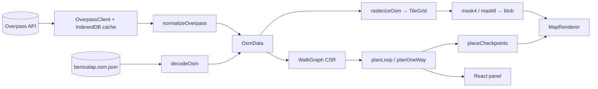

# Map rendering and data: Design

Part of the StepQuest specs; see [../README.md](../README.md). See also: [routing](../routing/requirements.md), [quest](../quest/requirements.md) (route and walker overlays), [retro-ui](../retro-ui/requirements.md) (dialogue box, plural forms).

## Overview

A client-only React app. All heavy lifting is pure TypeScript: OSM normalization, rasterization, auto-tiling and routing run without the DOM and are tested against the bundled Benicalap extract. The renderer is a small canvas engine in the style of old console map engines: a tile grid, a lazily painted tile atlas, cached 32×32-tile chunks, and sprites drawn on top.

## Architecture

## Data model

- `OsmData`: shared node arrays (`lat`, `lon`) plus ways `{ kind, highway, walkable, area, tunnel, crossing, nodes[] }`. Shared node indices encode junctions.
- Compact JSON (`CompactOsm`): delta-encoded 1e-6° integers and flat way rows; the 13.4k-way demo extract is 1.3 MB (≈410 kB gzip) and lazy-loaded.

## Tile grid

- Origin at the bbox's north-west corner, equirectangular projection, 5 m per tile (Benicalap: ≈636 × 646 tiles).
- Roads are thick segments sized by highway class (6–16 m); paths are 4-connected one-tile lines; areas are scanline-filled at tile centres.
- Layer bits per tile, resolved to one terrain. Sidewalks overlapping a drawn carriageway stay road; only `footway=crossing` turns road into zebra.

## Auto-tiling

- `mask4`: N=1, E=2, S=4, W=8. Paths connect to paths, crossings and (one-way) roads.
- `mask8`: N, NE, E, SE, S, SW, W, NW = 1…128; `reduceMask8` clears a diagonal unless both neighbouring cardinals are set → 47 masks (`BLOB_MASKS`).
- The map edge counts as connected so no borders appear at the edge of the loaded area.

## Rendering

- `paintTile(ctx, x, y, spec)` draws a tile from `(terrain, m4, m8, variant, roof, vertical)`; the atlas paints each distinct key once.
- Chunks (32×32 tiles = 512×512 px) are cached with an LRU of 96. Zoom ladder 0.5–48 CSS px per tile; ≥ 8 draws tiles, below that a 1-px-per-tile overview image.
- Overlay: route cells (4-connected rasterization of the polyline) as footprints, numbered checkpoint gems, finish flag, start mat and walker sprite.

## Tile art (task 51)

**Tile catalogue** (`src/render/tileset.ts`, `tileSpecs.ts`, `structures.ts`):

| Tile | Art | Chosen by |
| --- | --- | --- |
| Road | asphalt grain, crack on variant 5, kerb band with paving joints, lit/shaded kerb line, dashed centre line | `m8`, `variant`, `lane` |
| Crossing | grained asphalt, white bars with shaded lower or right row | `vertical` |
| Path, park | packed earth: `pathA/B`, specks, pebbles | `surface` 0 |
| Path, town | 4×4 flagstones in staggered rows, joints, lit corner | `surface` 1 |
| Plaza | slabs with joints and lit corners | `variant`, `m8` |
| Park grass | tufts (2, 3; also edge tiles that would hold a tree), stones (4, 7), flowers (5, 6), tree (0, 1 on interior tiles), bush beside a tree | `variant`, `deco` |
| Water | 3 ripple frames, sand shore, foam that laps with the frame | `frame`, `m8` |
| House | roof style (shingles, seams, clay) from `seed>>>4`, shutters, base course, porch, chimney | house `seed` |
| Apartments | shop front and awning on the ground floor for one seed in three | house `seed` |

**Palette use.** Only `src/render/palette.ts`. Added: `kerbLight`, `pebble`, `awnings` (four stripe pairs). Everything else reuses existing colours (`stone*`, `laneMark`, `waterDeep`, `fenceShade`). Light comes from the top-left.

**Variation scheme.** `tileSpecAt` derives `variant = tileHash(tx, ty) % 8` plus three new fields: `lane` (`laneCode`: contiguous road runs along both axes, the street runs along the clearly longer axis, width 3–9; centre tile of odd widths, one edge row of even widths; bit 8 alternates per tile for the dash pattern), `surface` (0 when any 8-neighbour is park) and `deco` (bush when a 4-neighbour holds a tree). Per-pixel grain uses an integer hash of (x, y, variant). No `Math.random`, no time input, so art depends only on the map position.

**Animation and budget.** `TileSpec.frame` (0–2) is part of `tileKey`, so each frame is one extra atlas slot per distinct water tile (about a dozen). Chunks bake frame 0 and record their water tiles. After the chunks are drawn, `drawWater` redraws the water tiles of painted visible chunks from the atlas when the frame is 1 or 2 and sets a single timer for the next 450 ms boundary; it sets none when no water is visible, at zoom below 8 (overview), or with `prefers-reduced-motion`. Other art adds no per-frame work. Atlas growth: lane (≤ 8 codes), surface (2), deco (2), frame (3) multiply keys only for road, path, grass and water tiles.

## Town and landmarks (Phase 3)

- OSM extras: `barrier=*` lines, `place=square` areas, and landmark points (`shop=supermarket`, hospitals and health centres, stations and subway entrances, schools). Points come from nodes or way/relation centres, are deduplicated per kind (a station's entrances merge) and stored in codec v2 as `[kind, lat×1e6, lon×1e6]` triples; ways gain a style index (park style, barrier type, building type, plaza). v1 data still decodes.
- `layoutTown(grid)` (cached per grid): landmarks first, at the nearest free spot of their size within 9 tiles (on buildings, then half on buildings, then any open ground or plaza); park gates where a footpath enters a big park. Remaining building components are cut by BSP into lots; each lot gets up to three houses placed with a largest-rectangle search, plus a front yard (fence or hedge with a gate in line with the door) or side garden when there is room. Everything is seeded from tile coordinates, so it is stable across reloads.
- Structures are painted after the tiles of each chunk and clipped to it, so they are cached with the chunk; the overview uses roof colours.
- Diagonal streets: a soft tile whose two cardinal neighbours and the diagonal between them are road gets an asphalt triangle in that corner; tiles with three road sides become road.
- Route: the polyline is rasterized to ordered 4-connected cells, staircase corners are dropped, and the band is stamped as a pixel brush along the segments, with arrow heads (9×9, rasterized from one triangle in 8 directions) every 6 cells.
- Walker: `facingFrom(dx, dy, previous)` with a 1.25 axis bias to avoid flicker on diagonals; frames 0-1-0-2 every 140 ms while moving; position tweened between fixes.

## Map without holes (task 50b)

- Root cause: `MapRenderer.render` cleared the canvas to ink black and painted only chunks inside the one loaded grid, each built synchronously in the frame that first needed it. Anything outside the loaded bounding box (the camera may go half a screen beyond it, and zoom 0.5 shows several kilometres) stayed black, and zooming into a big area built many chunks at once and stalled frames. The loaded area was only replaced through a manual "Load this area" button.
- Rendering: the canvas is cleared to the ground colour (`groundB`); the loaded grid rectangle is `groundA`. `chunkPlan.ts` (pure) lists the visible chunks and a one-chunk prefetch ring, both sorted by distance to the screen centre. `drawChunks` paints visible chunks in that order until `CHUNK_BUDGET_MS` (6 ms) is used, always at least one per frame; the others are drawn as a scaled slice of the 1-px-per-tile overview (same palette), and a follow-up frame is requested. When all visible chunks exist, one ring chunk is painted per frame. `LruCache` (96 chunks, or visible + 8 if the screen needs more) never evicts chunks on screen.
- Data: `ui/autoLoad.ts` (`shouldAutoLoad`) decides when a rested view outside the loaded area loads by itself: no download running, no route or quest to lose, and not within 500 m of a failed attempt. `App` waits 1.2 s after the map settles, then calls the existing `loadLiveAround`, so requests still go through `OverpassClient` (cache, single request, 10 s spacing, mirrors). With a plan or quest the "Load this area" button remains. Panning anywhere with several areas merged into one world was not done: the walking graph, tile grid and town layout are built per bounding box.

## Error handling: Overpass

- Overpass errors map to `busy`, `rateLimited`, `tooLarge`, `network`, `badResponse`, each with a translated message.

## Testing strategy

- Unit tests for geo maths, step conversion, tag classification, codec round-trip, Overpass client (mocked fetch: cache, throttling, fallback, size cap), rasterization (connectivity, fills, terrain mix on the fixture), auto-tiling (all masks), the tile painter (pixel probes), sprites, routing on the fixture (targets, feasibility, seeds, stride, robustness over random points), checkpoints, i18n parity and an App smoke test.

## Correctness properties (task 58)

Checked with fast-check (fixed seed `20261204`) in `src/osm/codec.property.test.ts` and `src/render/chunkPlan.property.test.ts`.

- **P-M1 Codec round trip.** For random maps (nodes at 1e-6° precision, ways of every kind with optional highway, style, name, safety flags and roundabout flag, landmarks, industrial rings, activity points), `decodeOsm(encodeOsm(x))` equals `x`, also after a JSON text round trip, and `encode(decode(encode(x)))` equals `encode(x)`. The bundled Benicalap extract survives a re-encode unchanged. Validates 1.1, 1.3.
- **P-D1 Visible chunks covered.** For any camera, zoom, screen size, grid and margin, every chunk that the screen rectangle overlaps (and that lies on the grid) is in `visible`; none is listed twice or in both `visible` and `ring`; chunks outside the screen are not visible; both lists are sorted nearest the centre first and stay inside the grid. Validates 7a.2, 7a.3.
- **P-D2 Cache keeps what is on screen.** For any sequence of insertions with any protected set, a protected chunk already cached is never evicted and the cache exceeds its limit only when everything else in it is protected; `chunkLimit` is at least the base and `visible + 8`, so filling the cache with the prefetch ring and the visible chunks never loses a visible one. Validates 7a.4.

## Day-cycle lighting (task 60)

- **Model** (`src/render/daylight.ts`, pure): `lightingAt(ms, place)` = `lightingFromAltitude(sunAltitude(ms, place))`. A piecewise-linear tint table by altitude (30° white, 12° faint warm, 6° golden, 0° orange, −4° pink-purple, −8° blue-purple, −12° and −18° blue night) gives the multiply colour; `darkness = 1 − luminance(tint)`. Lamp strength is a smoothstep from 4° to −6°, window strength from 2° to −8°, so windows light first, just after sunset. Phases: day ≥ 12°, golden ≥ sunset altitude (`HORIZON` exported from `sun.ts`), dusk ≥ −12°, night below. Dawn and dusk share the table, so the morning mirrors the evening. Civil twilight is part of the table, but routing keeps its own rule (night = below the horizon altitude), untouched.
- **Clock**: `MapRenderer.lighting` caches the value per 30 s; a 60 s timer requests a repaint (no per-frame work). `?time=HH:MM` is parsed by `parseTimeParam` in `MapView` and sets `setClockOverride(minutes)`, which uses that local time of today for lighting only.
- **Compositing** in `render()`: ground, chunks, water, rails, then `multiply` fill of the tint (skipped when darkness ≤ 0.5 %), then lights, then route, gems, walker. The route and sprites are drawn after the tint, so they stay bright. Chunk canvases never contain light, so the cache is the same all day and no chunk is repainted on a phase change.
- **Windows** (`lights.ts`): the real painters run once per building against a recording context that collects the glass rectangles (`P.window`, `P.glass`), so the glow sits exactly on the painted windows. About 70 % are kept by a hash of the building seed, position and window position (cached in a WeakMap). They are drawn as plain `fillRect` in warm yellow at the window strength, for houses and landmarks in visible chunks at detail zoom only.
- **Street lamps** (`lamps.ts`): `Layer.lit` (new raster bit 128) marks road tiles of ways with `SAFETY_LIT`. The data has no lamp nodes, so lamps stand on road kerb tiles on a lattice (every 12 tiles per side, the two sides offset by 6): lit tiles always, wide (≥ 3 tiles) streets as presumed-lit main avenues, and every street ≥ 2 tiles wide when the area has no lit tag at all. Lamps are bucketed per chunk once per grid. Each draws a cached 32-px stepped, dithered glow sprite additively (`lighter`), plus a 2×2 art-pixel bright head.
- **Walker and gems**: an additive glow sprite under the walker (4 tiles wide) and each gem (2.4 tiles) at lamp strength.
- **Performance**: one full-canvas fill per frame, plus at detail zoom a few hundred `fillRect` and `drawImage` calls of a cached sprite for the visible chunks. Nothing runs at far zoom except the tint.
- **Reduced motion**: lights are static, so there is nothing to switch off.
- **Testing**: `daylight.test.ts` (phases, golden before sunset, dusk exactly when `isDark`, parser, preview clock), `daylight.property.test.ts` (P-L1 to P-L4), `lights.test.ts` (windows on glass and stable, lit raster bit, lamp lattice and lit rule on a synthetic grid), `nightRender.test.ts` (renderer uses multiply and lights at night, not at noon).

### Correctness properties (task 60)

Fast-check, seed `20261204`, in `src/render/daylight.property.test.ts`.

- **P-L1 Bounds.** For any altitude, time and place, tint channels are integers in 0 to 255, darkness, lamps and windows lie in 0 to 1. Validates 9.3.
- **P-L2 Monotonic in altitude.** A lower sun never gives less darkness, lamp or window strength. Validates 9.3.
- **P-L3 Evening is continuous and monotonic.** For random places and days, from 3 h before to 3 h after sunset, darkness never decreases and changes by under 0.02 per minute. Validates 9.3.
- **P-L4 Morning mirror.** From 3 h before to 3 h after sunrise, darkness never increases. Validates 9.3.
