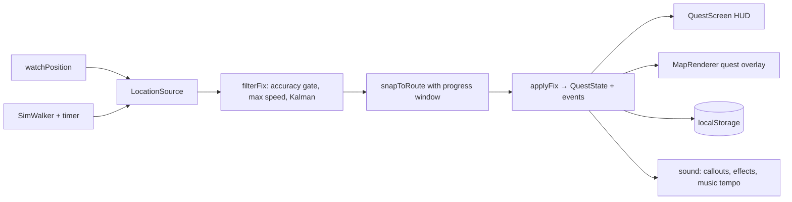
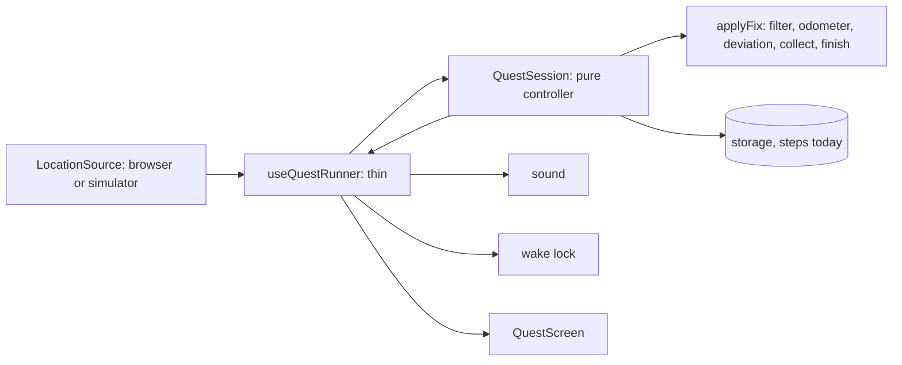

# Quest (GPS, gems, simulation): Design

Part of the StepQuest specs; see [../README.md](../README.md). See also: [routing](../routing/requirements.md) (rerouting, Requirement 7c), [voice-audio](../voice-audio/requirements.md) (callouts), [retro-ui](../retro-ui/requirements.md).

## Active quest (Phase 2)

- `QuestState` is plain JSON (route, stride, area reference, filter state, odometer, progress, collected count, timestamps, simulation settings) so it can be saved after every event and at most once a second otherwise.
- `applyFix` is a pure reducer; the UI only renders state and reacts to events (`collected`, `finished`, `offRoute`, `backOnRoute`, `rejected`).
- Time and pace use fix timestamps, so the simulator's warped clock produces realistic stats.
- The browser cannot track with the screen off; the wake lock keeps the screen on and the saved state covers reloads and gaps.

## Finish (Phase 3)

- Finish: the `finished` event stops the location source (`clearWatch`) and releases the wake lock; later fixes and errors are ignored and the HUD shows no warnings.

## Architecture review (Nov 2026)

Read of `src/quest/**`, `src/ui/useQuestRunner.ts`, `src/ui/QuestScreen.tsx`, the wake lock, the simulator and `dailySteps`, against requirements 6 and 6b. Method: read every module, then probe suspected defects with throw-away scripts before writing them down (the odometer figures below were measured, not guessed).

### Current structure

- `gpsFilter.ts`: `filterFix` (accuracy gate, speed gate, 1-D Kalman) and `advanceOdometer` (anchor-based).
- `quest.ts` (331 lines): state types, config, `createQuest`, the `applyFix` reducer, deviation judging, pickup radius, stats, route-distance-to-next, formatters.
- `snap.ts` (route geometry), `reroute.ts` (patch planning and `applyReroute`), `storage.ts` (save, load), `dailySteps.ts`, `wakeLock.ts`, `geolocation.ts` (browser source), `simulate.ts` and `simSource.ts` (virtual walker), `compass.ts`.
- `useQuestRunner.ts`: React hook that owns the quest ref, the location source, sound, wake lock, throttled saving, reroute tickets and error state. `QuestScreen.tsx` renders and also decides the signal message (lost, weak) inline.
- `App.tsx` credits "steps today" when the user presses End or New quest.

### Problems found

1. **Odometer counts steps while standing (measured).** The threshold was `clamp(0.5 × Kalman sd, 4, 15)`. A walker standing still with realistic noise (σ 5 m, reported accuracy 8 m) gains about 120 m in 10 minutes (160 phantom steps); with σ 12 m about 320 m; at accuracy 40 m about 1.5 km. Requirement 6.2 says "jitter-proof". (6b.6)
2. **"Three agreeing outliers" only counts to three.** `rejects` is incremented for any too-fast fix, so three unrelated glitches in a row (for example the simulator's glitches or multipath) move the filter to the last of them. The comment and requirement say the fixes must agree. The speed gate also adds only the new fix's accuracy, not the previous one's, so two poor fixes a second apart can be called "too fast". (6b.5)
3. **Accuracy 0, NaN or missing** is rejected as `inaccurate` and raises the weak-signal hint forever. In `applyFix` the off-route threshold would be NaN for such a value (`Math.max(40, NaN)`) and the walker would count as always off-route. Invalid coordinates are also reported as `inaccurate`. (6b.1, 6b.2)
4. **Time goes backwards or forwards.** A fix with a timestamp in the future, or a clock set back, makes every later fix `stale` and the quest freezes for good. Browsers can also hand back a cached position with an old timestamp after the page was in the background; nothing checks its age against the clock. (6b.3, 6b.4)
5. **A gem can be skipped for good.** "Walked past" required the advance along the route to be at most 400 m per fix, whatever the time between fixes. After a 10-minute gap (page in the background, tunnel) the walker is 700 m on, the gem 400 m back is not collected, and since gems go in order the quest can never finish. The same limit also allowed a 600 m teleport in 1 s up to 400 m. The rule needs the elapsed time. (6b.7)
6. **A jump accepted after outliers is walked distance.** It adds the whole straight-line jump to the odometer. (6b.6)
7. **Off-route has no hysteresis.** One fix with a snap just under the threshold clears the deviation: `offStart` (with its reroute retry distance) is lost and `lost` ends with a `backOnRoute` event, so the message and the reroute can flap. `backOnRoute` is also not emitted when `lost` ends because the walker heads for the gem again, which leaves the voice silent about a message that has disappeared. (6b.9)
8. **Reroute race.** `patchFits` checks quest id, reroute count and not finished. A gem collected while the worker was busy leaves the patch built for `collected = k` applied at `k + 1`: the gem the walker just collected is replaced by a newly placed one and the numbering shifts. A patch also still applies after the walker has returned to the old route, replacing the route with a leg from a position they have left, and sets `alongM` to 0. The `.then` has no `catch`, so a rejected promise is an unhandled rejection. (6b.10)
9. **Saved quest format.** `isQuest` accepts any `collected` number (NaN, negative, larger than the route) so a corrupt save finishes at the next fix; stride 0 gives Infinity steps. A save with another `v` is deleted (a downgrade destroys a quest, and there is no migration path for an upgrade). The saved route is never compared with the map that was loaded: a demo extract that changed leaves a quest on a map that does not contain it. (6b.8, 6b.11)
10. **Steps today.** Credited only in `App.endQuest`, at the wall-clock day of pressing the button. A walk finished before midnight and closed after it counts for the next day; a quest that is never ended, or expires after 24 h, counts for nothing; a real walk switched to the simulator loses its real part. (6b.12)
11. **Wake lock.** A visibility change while the first request is still pending starts a second request; the first sentinel is overwritten and never released, so the screen stays on after the quest. A request that resolves after `release()` is stored in `sentinel`, so `active()` can report a lock that was released. `wakeActive` in the hook is a single `setTimeout(500)` read that is neither cleared nor updated when the lock is lost or regained. (6b.13)
12. **Hook leaks and edge cases.** The location error callback treats "no quest" as "quest not finished" (`undefined === undefined`), so a late error after ending sets an error. Unmount does not drop pending reroute answers (they would save a quest after the page left). The simulator keeps emitting the rest of a tick after `stop()` was called from inside `onFix`. The signal message (lost 30 s, weak 5 s) is decided inline in the component and untested. (6b.14, 6b.16)
13. **Module boundaries.** `quest.ts` mixes types, config, five concerns of the reducer and the view helpers; `useQuestRunner.ts` mixes pure rules (save throttle, reroute ticket, finish handling, step credit) with React and Web Audio. Neither can be tested without the other. (6b.15)
14. **Dead or misplaced code.** `testWalk.ts` is a test helper that lives next to production code. `QuestStats.remainingM` is computed and read by nothing in the UI. `LocationSource` offers an error channel the simulator ignores (kept: it is the interface). `WakeLockSentinelLike.addEventListener` was declared and never used.

Checked and found fine: duplicate gems from one fix (the collect loop is monotonic and ordered), two gems close together (both collected in order from one fix), a loop that starts at its flag (finish needs the whole count), finish ignoring later fixes, resume of a simulated walk (clock continues from `lastFixAt`), pending reroute after End (ticket bump), the 22 to 35 m pickup radius.

### Target design

- `state.ts`: `QuestState`, `QuestEvent`, `QuestConfig`, `createQuest`, `trackFor`. Plain JSON, the versioned save format.
- `deviation.ts`: off-route threshold with hysteresis, `judgeDeviation`.
- `collect.ts`: `collectCheckpoints` (pure, ordered, exactly once, time-aware passing).
- `machine.ts`: `applyFix`, composing filter, odometer, deviation and collection. No I/O.
- `stats.ts`: `questStats`, `routeToNext`, formatters. `signal.ts`: `signalStatus`. `quest.ts` stays as the public entry that re-exports them, so imports do not change.
- `gpsFilter.ts`: input normalisation (`invalid`, unknown accuracy), outlier agreement, clock recovery, odometer with a noise-based threshold. `fixFreshness.ts`: age check for browser fixes.
- `migrate.ts`: `migrateQuest` (version chain, validation) used by `storage.ts`; `routeNearBbox` for the map check.
- `session.ts`: `QuestSession` owns the current state and the rules around it: applies fixes, decides when to save (events at once, otherwise once a second), credits steps, numbers reroute requests (latest wins), accepts or refuses a patch, closes the quest. It takes the store and the step credit as parameters, so tests use fakes.
- `useQuestRunner.ts`: creates the session, starts and stops the source and wake lock, plays sound from the events the session returns, mirrors the state into React. No quest rules.
- `wakeLock.ts`: one sentinel at most, a pending flag, an `onChange` callback.

### Rationale

- Threshold for the odometer: probed with 20 seeds of 10 minutes at σ 3 to 25 m (reported accuracy about 1.6 σ). Standing drift in 10 minutes with the old rule: 58 m (σ 3), 119 m (σ 5), 207 m (σ 8). With a threshold of k × accuracy: k = 1.5 gave 5, 6, 27 m for σ 3, 5, 8; k = 2 gave 1, 3, 14 m, and 30 m at σ 12. Walking at 1.4 m/s (840 m true) read 837, 830, 830 m at k = 2 (within 1.5 %). k = 2 is the smallest factor that stays under 15 m up to σ 8. The price is up to two accuracy radii not counted at the very end of a walk.
- Time-aware passing: 3 m/s is twice a brisk walk, so a walker or a slow tunnel exit can be credited with gems on the line, while a 600 m jump in a second cannot. The old 400 m cap is replaced, not kept as a minimum, because it let a teleport collect gems.
- Hysteresis 70 %: a walker has to be clearly back on the line before the deviation resets. The factor is a judgement (it is not derived from a measurement); it is a `QuestConfig` field so it can be tuned.
- Step credit on save instead of on End: saves already happen at most once per second and on every event, and `creditedSteps` in the saved quest makes the credit idempotent across reloads. The cost is one extra small `localStorage` write per save.
- A session class rather than more hook refs: the rules need to run in tests without React, and the property tests drive the session with random traces. A reducer alone cannot own the reroute ticket and the save throttle, which are state about time.
- Not changed on purpose: elapsed time counts wall time including pauses (a "moving time" needs a decision from the product owner); the walker is not told in the UI when a saved quest was left behind on a map that could not be loaded (it needs new strings).

### Behaviour changes (all deliberate)

1. Standing still no longer adds steps; walking distance is counted in chunks of at most 30 m (twice the accuracy) and the last chunk is not counted until it is complete.
2. Accuracy 0 or missing is accepted as 20 m; invalid coordinates are `invalid`, not `inaccurate`.
3. A jump is accepted after three outliers that agree with each other (before: any three), and its odometer share is capped.
4. A gem passed in a long gap is collected; a gem "passed" by a teleport is not.
5. A reroute answer for another gem count or for a walker who is back on the route is ignored. The next off-route stretch asks again after 80 m.
6. Back-on-route needs 70 % of the off-route distance. `backOnRoute` is also emitted when the "left the route" message ends because the walker heads for the gem again.
7. Saved quests are version 2. Version 1 saves are migrated on load. Steps today are credited as walked, for the day of the fix.
8. The off-route decision (20 m of real walking) can come one fix later than before, because the odometer now counts in chunks of up to 12 m at typical accuracy; the "reroute within N m of the corner" test went from 90 m to 100 m.
9. Returning to the route after a long gap takes one more fix: the smoother still lags behind the new position, and the walker must be within 70 % of the threshold.
10. A resumed quest is checked against the loaded map (`routeNearBbox`); a demo quest that does not fit is discarded.
11. Gentle rerouting toward the next gem still shows no "you left the route" message, and the ×1 to ×120 simulator is unchanged for the user.

### Outcome (tasks 64.1 to 64.13)

- Modules: `state.ts`, `deviation.ts`, `collect.ts`, `machine.ts`, `stats.ts`, `signal.ts`, `session.ts`, `migrate.ts`, `fixFreshness.ts` added; `quest.ts` re-exports. `useQuestRunner.ts` shrank from 234 to about 200 lines and holds no quest rule.
- Observed, not changed: the Kalman smoother lags the walker by about 10 m when fixes come every 8 s (about 5 m at one fix per second). It delays pickups slightly (a gem is collected when the smoothed position is in range). Tuning `processNoise` is a separate decision.
- Known limit: the first odometer anchor is a raw fix, so a standing walker can gain one threshold-sized chunk (up to about 13 m at 4 m noise) at the start, never more over time.
- Not done on purpose: the walker is not told in the UI when a saved live-map quest could not be resumed because its map failed to load (needs new EN and ES strings); moving time versus elapsed time.
- Tests: `runnerReview.test.ts` (regressions), `persistence.test.ts`, `session.test.ts`, `signal.test.ts`, `wakeLock.test.ts`, `sources.test.ts`, `trace.property.test.ts` (random noisy traces), and additions to `useQuestRunner.test.tsx`. A mutation check (odometer factor 2 to 0.5) makes the standing-still tests fail, as it should.

## Step counting review (Nov 2026)

Scope: `src/geo/steps.ts`, `ui/settings.ts`, `ui/numberInput.ts`. Requirement 6c, tasks 69.11 and 69.12.

- **B14** Typed strides were rounded to 1 cm (`commitStride`), but a saved stride went only through `clampStride`, so a stored 0.7549 showed as 0.75 and planned with 0.7549. New `roundStride` (clamp then round to 1 cm); `sanitizeSettings` uses it.
- Checked and correct: steps ↔ metres round trip is exact for every goal 100 to 60,000 and stride 0.40 to 1.20 in 1 cm steps (property test; the division and multiplication error is far below half a step). `withinTolerance` is exact at the 5 % edge for integer goals (checked for all goals 100 to 60,000). `strideFromHeightCm` never leaves the bounds and does not decrease with height, also for NaN and infinities.
- Not changed: `stepsToMetres` and `metresToSteps` still clamp their stride argument silently, so a caller that skips `roundStride` gets the clamped value. The app's entry points all go through `clampSteps`, `commitStride` or `sanitizeSettings`.

Tests: `geo/review.test.ts`, `ui/settings.test.ts`.

## Streamed world (map-rendering requirement 19)

New map cells may arrive during a quest. They only add drawing and graph edges: the quest state, its route, gems and progress are never changed by an arrival, the renderer keeps its grid object, and cells within one cell of the route are never evicted. A reroute started after an arrival uses the bigger graph. On resume, the cached cells under the saved route are added before the "route fits the map" check. Tested in `world/liveWorld.test.ts`. See [map-rendering design](../map-rendering/design.md#streaming-multi-area-world-requirement-19-task-70).
