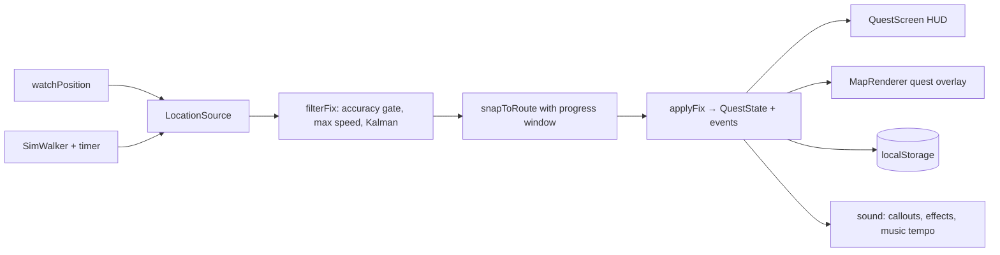

# Quest (GPS, gems, simulation): Design

Part of the StepQuest specs; see [../README.md](../README.md). See also: [routing](../routing/requirements.md) (rerouting, Requirement 7c), [voice-audio](../voice-audio/requirements.md) (callouts), [retro-ui](../retro-ui/requirements.md).

## Active quest (Phase 2)

- `QuestState` is plain JSON (route, stride, area reference, filter state, odometer, progress, collected count, timestamps, simulation settings) so it can be saved after every event and at most once a second otherwise.
- `applyFix` is a pure reducer; the UI only renders state and reacts to events (`collected`, `finished`, `offRoute`, `backOnRoute`, `rejected`).
- Time and pace use fix timestamps, so the simulator's warped clock produces realistic stats.
- The browser cannot track with the screen off; the wake lock keeps the screen on and the saved state covers reloads and gaps.

## Finish (Phase 3)

- Finish: the `finished` event stops the location source (`clearWatch`) and releases the wake lock; later fixes and errors are ignored and the HUD shows no warnings.
