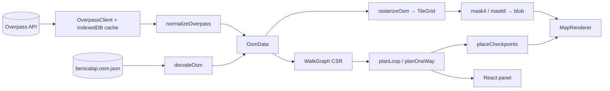
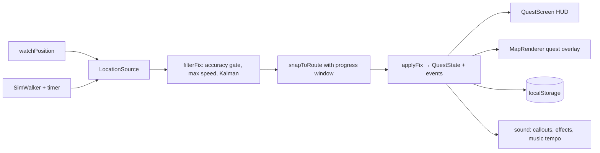
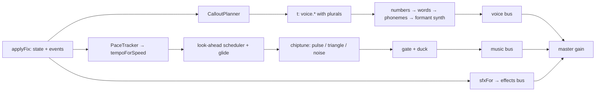

# Design Document

## Overview

A client-only React app. All heavy lifting is pure TypeScript: OSM normalization, rasterization, auto-tiling and routing run without the DOM and are tested against the bundled Benicalap extract. The renderer is a small canvas engine in the style of old console map engines: a tile grid, a lazily painted tile atlas, cached 32×32-tile chunks, and sprites drawn on top.

## Architecture

## Data model

- `OsmData`: shared node arrays (`lat`, `lon`) plus ways `{ kind, highway, walkable, area, tunnel, crossing, nodes[] }`. Shared node indices encode junctions.
- Compact JSON (`CompactOsm`): delta-encoded 1e-6° integers and flat way rows; the 13.4k-way demo extract is 1.3 MB (≈410 kB gzip) and lazy-loaded.

## Tile grid

- Origin at the bbox's north-west corner, equirectangular projection, 5 m per tile (Benicalap: ≈636 × 646 tiles).
- Roads are thick segments sized by highway class (6–16 m); paths are 4-connected one-tile lines; areas are scanline-filled at tile centres.
- Layer bits per tile, resolved to one terrain. Sidewalks overlapping a drawn carriageway stay road; only `footway=crossing` turns road into zebra.

## Auto-tiling

- `mask4`: N=1, E=2, S=4, W=8. Paths connect to paths, crossings and (one-way) roads.
- `mask8`: N, NE, E, SE, S, SW, W, NW = 1…128; `reduceMask8` clears a diagonal unless both neighbouring cardinals are set → 47 masks (`BLOB_MASKS`).
- The map edge counts as connected so no borders appear at the edge of the loaded area.

## Rendering

- `paintTile(ctx, x, y, spec)` draws a tile from `(terrain, m4, m8, variant, roof, vertical)`; the atlas paints each distinct key once.
- Chunks (32×32 tiles = 512×512 px) are cached with an LRU of 96. Zoom ladder 0.5–48 CSS px per tile; ≥ 8 draws tiles, below that a 1-px-per-tile overview image.
- Overlay: route cells (4-connected rasterization of the polyline) as footprints, numbered checkpoint gems, finish flag, start mat and walker sprite.

## Routing

- Graph: walkable ways only, clipped to the loaded bbox; CSR adjacency; components labelled, snapping only to the largest one (≤ 150 m).
- A* with a straight-line heuristic and a per-edge cost multiplier; each leg of a multi-stop route multiplies already-used edges by 6 to avoid retracing.
- Loop: triangle start → P1 → P2 → start, P1/P2 at a size `r` along a seeded bearing with a 70–110° spread. `r` is tuned by a damped secant step (≤ 7 iterations) until length is within ±5 %; up to 8 bearings are tried.
- A→B: shortest path first (too short / direct match). Otherwise two detour shapes (one via point off the A–B line, or a two-point "bracket") on both sides and at 3 anchor positions, each tuned the same way.
- Score: within tolerance first, then least overlap. "Too long" reports the longest route found.

## Active quest (Phase 2)

- `QuestState` is plain JSON (route, stride, area reference, filter state, odometer, progress, collected count, timestamps, simulation settings) so it can be saved after every event and at most once a second otherwise.
- `applyFix` is a pure reducer; the UI only renders state and reacts to events (`collected`, `finished`, `offRoute`, `backOnRoute`, `rejected`).
- Time and pace use fix timestamps, so the simulator's warped clock produces realistic stats.
- The browser cannot track with the screen off; the wake lock keeps the screen on and the saved state covers reloads and gaps.

## Town and landmarks (Phase 3)

- OSM extras: `barrier=*` lines, `place=square` areas, and landmark points (`shop=supermarket`, hospitals and health centres, stations and subway entrances, schools). Points come from nodes or way/relation centres, are deduplicated per kind (a station's entrances merge) and stored in codec v2 as `[kind, lat×1e6, lon×1e6]` triples; ways gain a style index (park style, barrier type, building type, plaza). v1 data still decodes.
- `layoutTown(grid)` (cached per grid): landmarks first, at the nearest free spot of their size within 9 tiles (on buildings, then half on buildings, then any open ground or plaza); park gates where a footpath enters a big park. Remaining building components are cut by BSP into lots; each lot gets up to three houses placed with a largest-rectangle search, plus a front yard (fence or hedge with a gate in line with the door) or side garden when there is room. Everything is seeded from tile coordinates, so it is stable across reloads.
- Structures are painted after the tiles of each chunk and clipped to it, so they are cached with the chunk; the overview uses roof colours.
- Diagonal streets: a soft tile whose two cardinal neighbours and the diagonal between them are road gets an asphalt triangle in that corner; tiles with three road sides become road.
- Route: the polyline is rasterized to ordered 4-connected cells, staircase corners are dropped, and the band is stamped as a pixel brush along the segments, with arrow heads (9×9, rasterized from one triangle in 8 directions) every 6 cells.
- Walker: `facingFrom(dx, dy, previous)` with a 1.25 axis bias to avoid flicker on diagonals; frames 0-1-0-2 every 140 ms while moving; position tweened between fixes.
- Dialogue: `DialogueBox` (typewriter at 28 ms per character, skip / next on tap, Enter or Space, auto-close for pickups and the start). Priority: finish, then pickup, then start.
- Plurals: templates use `{n|one|other}` (with `#` for the value), resolved by `Intl.PluralRules` for the active locale; formatted numbers are read by their digits.
- Finish: the `finished` event stops the location source (`clearWatch`) and releases the wake lock; later fixes and errors are ignored and the HUD shows no warnings.

## Sound (Phase 4)

- Everything that decides what to play is pure and tested (`callouts.ts`, `tempo.ts`, `scheduler.ts`, `chiptune.ts`, `sfx.ts`, `voiceQueue.ts`, `voice/*`). `engine.ts` is the only Web Audio code.
- Voice: text from the i18n dictionaries, numbers spelled out (`spellNumbersInText`), words to phonemes (`g2p.ts`), then `renderPhones` at 22.05 kHz into an AudioBuffer (cached, LRU of 24). A phrase takes a few tens of milliseconds to render.
- Synth: per sample, a Rosenberg glottal pulse (differentiated) and LCG noise feed four cascaded two-pole resonators (F1–F3 from the phoneme, F4 fixed); fricatives add band-filtered hiss; stops have a closure and a burst. Formants glide over the first 30 ms of each phoneme; amplitudes are smoothed over 5 ms. Pitch: base 112 Hz, falling over the sentence, raised on stressed vowels, snapped to semitones; output normalized and quantized to 6 bits.
- Music: `makeSong(seed)` builds 16 bars (A A' B A) from a common progression; melody bars come from rhythm templates and a chord-tone-on-strong-beat rule; arpeggio, bass pattern and drums from simple rules. Songs follow each other with seed + 1. The scheduler fills a 150 ms look-ahead window every 25 ms; the tempo glides towards one beat per step (84–150 BPM) at most 12 BPM per second. With no walking (speed under 0.35 m/s over 12 s of fixes, or no fix for 10 s) the music gate fades out and scheduling stops; it restarts at the new tempo.
- Unlocking: the context is created in the "Start quest", sound button or "Use simulation" tap; listeners on tap, key, visibility, pageshow and focus resume it after an interruption. Where Safari exposes `navigator.audioSession`, its type is set to "playback".
- Speech bubbles (task 50): the voice queue is the single source of truth. `AudioEngine.say` always pushes to the `VoiceQueue`; the phrase that starts playing becomes `snapshot.phrase` (`{ id, text }`) and is cleared when the source ends, is interrupted, or `stopVoice` runs (including muting). When audio cannot speak (no context yet, muted, voice volume 0, context not running) the phrase is "played" silently: a timer of `bubbleDurationMs(text)` (1000 ms + 70 ms per character, 1.8 to 7 s) takes the place of the buffer's end and then advances the queue the same way. `QuestScreen` passes `phrase.text` to `MapView`, which calls `MapRenderer.setBubble`. The renderer draws the bubble after the walker: ink outline with notched corners, paper fill, blue inner rule, stepped shadow and tail, text in Press Start 2P at 8 CSS px wrapped by `wrapBubbleText`, to the right of the head or to the left near the screen edge, clamped to the canvas. No animation, so reduced motion needs no special case. Text is already translated when queued, so the bubble follows the app language.

## Error handling

- Overpass errors map to `busy`, `rateLimited`, `tooLarge`, `network`, `badResponse`, each with a translated message.
- Planner failures return a reason plus min/max steps and the closest route for preview; the UI offers a one-tap "Use N steps".

## Testing strategy

- Unit tests for geo maths, step conversion, tag classification, codec round-trip, Overpass client (mocked fetch: cache, throttling, fallback, size cap), rasterization (connectivity, fills, terrain mix on the fixture), auto-tiling (all masks), the tile painter (pixel probes), sprites, routing on the fixture (targets, feasibility, seeds, stride, robustness over random points), checkpoints, i18n parity and an App smoke test.
