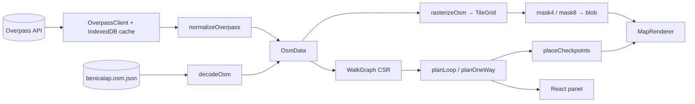

# Design Document

## Overview

A client-only React app. All heavy lifting is pure TypeScript: OSM normalization, rasterization, auto-tiling and routing run without the DOM and are tested against the bundled Benicalap extract. The renderer is a small canvas engine in the style of old console map engines: a tile grid, a lazily painted tile atlas, cached 32×32-tile chunks, and sprites drawn on top.

## Architecture

## Data model

- `OsmData`: shared node arrays (`lat`, `lon`) plus ways `{ kind, highway, walkable, area, tunnel, crossing, nodes[] }`. Shared node indices encode junctions.
- Compact JSON (`CompactOsm`): delta-encoded 1e-6° integers and flat way rows; the 13.4k-way demo extract is 1.3 MB (≈410 kB gzip) and lazy-loaded.

## Tile grid

- Origin at the bbox's north-west corner, equirectangular projection, 5 m per tile (Benicalap: ≈636 × 646 tiles).
- Roads are thick segments sized by highway class (6–16 m); paths are 4-connected one-tile lines; areas are scanline-filled at tile centres.
- Layer bits per tile, resolved to one terrain. Sidewalks overlapping a drawn carriageway stay road; only `footway=crossing` turns road into zebra.

## Auto-tiling

- `mask4`: N=1, E=2, S=4, W=8. Paths connect to paths, crossings and (one-way) roads.
- `mask8`: N, NE, E, SE, S, SW, W, NW = 1…128; `reduceMask8` clears a diagonal unless both neighbouring cardinals are set → 47 masks (`BLOB_MASKS`).
- The map edge counts as connected so no borders appear at the edge of the loaded area.

## Rendering

- `paintTile(ctx, x, y, spec)` draws a tile from `(terrain, m4, m8, variant, roof, vertical)`; the atlas paints each distinct key once.
- Chunks (32×32 tiles = 512×512 px) are cached with an LRU of 96. Zoom ladder 0.5–48 CSS px per tile; ≥ 8 draws tiles, below that a 1-px-per-tile overview image.
- Overlay: route cells (4-connected rasterization of the polyline) as footprints, numbered checkpoint gems, finish flag, start mat and walker sprite.

## Routing

- Graph: walkable ways only, clipped to the loaded bbox; CSR adjacency; components labelled, snapping only to the largest one (≤ 150 m).
- A* with a straight-line heuristic and a per-edge cost multiplier; each leg of a multi-stop route multiplies already-used edges by 6 to avoid retracing.
- Loop: triangle start → P1 → P2 → start, P1/P2 at a size `r` along a seeded bearing with a 70–110° spread. `r` is tuned by a damped secant step (≤ 7 iterations) until length is within ±5 %; up to 8 bearings are tried.
- A→B: shortest path first (too short / direct match). Otherwise two detour shapes (one via point off the A–B line, or a two-point "bracket") on both sides and at 3 anchor positions, each tuned the same way.
- Score: within tolerance first, then least overlap. "Too long" reports the longest route found.

## Error handling

- Overpass errors map to `busy`, `rateLimited`, `tooLarge`, `network`, `badResponse`, each with a translated message.
- Planner failures return a reason plus min/max steps and the closest route for preview; the UI offers a one-tap "Use N steps".

## Testing strategy

- Unit tests for geo maths, step conversion, tag classification, codec round-trip, Overpass client (mocked fetch: cache, throttling, fallback, size cap), rasterization (connectivity, fills, terrain mix on the fixture), auto-tiling (all masks), the tile painter (pixel probes), sprites, routing on the fixture (targets, feasibility, seeds, stride, robustness over random points), checkpoints, i18n parity and an App smoke test.
