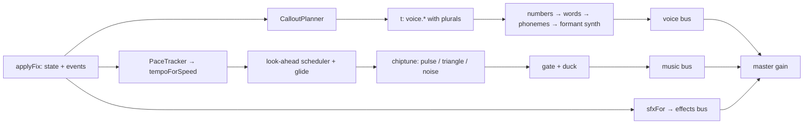
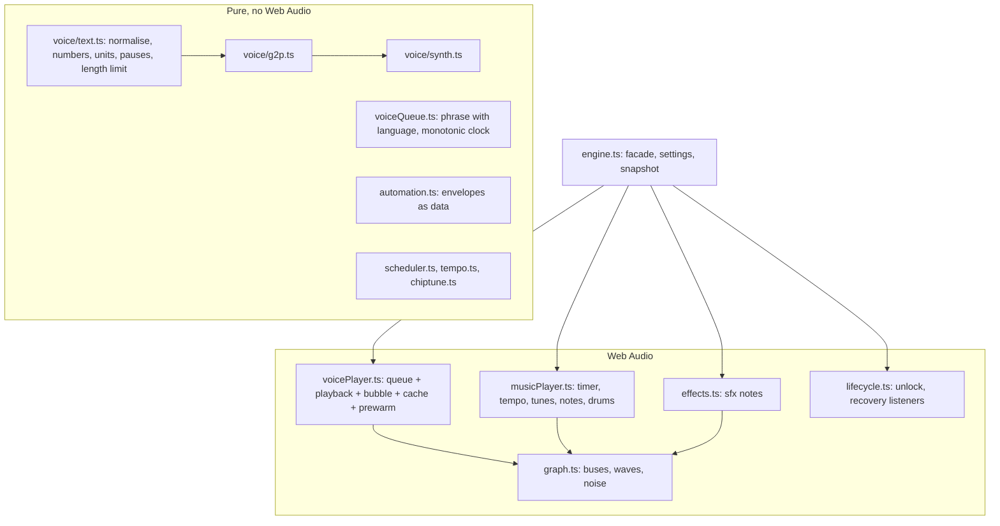

# Voice and audio: Design

Part of the StepQuest specs; see [../README.md](../README.md). See also: [quest](../quest/requirements.md) (events that trigger callouts), [map-rendering](../map-rendering/requirements.md) (the speech bubble is drawn by the map renderer).

## Sound (Phase 4)

- Everything that decides what to play is pure and tested (`callouts.ts`, `tempo.ts`, `scheduler.ts`, `chiptune.ts`, `sfx.ts`, `voiceQueue.ts`, `voice/*`). `engine.ts` is the only Web Audio code.
- Voice: text from the i18n dictionaries, numbers spelled out (`spellNumbersInText`), words to phonemes (`g2p.ts`), then `renderPhones` at 22.05 kHz into an AudioBuffer (cached, LRU of 24). A phrase takes a few tens of milliseconds to render.
- Synth: per sample, a Rosenberg glottal pulse (differentiated) and LCG noise feed four cascaded two-pole resonators (F1–F3 from the phoneme, F4 fixed); fricatives add band-filtered hiss; stops have a closure and a burst. Formants glide over the first 30 ms of each phoneme; amplitudes are smoothed over 5 ms. Pitch: base 112 Hz, falling over the sentence, raised on stressed vowels, snapped to semitones; output normalized and quantized to 6 bits.
- Music (the tune is now the composed loop of the [chiptune](../chiptune/design.md) spec; the rest of this note still holds for scheduling and tempo): `makeSong(seed)` built 16 bars (A A' B A) from a common progression; melody bars come from rhythm templates and a chord-tone-on-strong-beat rule; arpeggio, bass pattern and drums from simple rules. Songs follow each other with seed + 1. The scheduler fills a 150 ms look-ahead window every 25 ms; the tempo glides towards one beat per step (84–150 BPM) at most 12 BPM per second. With no walking (speed under 0.35 m/s over 12 s of fixes, or no fix for 10 s) the music gate fades out and scheduling stops; it restarts at the new tempo.
- Unlocking: the context is created in the "Start quest", sound button or "Use simulation" tap; listeners on tap, key, visibility, pageshow and focus resume it after an interruption. Where Safari exposes `navigator.audioSession`, its type is set to "playback".
- Speech bubbles (task 50): the voice queue is the single source of truth. `AudioEngine.say` always pushes to the `VoiceQueue`; the phrase that starts playing becomes `snapshot.phrase` (`{ id, text }`) and is cleared when the source ends, is interrupted, or `stopVoice` runs (including muting). When audio cannot speak (no context yet, muted, voice volume 0, context not running) the phrase is "played" silently: a timer of `bubbleDurationMs(text)` (1000 ms + 70 ms per character, 1.8 to 7 s) takes the place of the buffer's end and then advances the queue the same way. `QuestScreen` passes `phrase.text` to `MapView`, which calls `MapRenderer.setBubble`. The renderer draws the bubble after the walker: ink outline with notched corners, paper fill, blue inner rule, stepped shadow and tail, text in Press Start 2P at 8 CSS px wrapped by `wrapBubbleText`, to the right of the head or to the left near the screen edge, clamped to the canvas. No animation, so reduced motion needs no special case. Text is already translated when queued, so the bubble follows the app language.

## Correctness properties (task 59)

Checked with fast-check (fixed seed `20261204`) in `src/audio/speechBubble.property.test.ts`.

- **P-V1 Wrapping keeps all the text.** For any text and width 1–40, every line of `wrapBubbleText` is non-empty and at most the width; the lines hold the same characters in the same order as the text once whitespace is ignored; when no word is longer than the width, the words are unchanged. Validates 7.7.
- **P-V2 Silent bubble time.** `bubbleDurationMs` is between 1.8 s and 7 s and never decreases for longer text. Validates 7.8.

## Architecture review (Nov 2026)

Scope: everything in `src/audio/**`. Method: read the code against requirement 7, probe it with a throwaway script (numbers, accents, punctuation, odd options), profile the synthesizer, and walk the engine through suspend, interruption and mute with the fake AudioContext.

### Structure before the review

| File | Lines | Concern |
| --- | --- | --- |
| `engine.ts` | 568 | Buses, unlock and recovery, sound effects, voice queue playback, bubble state, speech cache, ducking, music scheduling, note and drum synthesis, wave tables |
| `voice/synth.ts` | 550 | Parameter tracks, resonators, rendering, `renderText` |
| `voice/g2p.ts`, `numbers.ts` | 216, 83 | Letter-to-sound, numbers; punctuation handling hides in `textToPhones` |
| `voiceQueue.ts`, `speechBubble.ts`, `scheduler.ts`, `tempo.ts`, `chiptune.ts`, `sfx.ts`, `settings.ts`, `callouts.ts` | small, pure | Fine as they are |

`engine.ts` is the only Web Audio file, which is right, but it holds six concerns, so the voice player and the music player cannot be tested or reasoned about alone.

### Problems found

Bugs (each has a regression test, task 62.9):

| Id | Where | Problem |
| --- | --- | --- |
| B1 | `numbers`/`g2p` | "1.5 km" became "one. five": the full stop is a sentence pause (Spanish "1,5" became "uno, cinco"). |
| B2 | `numbers`/`g2p` | A number of 1e9 or more stays as digits, and `g2p` drops digits, so "5000000000 steps" was spoken as "steps". |
| B3 | `numbers` | An ordinary space counted as a thousand separator, so "3 100" was read as 3100. |
| B4 | `g2p` | Decomposed ñ (n + U+0303) split the word in two and lost the tilde. In English "café" lost its "é" ("caf"). |
| B5 | `g2p` | "!!", "..." and "?!," stacked 300 ms pauses (600 ms to 1 s of silence). |
| B6 | `g2p` | Units were spelled as letters ("km" as "K M"). |
| B7 | `synth` | `speed: 0` threw `RangeError: Invalid typed array length: Infinity`. One non-finite sample made the peak NaN and the whole phrase NaN. |
| B8 | engine/synth | No limit on phrase length: a 2,000-character text blocks the main thread for seconds and produces minutes of audio. |
| B9 | `engine.say` | The language was one engine field, not part of the queued phrase: after a language switch, queued Spanish text was synthesized with English rules. |
| B10 | `engine.play` | An exception in the synthesizer or in `createBuffer` left `queue.playing` set, so no later phrase was ever spoken. |
| B11 | `engine.playPhrase` | When the context is interrupted or closed, `onended` may never fire: queue and bubble stay stuck until the quest ends. |
| B12 | `engine.stopSource` | `source.stop()` at full level on a cut-in or mute: an audible click. |
| B13 | `engine.applyGains`, `duck`, `gate` | `cancelScheduledValues` followed by `setTargetAtTime` restarts from the static `value` in Firefox and Safari: a jump (pop) when changing during a ramp. |
| B14 | `engine.duck` | If a cut-in phrase is shown silently, the ducking stays on until the next phrase ends. |
| B15 | `engine.unlock` | A context that the system closed was resumed forever and never replaced. |
| B16 | `wrapBubbleText` | `maxChars <= 0` loops until `RangeError`; surrogate pairs were split in half. |
| B17 | `setTempo`, `stepSeconds` | `setTempo(NaN)` made `nextTime` NaN: the `while` never ran again, the music was dead until a new quest. |
| B18 | `chiptune` | In the last bar every melody note from step 8 on became "the held tonic" with a length up to the bar end: three overlapping copies of the same note. |
| B19 | `VoiceQueue` | Age was measured with `Date.now()`; a clock change drops or keeps phrases wrongly. |
| B20 | `engine.say` | A blank phrase was accepted: an empty bubble and 150 ms of silence. |
| B21 | `engine.tick` | Look-ahead of 150 ms with a 25 ms `setInterval`: when a hidden tab throttles timers to 1 s, the music stutters. |
| B22 | `engine.tone`, `drum`, `sfxNote` | Nodes were never disconnected after their note ended (Safari keeps them alive longer). |
| B23 | `engine.drum` | Exponential ramps end at 0.001, not 0 (a −60 dB step when the node stops). |
| B24 | `VoiceQueue.push` | Found by property P-V4: an urgent phrase was dropped as a "duplicate" when the same text waited in the queue at a lower priority, so the cut-in never happened. |
| B25 | `englishWord` | `EN_LEXICON[word]` found inherited properties: the word "constructor" or "toString" crashed the converter (`Object.hasOwn` now). |

Performance:

| Id | Observation | Action |
| --- | --- | --- |
| P1 | A typical callout (5 s of audio) renders in about 25 ms on a desktop once warm, 60 ms the first time; 15 % of the profile is garbage collection from an array allocated every 4 samples. A phone is 4 to 6 times slower: 100 to 350 ms on the main thread at the moment of a gem pickup. | Remove the per-frame allocation (output identical). |
| P2 | Every callout is rendered at the moment it is due. Distance marks (500, 200, 100, 50 m) and turn phrases are known in advance. | `AudioEngine.prewarm` renders a list of phrases one per idle slot, only when nothing is speaking; the quest runner calls it at the start. |
| P3 | The speech cache counts 24 entries, not bytes (24 long phrases is 14 MB). | Bound by 8 MB of samples. |

Design:

- D1: `engine.ts` mixes six concerns (see the table above).
- D2: `locale` and `armed` are fields declared after the methods that use them; the language is global state instead of data of the phrase (B9).
- D3: the text pipeline (normalise, numbers, units, punctuation, phones) has no name or home; pieces live in `numbers.ts` and `textToPhones`.
- D4: Web Audio parameter automation is written three ways (`applyGains`, `duck`, `gate`, note envelopes), each with B13.
- D5: `renderStats()` is a module-level global; harmless (tests only), left as is.

Checked and fine: settings (repair, migration), `PaceTracker`, `scheduleWindow` drift (steps accumulate on the audio clock, so a late timer cannot drift), callout planner (single speaking of marks, turns and halfway), SFX note lists, tone envelope shape and release (decays to under 0.0001 before `stop`), unlock listeners (installed once), `getSnapshot` identity.

### Target design

Public API (what the rest of the app may use; unchanged names): `audioEngine()`, `AudioEngine` methods `subscribe`, `getSnapshot`, `getSettings`, `updateSettings`, `unlock`, `armUnlock`, `say`, `stopVoice`, `prewarm`, `playSfx`, `playMenuMusic`, `startMusic`, `setTempo`, `stopMusic`, `tempo`, `supported`, and the pure modules `callouts.ts`, `tempo.ts`, `settings.ts`, `speechBubble.ts`. Everything else is internal to `src/audio`.

Rules each module keeps:

- `voicePlayer.ts` owns the queue, the phrase on air and the bubble. A phrase is **on air** from the moment the queue hands it out until the source ends, is cut, or its silent timer ends; the bubble is the on-air phrase and nothing else (P-V5). Every path out of "on air" goes through one function, `finish()`, which advances the queue and releases the ducking.
- A phrase leaves "on air" in exactly one of four ways: the source ends, a cut-in replaces it, `stop()` clears everything, or the **watchdog** fires (buffer length + 1.5 s, or the silent length). The watchdog also covers a context that stops running (interrupted, suspended, closed): the phrase continues as a silent bubble for its remaining time.
- `automation.ts` describes envelopes as data (`set`, `linear`, `target` events) so tests can check "starts at 0, ends at 0" without a browser. `rampTo(param, value, time, tc)` pins the current value before the ramp (B13).
- `musicPlayer.ts` never lets a non-finite number reach the scheduler: `sanitizeBpm` is the single entry.

### Rationale

- Splitting along the data flows (voice, music, effects, lifecycle) keeps each file under about 250 lines and makes the two stateful parts (voice, music) testable with the same fake context.
- The language belongs to the phrase, like the priority, because the queue outlives the language switch.
- A watchdog is cheaper and more robust than trying to enumerate every way a browser can lose an `ended` event.
- Pre-rendering is idle-slot based (one phrase per timer slot) instead of a Worker: the synthesizer is pure, but a Worker would need a build change and message plumbing for phrases that are cached anyway after the first use. Alternative left open: a Worker if phone profiling shows more than 150 ms per phrase.
- Short phrases are kept whole; the length limit (280 characters) only protects against pathological text. The app's longest callout is about 100 characters.

### Audible changes (all other output is bit-identical to before)

0. Everything else about the voice (formants, pitch, timing) is unchanged: the output of every existing callout is bit-identical to before, apart from the end fade (a negative zero became a plain zero) and the points below.
1. Decimals, large numbers, units and decomposed accents are now spoken correctly (previously wrong or silent). No existing callout text changes.
2. Repeated punctuation gives one pause instead of several (none of the current callouts has repeated punctuation).
3. Voice phrases that are cut in or muted fade out in 15 ms instead of clicking. Kick, snare and hi-hat have a 2 ms / 1 ms attack (from zero) instead of an instant start, which removes a digital click and is not audible as a change in character.
4. The last bar of a song holds one tonic instead of three stacked copies (quieter, cleaner ending).
5. In a hidden tab the music is scheduled further ahead, so it does not stutter.

## Correctness properties (Nov 2026 review)

Checked with fast-check (fixed seed `20261204`) in `src/audio/audio.property.test.ts` unless stated.

- **P-V3 Any callout synthesizes.** For every `voice.*` string in EN and ES, with plural forms and random numbers and directions, `renderText` returns finite samples within [-1, 1], with a first and last sample of zero, and does not throw. Validates 7e.7.
- **P-V4 Queue invariants.** For any sequence of `push` and `next` calls: at most one phrase is playing; the queue never exceeds `maxQueue`; `next` returns phrases by priority and then by arrival; a phrase of priority 2 or more above the playing one always interrupts; a stale phrase below priority 5 is never returned; the same text is never in the queue twice. Validates 7.6, 7e.6.
- **P-V5 Bubble matches the phrase on air.** For any sequence of `say`, end, `stopVoice`, mute and language actions on the engine with a fake context, `snapshot.phrase` is `undefined` exactly when the queue has nothing playing, and otherwise equals the text of the playing phrase. Validates 7.7, 7e.2, 7e.3.
- **P-V6 Envelopes.** For any level, start time and duration, note, drum and effect envelopes start at 0 and end within 1e-3 of 0, and never go negative. Validates 7f.4.
- **P-V7 Tempo is always finite.** For any numbers (including NaN and infinities) `tempoForSpeed`, `glideTempo`, `sanitizeBpm`, `stepSeconds` and `scheduleWindow` return finite values within range, and the schedule's times increase. Validates 7f.1.
- **P-V8 Speech text.** For any text, `normalizeSpeech` contains no digits and no two consecutive pause marks, and `textToPhones` only returns known symbols. Validates 7d.
- **P-V2 (extended)** `wrapBubbleText` terminates for any width (including 0 and negative) and keeps every character in order.
