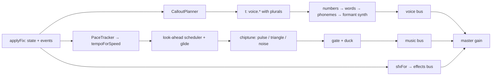

# Voice and audio: Design

Part of the StepQuest specs; see [../README.md](../README.md). See also: [quest](../quest/requirements.md) (events that trigger callouts), [map-rendering](../map-rendering/requirements.md) (the speech bubble is drawn by the map renderer).

## Sound (Phase 4)

- Everything that decides what to play is pure and tested (`callouts.ts`, `tempo.ts`, `scheduler.ts`, `chiptune.ts`, `sfx.ts`, `voiceQueue.ts`, `voice/*`). `engine.ts` is the only Web Audio code.
- Voice: text from the i18n dictionaries, numbers spelled out (`spellNumbersInText`), words to phonemes (`g2p.ts`), then `renderPhones` at 22.05 kHz into an AudioBuffer (cached, LRU of 24). A phrase takes a few tens of milliseconds to render.
- Synth: per sample, a Rosenberg glottal pulse (differentiated) and LCG noise feed four cascaded two-pole resonators (F1–F3 from the phoneme, F4 fixed); fricatives add band-filtered hiss; stops have a closure and a burst. Formants glide over the first 30 ms of each phoneme; amplitudes are smoothed over 5 ms. Pitch: base 112 Hz, falling over the sentence, raised on stressed vowels, snapped to semitones; output normalized and quantized to 6 bits.
- Music: `makeSong(seed)` builds 16 bars (A A' B A) from a common progression; melody bars come from rhythm templates and a chord-tone-on-strong-beat rule; arpeggio, bass pattern and drums from simple rules. Songs follow each other with seed + 1. The scheduler fills a 150 ms look-ahead window every 25 ms; the tempo glides towards one beat per step (84–150 BPM) at most 12 BPM per second. With no walking (speed under 0.35 m/s over 12 s of fixes, or no fix for 10 s) the music gate fades out and scheduling stops; it restarts at the new tempo.
- Unlocking: the context is created in the "Start quest", sound button or "Use simulation" tap; listeners on tap, key, visibility, pageshow and focus resume it after an interruption. Where Safari exposes `navigator.audioSession`, its type is set to "playback".
- Speech bubbles (task 50): the voice queue is the single source of truth. `AudioEngine.say` always pushes to the `VoiceQueue`; the phrase that starts playing becomes `snapshot.phrase` (`{ id, text }`) and is cleared when the source ends, is interrupted, or `stopVoice` runs (including muting). When audio cannot speak (no context yet, muted, voice volume 0, context not running) the phrase is "played" silently: a timer of `bubbleDurationMs(text)` (1000 ms + 70 ms per character, 1.8 to 7 s) takes the place of the buffer's end and then advances the queue the same way. `QuestScreen` passes `phrase.text` to `MapView`, which calls `MapRenderer.setBubble`. The renderer draws the bubble after the walker: ink outline with notched corners, paper fill, blue inner rule, stepped shadow and tail, text in Press Start 2P at 8 CSS px wrapped by `wrapBubbleText`, to the right of the head or to the left near the screen edge, clamped to the canvas. No animation, so reduced motion needs no special case. Text is already translated when queued, so the bubble follows the app language.

## Correctness properties (task 59)

Checked with fast-check (fixed seed `20261204`) in `src/audio/speechBubble.property.test.ts`.

- **P-V1 Wrapping keeps all the text.** For any text and width 1–40, every line of `wrapBubbleText` is non-empty and at most the width; the lines hold the same characters in the same order as the text once whitespace is ignored; when no word is longer than the width, the words are unchanged. Validates 7.7.
- **P-V2 Silent bubble time.** `bubbleDurationMs` is between 1.8 s and 7 s and never decreases for longer text. Validates 7.8.
